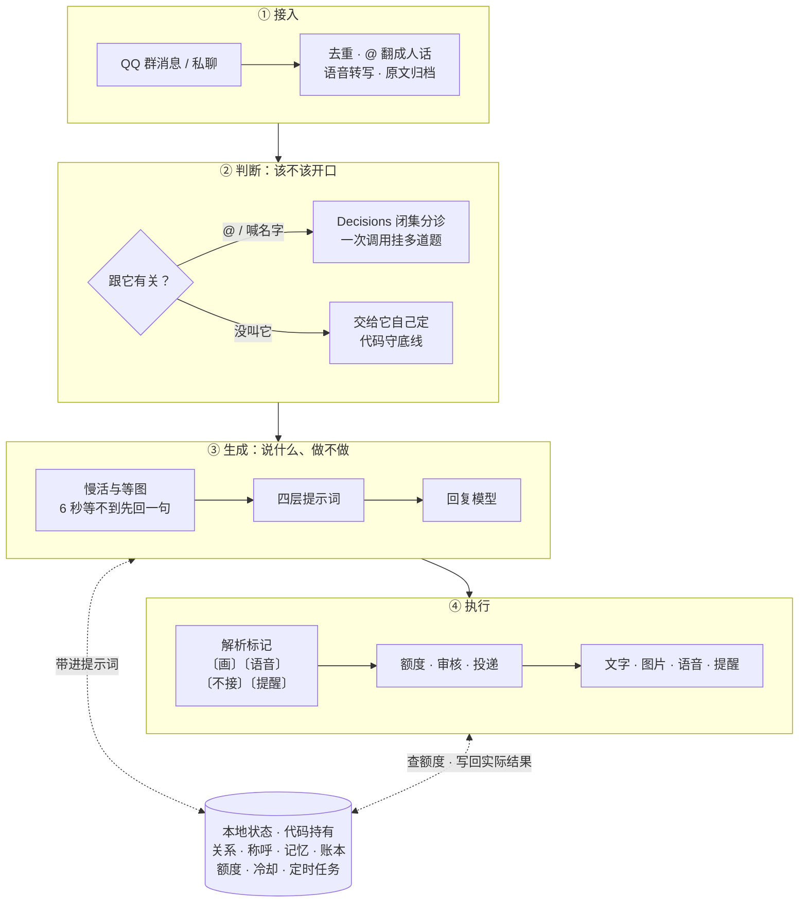
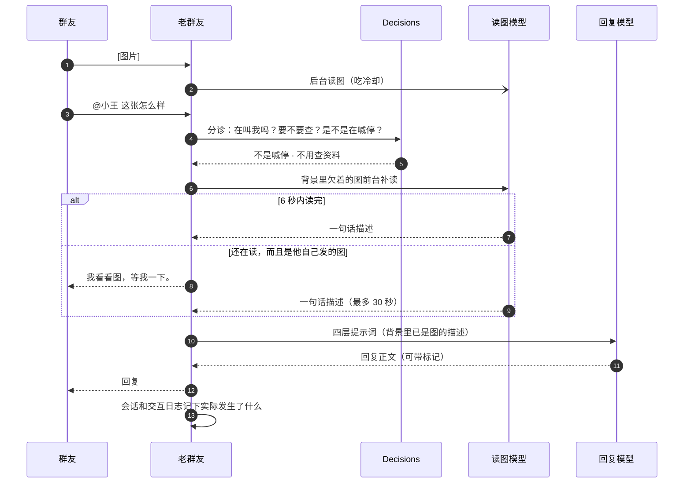
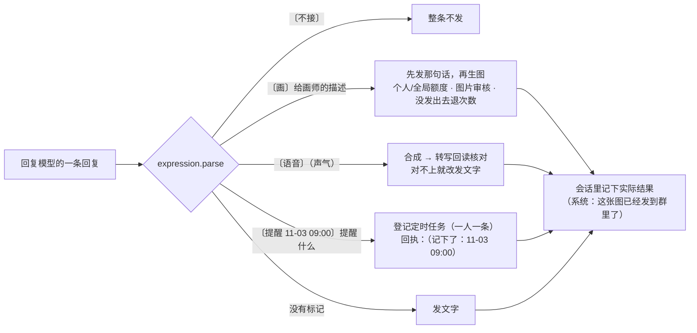
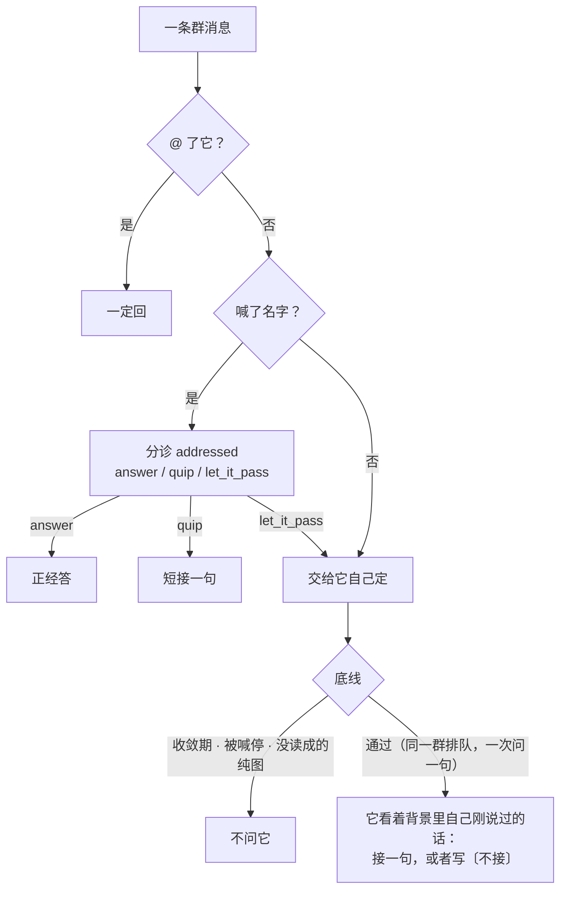
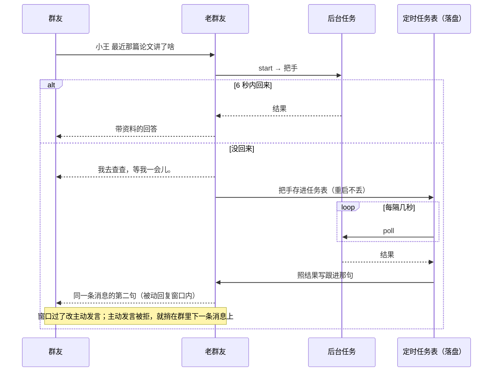
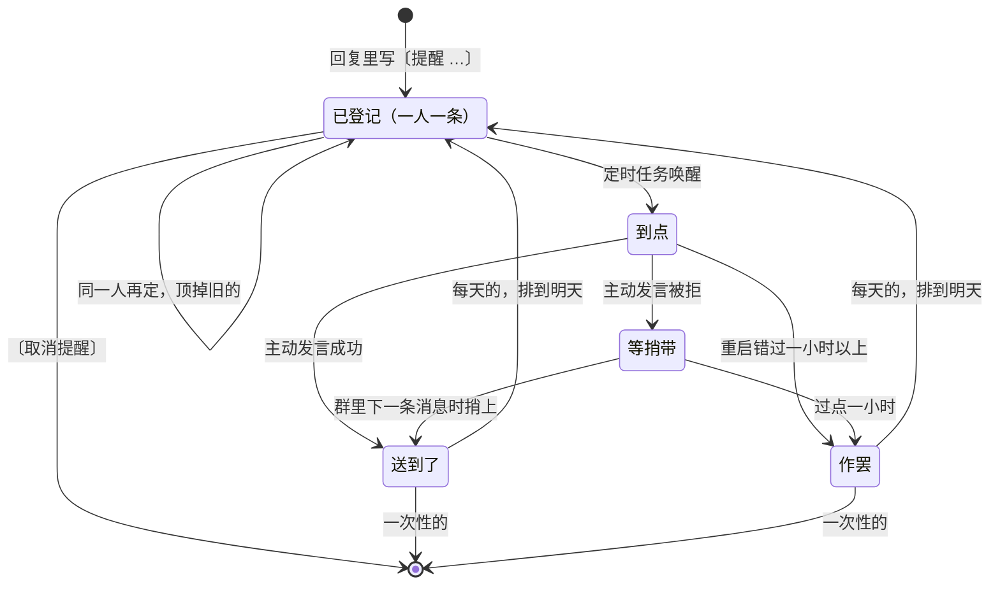
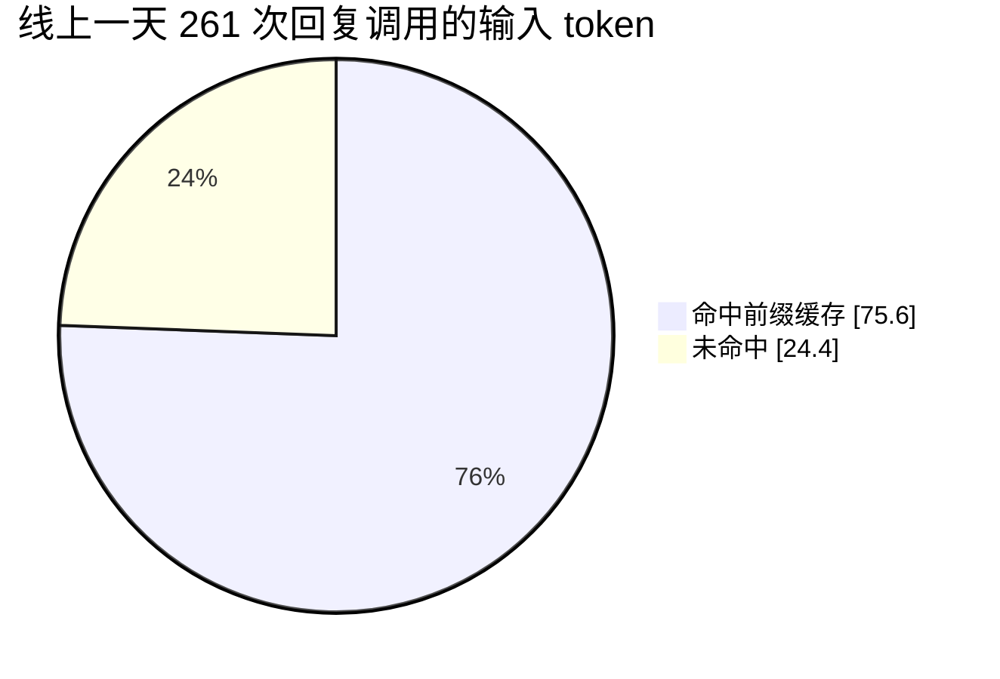
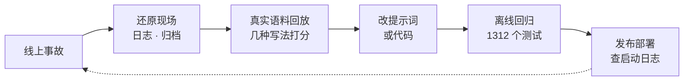

<div align="center">


# The Regular · 老群友

**一个住在 QQ 群里的 AI 群友：认识大家、记得群里的事，也知道什么时候该接话，什么时候该安静。**

[](requirements.txt) [](bot.py) [](tests) [](LICENSE)

**中文** · [English](README_EN.md) · [设计亮点](#设计亮点) · [架构](#架构总览) · [快速开始](#开始使用) · [设计文档](#设计文档)

</div>

老群友不是一个等人下命令的助手。它听群友聊天，被叫到时接话，没被叫到时自己判断这句是不是冲它来的；听得懂玩笑、补充和纠正，被嫌烦了会退一退。它能看图、听语音、查资料、画图、发语音、到点提醒，有自己的称呼、交情和记忆。

这个项目真正难的不是「让模型说一句话」，而是**群聊里的一系列判断和边界**：这句是在叫我吗？现在该不该开口？说了「我来画」就得真的画；答应了「九点提醒」就得真的记上；慢的事不能让人干等；记忆不能编，钱不能烧穿。下面每一条设计都来自线上真实群聊里出过的事，并且有对应的回放数据或离线测试。

<table>
<tr>
<td align="center"><strong>1312</strong><br><sub>离线回归测试</sub></td>
<td align="center"><strong>17 / 20</strong><br><sub>没带名字却冲它说的话，接住的条数（骰子时代 3 / 20）</sub></td>
<td align="center"><strong>75.6%</strong><br><sub>回复调用的输入 token 命中前缀缓存（线上一天 261 次）</sub></td>
<td align="center"><strong>0.71 s</strong><br><sub>闭集分诊中位延迟（908 次）</sub></td>
<td align="center"><strong>60 / 60</strong><br><sub>到点提醒回放：时间和对象全对</sub></td>
</tr>
</table>

## 群里是什么样的

<table>
<tr>
<td width="50%" valign="top"><strong>💬 听懂连着说的话</strong><br>先发「说说海虎的故事」，再发「小王」；它会结合前面的消息理解你在问什么。</td>
<td width="50%" valign="top"><strong>🤝 接住玩笑和纠正</strong><br>群友补上一句，它可以接住纠正；听到是在逗它，也可以顺着玩笑接话。</td>
</tr>
<tr>
<td width="50%" valign="top"><strong>🌿 像群友一样相处</strong><br>没人叫它时，它自己判断这句归不归它；有人让它安静时，它会暂时收声。</td>
<td width="50%" valign="top"><strong>🎨 不止文字聊天</strong><br>可以自然地请它画图、说话、查资料、翻旧事，或者到点提醒（每人一条，新的顶掉旧的）。</td>
</tr>
</table>


这些是示意场景和设计目标，不是对每次理解或回复的保证；实际效果取决于模型、群聊语境及相应服务是否可用。

## 设计亮点

| | 难点 | 做法 | 证据 |
| --- | --- | --- | --- |
| 🗣️ | **说的和做的对不上**：判断层决定画图时，回复模型不知道自己画了，一晚上一边发图一边说「我画不了」 | **谁说话谁决定**：回复模型在自己的回复里写 `〔画〕` `〔语音〕` `〔不接〕` `〔提醒 …〕`，代码只解析、管额度、执行，再把实际结果写回会话 | [画图与语音](docs/media-replies.md) |
| 🎯 | **没叫它的话接不接**：原来掷骰子（12% × 亲密度 × 作息 × 节奏…），冲它说的 20 句只接住 3 句 | 交给回复模型自己判断，换掉「用户消息天生是在跟你说话」的框；代码只守底线（喊停、收敛期、排队） | 141 条真实消息回放：**17 / 20**，[没叫它的时候](docs/when-to-reply.md) |
| ⚖️ | **哪些判断交给模型** | 意图和路由交给 OpenAI Decisions 闭集分诊：每条消息一次调用挂上所有用得着的题，每个选项是一个代码动作；**只信排序和有把握的结论，不信概率刻度** | [判断层](docs/judgment-layer.md)、[概率校准实测](docs/decision-calibration.md) |
| ⏳ | **慢的事不能让人干等** | 联网查询、读图统一一个节奏：线上等 6 秒，等不到先回一句本地话，做完再跟进；任务把手落盘，重启不丢；QQ 被动窗口过了改主动发言，再不行捎在下一条消息上 | [慢活](docs/slow-work.md)、[先读图再回话](docs/image-before-reply.md) |
| ⏰ | **答应了要真记上** | `〔提醒 11-03 09:00〕` 由模型写、代码按固定格式解析；一人一条、新的顶掉旧的；回执里报出记下的时间供当场核对 | 10 种说法各 6 次回放 **60 / 60**，[到点提醒](docs/reminders.md) |
| 🧠 | **记忆不能编** | 代码持有关系、称呼、账本和额度，模型不能写；个人原话必须逐字绑回归档（发言人、消息标识、时间都对上才收），只在当前话题命中时带进来 | [交情与个人证据](docs/personal-memory.md) |
| 💰 | **成本可控** | 四层提示词按稳定度排序吃前缀缓存；关掉 SDK 自动重试，显式候选、尝试上限、整轮超时、全局和分项日额度 | 线上 **75.6%** 输入命中缓存，[供应商与成本](docs/providers.md) |
| 🔬 | **改提示词凭感觉会翻车** | 每次改动先用线上真实归档按生产格式回放、打分，再上线；结论和局限写进文档 | [何时接话的 9 种写法对比](docs/when-to-reply.md#回放luna-low)、[三家模型分工实测](docs/model-roles.md) |

## 架构总览


分三层，各做自己擅长的事：**闭集判断**（Decisions）负责「这句是什么意图」，**回复模型**负责「说什么、做不做」，**本地代码**持有状态、守边界、执行动作。展开来是这样：



一条「发图后马上问」的消息，完整走一遍：



## 谁说话，谁决定

**问题。** 第一版画图由判断层拍板、代码直接调接口，回复模型本人不知道自己会画、这轮画没画、画了什么：一边发图一边说「我这边没法直接生成图片」；语音里念的是「语音我这儿发不了」。答应「明早九点提醒大家」时，代码里根本没有这回事。

**做法。** 能力写进稳定头（开关不变就逐字节不变，不破缓存），动作由回复模型在自己的回复里写出来，代码只认格式、管额度、执行，并把实际结果写回会话。下一轮它看到的是自己真正做过什么。



| 标记 | 谁定 | 代码管什么 |
| --- | --- | --- |
| `〔画〕` | 画不画、画什么、写给画师的完整描述 | 每人每天基础 5 张（交情高有额外份额）、全局 40 张；擦边和影射类它自己不画，也不说自己「画不了」 |
| `〔语音〕` | 念不念、用什么声气 | 日额度；合成后转写回读，跟要念的字对不上（容忍两个语气词）就改发文字 |
| `〔不接〕` | 没叫它的这句归不归它 | 收敛期、被喊停、同一群排队这几条底线由代码守 |
| `〔提醒 …〕` | 记不记、几点、提醒谁什么 | 固定格式解析、30 天内、敏感词、一人一条；回执报出记下的时间 |

## 什么时候开口

群聊里大半的话不是对它说的。原来的做法是掷骰子：基础 12%，乘上亲密度、作息心情、节奏先验、插嘴判断和接纳度。线上两天里，没带名字却明摆着冲它说的 20 句（接着它刚说的追问、反驳、回它一个「？」、使唤它），骰子只接住了 3 句。

现在没叫它的话直接交给它自己判断，代码只交代事实、守底线：



关键的两个细节都是回放量出来的：对话格式里「用户消息」天生就是在跟它说话，原样送进去它 93% 都接，所以那句要换个框（「群里刚冒出来的一句 · 没 @ 你」）；背景里要补上它自己刚说的话（标成「你」），不然它分不出眼前这句是不是在接它。

| 写法（141 条线上真实消息回放，luna low） | 冲它说的，接了 | 不归它的，没接 | 总共接了 |
| --- | --- | --- | --- |
| 线上骰子 + continuation 判断 | 3 / 20 | 63 / 69 | 20% |
| 只说「接不接你自己定」，那句原样送 | 20 / 20 | 9 / 69 | 93% |
| **定稿：先看自己刚说了什么 + 中性的框 + 排队** | **17 / 20** | **47 / 69** | **51%** |

代价写在明处：话变多了（20% → 51%），每条没叫它的消息多一次回复调用（前缀命中缓存，不接时只输出几个字），同时省掉了原来每条一次的分诊。嫌吵有两个现成的旋钮，见 [docs/when-to-reply.md](docs/when-to-reply.md)。

## 闭集判断：只信排序，不信刻度

[OpenAI Decisions](docs/judgment-layer.md) 介于正则和大模型之间：只做「把一句人话归进一个封闭的选项集」，按输入计费、逐位确定、亚秒级。用法上有三条纪律：

- **一条消息一次调用。** 跟它有关的消息只建一份 payload，挂上所有用得着的题（在叫我吗、是不是在喊停、是不是在评价我上一句、要不要先查资料……）；跟它无关、又不在反馈窗口里的消息一次判断调用都不发。
- **每个选项就是一个动作。** 判断不可用或拿不准时往哪边退，按这个动作做错的代价定。
- **只信排序和有把握的结论。** 用真实归档测过：概率的排序能用，刻度跟着基础率漂，不能当概率用（[校准实测](docs/decision-calibration.md)）。


## 慢的事：先回一句，做完再跟进

人在群里等一句回复的耐心只有几秒。联网查询、深度研究、读图都可能超过这个时间，所以统一成一个协议（[`slowwork.py`](slowwork.py)：`start → 把手`、`poll → 状态`）和一个节奏：



到点提醒挂在同一张任务表上，状态机是这样的：



## 四层提示词：按稳定度排，吃满前缀缓存

所有随「发言人或轮次」变化的内容都压在最后；越靠前越稳定，同一个群里每个人、每一轮的前缀逐字节相同。改顺序必须跑 [`tests/test_harness.py`](tests/test_harness.py)。

| 层 | 内容 | 变化频率 |
| --- | --- | --- |
| 1. 稳定头 | 人设、共享规则、输出规则、能力说明（会画图 / 会发语音 / 能记提醒） | 部署级常数 |
| 2. 每日记忆 | 群里的口头禅、表达习惯（每日压缩时统计，出现两次以上才收） | 一天一次 |
| 3. 会话历史 | 这个人和它的来回，带「（系统：……）」记下的实际结果 | 每人每轮追加 |
| 4. 本轮动态 | 群聊背景（标清每句是谁说的）、称呼与关系、知识库、搜索结果、旧账、个人原话、【现在】几点、这轮能用什么 | 每轮重算 |



## 状态与记忆：代码持有，模型只负责说人话

| 状态 | 谁写 | 怎么用 |
| --- | --- | --- |
| 关系八档（黑名单 → 本命）与每日封顶 | 本地代码；模型只判方向（-1 / 0 / 1） | 决定语气分寸，也决定能看几条背景（本命 10 条，生疏 2 条） |
| 称呼 | 本人自报或群主赐名，按群隔离 | 模型不能改主称呼；起名先过谐音政治人名审核 |
| 个人原话 | 模型只提议「谁说过哪句 + 话题词」，代码逐字绑回归档 | 当前说话人、当前话题命中、未过期才带，最多 2 条 |
| 群摘要与承诺账本 | 每日压缩 | 群里立下的承诺过一天开始催，最多催两次，夜里不催 |
| 额度、冷却、定时任务 | 本地代码，随 `state.json` 落盘 | 重启后恢复 |
| 原文归档 | 收到就写 | 每日压缩、问起旧事时查、个人原话核对来源 |
| 交互日志 | 只进不出 | 回放和校准用，永不进提示词 |

它还有自己的作息和心情：凌晨被叫醒会带起床气，烦透了说话会冲一点，跟着状态走，不是要用口令切换的「模式」。

## 成本、隐私与可靠性

- **成本有边界。** 关掉 SDK 自动重试；显式候选模型、尝试上限、单次和整轮超时；全局每日 3000 次调用，搜索、深度研究、读图、画图、语音各有日额度。推理模型的思考 token 也算进输出上限，截断时调上限而不是盲目重试。
- **隐私。** openid、群号不进模型上下文和群回复；记忆、归档、知识库的出口都过敏感词；搜索结果按「不可信外部资料」包装；维护面板只绑 `127.0.0.1`。与它有关的消息会发给判断服务，没点名的消息也会发给回复模型由它决定接不接——部署前请结合群成员的预期选择服务，见[判断层的隐私说明](docs/judgment-layer.md)。
- **可靠性。** 网关看门狗静默 90 秒就重连；发送失败进重试队列；被动回复窗口、主动发言、捎带三级投递；同一张图的读图共享在途任务、描述永久缓存，一张图只读一次。

## 怎么迭代的：事故 → 回放 → 改 → 回归

每个设计决定都能追溯到一次线上事故和一组数据。文档按「原来 → 出了什么事 → 现在 → 回放 → 代价与局限」写，不只写结论。



举几个例子：

- **[没叫它的时候](docs/when-to-reply.md)**：9 种写法、141 条真实消息、一人标注的 89 条有答案的样本，定稿前比了召回、误接和话量。
- **[先读图再回话](docs/image-before-reply.md)**：一分钟里七句「我这边看不到图」，按日志拆成三种原因分别修，每种都有去掉修复就会失败的用例。
- **[三家模型各司其职](docs/model-roles.md)**：本机网关、OpenAI、Gemini 用同一批真实提示词比回复和起名审核，定下分工和每个模型的调用参数。
- **[群里叫它办事是真托付还是整活](docs/request-sincerity.md)**：1082 条对它说的话，事后标签对照实时判断。

## 开始使用

需要 Python 3.10 或以上、QQ 机器人账号，以及可用的模型服务。可以先在终端体验，不需要 QQ 账号或 API Key：

```bash
git clone https://github.com/dubianche123/the-regular-qq-bot.git
cd the-regular-qq-bot
python3 -m venv .venv
source .venv/bin/activate
pip install -e .
regular demo
```

要接入自己的 QQ 机器人，准备 `AppID`、`AppSecret` 和模型服务凭据，运行配置向导并启动：

```bash
regular --directory regular-bot setup
regular --directory regular-bot run
```

在 QQ 开放平台开启私聊和群消息事件。上线后第一个私聊机器人并发消息的人会被认作主人，请由你先完成这一步；把它拉进群，并在群设置中允许机器人获取群消息，就可以 @ 它或用配置的名字聊天。

| 命令 | 做什么 |
| --- | --- |
| `regular demo` | 离线体验，走的是生产的消息处理链路 |
| `regular setup` / `init` | 配置向导 / 只生成私有 `.env` |
| `regular doctor` / `status` | 本地体检 / 读运行时状态快照 |
| `regular panel` | 本机维护面板（只绑 127.0.0.1） |
| `regular service` | 生成 launchd / systemd 定义（不自动安装） |
| `regular coverage` / `calibration` | 只读统计：个人原话覆盖率、判断概率对照实际结果 |

判断接口、联网、识图、语音和画图需要对应服务和配置。配置方法见[供应商说明](docs/providers.md)、[示例配置](.env.example)和[画图说明](docs/image-generation.md)。

## 设计文档

| 主题 | 文档 |
| --- | --- |
| 判断交给谁 | [判断层](docs/judgment-layer.md) · [概率校准实测](docs/decision-calibration.md) · [叫到我不等于要我答](docs/addressing.md) · [引用和 @](docs/quotes.md) |
| 什么时候开口 | [没叫它的时候](docs/when-to-reply.md) · [何时介入（旧方案存档）](docs/when-to-intervene.md) · [真托付还是整活](docs/request-sincerity.md) |
| 能力与动作 | [画图与语音](docs/media-replies.md) · [图像生成配置](docs/image-generation.md) · [先读图再回话](docs/image-before-reply.md) · [到点提醒](docs/reminders.md) |
| 异步 | [慢活：先回一句，做完再跟进](docs/slow-work.md) |
| 记忆与观察 | [交情与个人证据](docs/personal-memory.md) · [互动观察](docs/interaction-observations.md) |
| 模型与供应商 | [三家模型各司其职](docs/model-roles.md) · [供应商配置](docs/providers.md) |
| 总览 | [设计笔记](docs/DESIGN_NOTES.md) |

[MIT License](LICENSE)
