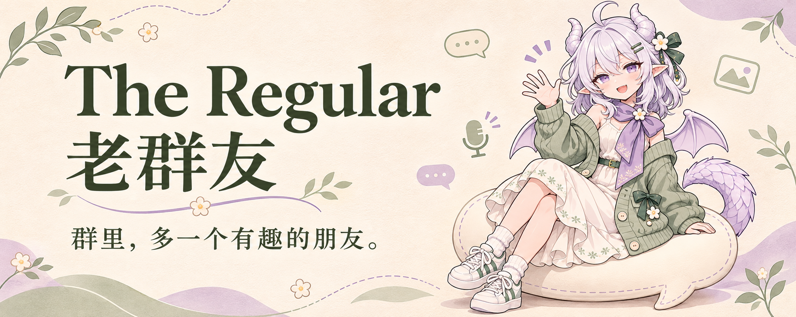
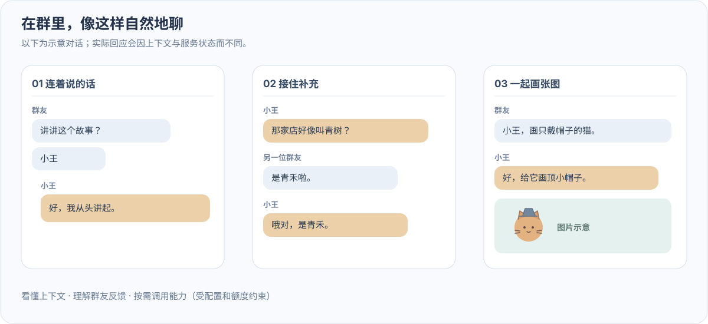
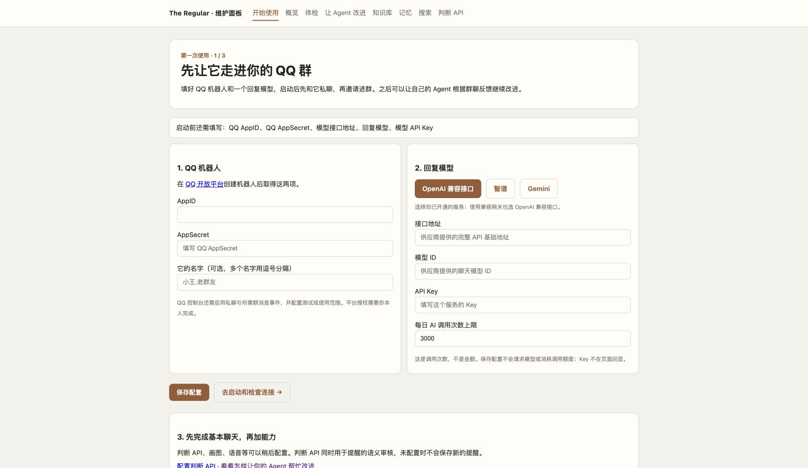
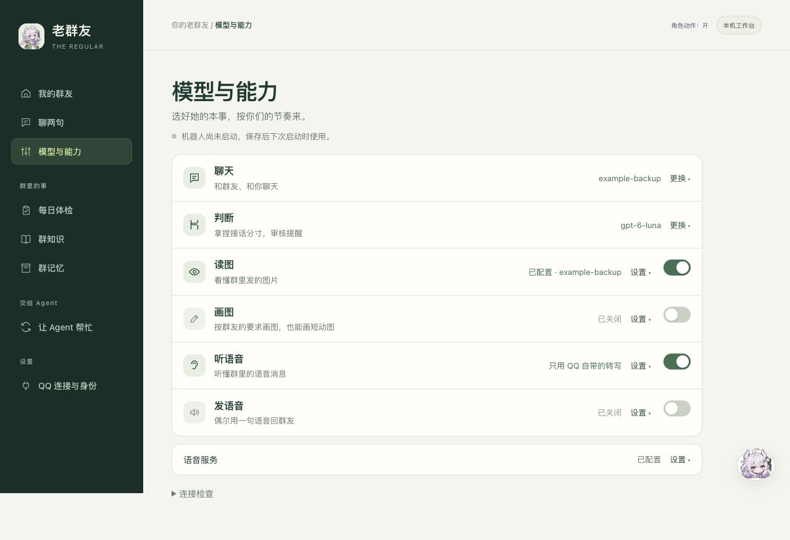
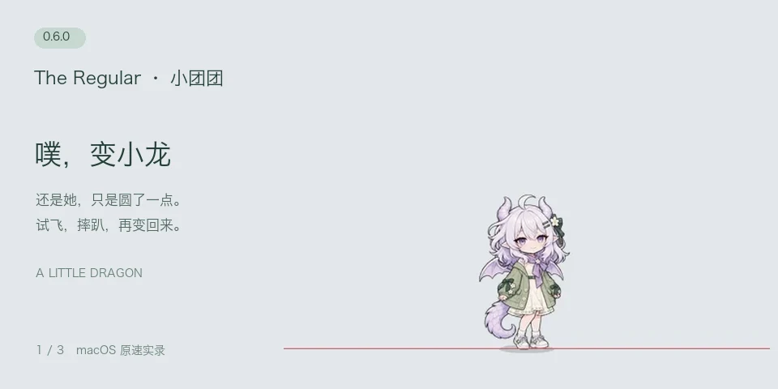
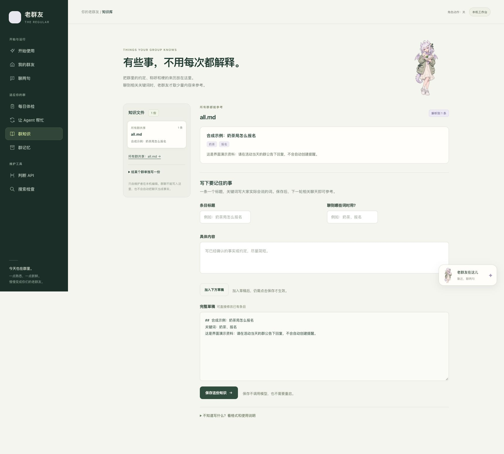
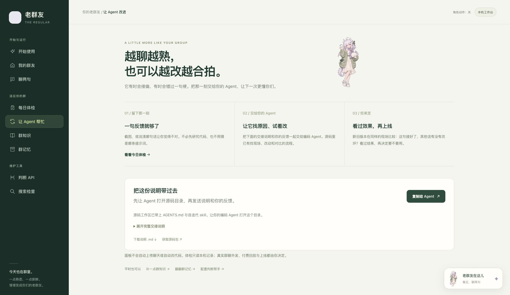

<div align="center">



# The Regular · 老群友

**群里多一位会接梗、记得你们，还能画图和发语音的老朋友。**

让你的 Agent 根据群聊反馈，帮你迭代出更懂你们的 QQ 群机器人。

[](requirements.txt) [](bot.py) [](LICENSE)

**中文** · [English](README_EN.md) · [下载](https://github.com/dubianche123/the-regular-qq-bot/releases/latest) · [开始使用](#开始使用) · [让它更懂你们](#让它更懂你们)

</div>

你们聊天，它也在。有人喊它，就来搭话；没人喊，也会看看是不是轮到自己接一句。聊得起劲时能跟着玩梗，被嫌烦了就安静一会儿。群里的称呼、聊过的事、它自己刚说过什么，都成为下次相处的线索。

想看点有意思的？让它画一只打篮球的鸡，甚至动起来；想听它说话？让它用语音念一句。**名字和人设由你定，每个群都能养出自己的相处方式。**

> **领到了 ChatGPT Pro 的 API 额度，还没想好用来做什么？** 可以从给群里添一位新朋友开始。符合条件的 Pro / Business 订阅需要先领取并关联自己的 API 组织，额度在对应周期结束时过期；并非所有订阅都自动附送。以 [OpenAI 官方说明](https://developers.openai.com/api/docs/guides/chatgpt-api-credits)和你的账号权益为准。也支持配置其他回复模型服务。

## 它会怎样待在群里

下面是**玩法示意，非真实群聊截图**；画图、语音和提醒需先配好相应服务。

| 你们说 | 老群友可以怎么接 |
| --- | --- |
| 「小王，你怎么看？」 | 看前后文回话；接着追问时，不必每句都重新 @ |
| 「画一只正在打篮球的鸡的动图」 | 自己补全短循环动作，把生成的 GIF 发回群里 |
| 「用刚睡醒的语气说句早安」 | 写好要说的话，再用语音发出来 |
| 「明早九点提醒我开会」 | 问清必要信息、确认记下，到点在群里 @ 发起人 |
| 「刚才没问你啦」 | 收一收；把这次反馈留给后续改进 |

<details>
<summary>看看一段群聊互动示意</summary>



</details>

它最在意这三件事：

- **会聊，也给大家留空间。** 不要求每句话都带命令，能看前后文决定接不接；也可能接歪，所以留了纠正和喊停的路。
- **相处有连续性。** 记称呼、关系和部分有来源的旧话，也记自己实际发过的内容；隔了一阵接旧话，会关联原句。
- **不合拍的地方，能让你的 Agent 帮忙改。** 把“这句为什么没接”“怎么又接错人了”变成可重放的例子，再比较修改前后的表现。

## 开始使用

先准备好 **Python 3.10+、你自己的 QQ 开放平台机器人 AppID / AppSecret，以及一个回复模型服务的 API Key、接口地址和模型 ID**。QQ 侧的创建、事件订阅和使用范围仍需你本人完成；这不是登录个人 QQ 账号的客户端。

### 1. 下载，把老群友放到桌边

[**下载最新版本 →**](https://github.com/dubianche123/the-regular-qq-bot/releases/latest) 选择 **Source code (zip)**，完整解压，再打开对应启动文件：

| Windows | macOS | Linux |
| --- | --- | --- |
| 双击 `start.bat` | 双击 `start.command` | 在项目目录运行 `bash start.sh` |

首次启动会联网安装依赖，然后让老群友出现在桌边。**鼠标靠近人物，她会转头看你，侧边浮出聊天、投喂、动态和工作台。** 切换到其他应用，人物也会留在桌面。macOS 阻止双击时可运行 `bash start.sh`；没有图形桌面或原生组件不可用时会使用网页入口。

想交给自己的 Agent 安装？复制[这段安装提示词](docs/agent-setup.md)，让它检查环境、装好项目，再由你填写密钥和完成 QQ 授权。

### 2. 填好名字、QQ 和回复模型

在人物旁点击「工作台」，跟着首页完成两个连接：**「QQ 连接与身份」**填写 QQ 凭据和它的名字；**「模型与能力」**展开「聊天」，选服务、模型并填入 Key。已有模型可以直接下拉选择，也能选「填写其他模型」。保存后，平时看到的是连接状态，需要修改时再展开。



### 3. 启动，让它认识你

在「我的群友」点击「启动机器人」，等状态显示 **已连上 QQ**。先由你发第一条非空私聊完成认主，再拉它进群、允许群消息，用 @ 或名字打个招呼。

保持电脑和面板服务的终端运行；关网页不会停机器人，退出面板服务会停止它自己启动的机器人。私有数据默认在 **`~/.the-regular`**，下次打开沿用，不用重新填。

[完整上手与问题排查](docs/getting-started.md) · [服务与 Key 怎么配](docs/providers.md) · [所有配置示例](.env.example)

<details>
<summary>还没准备 QQ 机器人或 Key？先试离线聊天链路</summary>

完成依赖安装后，在项目目录运行：

```bash
# macOS / Linux；Windows 使用 .venv\Scripts\python.exe
.venv/bin/python -m regular demo
```

这个终端 demo 不连接 QQ、不调用模型，可先看看消息处理与本地指令。它不代表真实模型的聊天效果。

</details>

## 再给它添点本事

基础聊天先跑起来，其他能力按需加。**一个能聊天的 Key，不保证同时有画图、语音或判断接口权限。**

在**「模型与能力」**里，聊天、判断、读图、画图、听语音和发语音各占一行。日常看状态，点开才修改；只想文字聊天，关掉不需要的能力即可。判断和聊天可以分别选模型，同一服务可选择使用聊天 Key。[怎样配置和关闭 →](docs/capabilities.md)

<details>
<summary>一眼看清她会什么，需要时再展开设置</summary>



</details>

| 想要什么 | 还需要什么 |
| --- | --- |
| 看图片 | 回复模型支持图片，或另配视觉模型；[配置方法](docs/providers.md#识图默认继承也可独立配置) |
| 画静图、短循环动图 | 支持相应输出的 Images API、额度及画图前判断检查；[画图配置](docs/image-generation.md) |
| 听语音、发语音 | 官方语音服务权限和本地音频依赖；[语音配置](docs/getting-started.md#语音单独开启)、[媒体说明](docs/media-replies.md) |
| 到点提醒、更多语义判断 | 在「模型与能力 → 判断」连接判断服务；提醒审核通过才会保存；[提醒说明](docs/reminders.md) |
| 群规、活动约定、梗的来历 | 在「群知识」按条目填写，预览后保存；聊到相关线索时再参考 |

文字接话、收到请求后画图和发语音已有实现；**没人叫它时主动挑图或语音的玩法仍暂缓**。语音是合成说话，不是唱歌；动图是短循环 GIF，不是长视频。

## 桌边也可以见到它

<p align="center"></p>

老群友也是默认的桌面入口：**一只住在屏幕底边的 Q 版小龙，会走、会坐下喝茶看书、会困了睡觉，拎起来会晃腿、松手会掉回地面。** 更关键的是，她演的是小王此刻的真实状态：群里有人@她就掏手机，接了话就开口，画了图就拿起速写本，机器人停了就打哈欠睡觉。靠近时她转头看你，侧边浮出聊天、投喂、动态和工作台；摸头会害羞，戳多了会生气。

双击启动文件就能打开；命令行可运行 `regular --directory ~/.the-regular pet`，无需先开设置。浏览器里也能从「聊两句」进入文字对话。**想直接说话？点桌宠旁的「语音」就能连续聊，说完自动回应，也可以直接插话，不用一直按着按钮。** 随时可以静音，关闭小卡即结束。使用现有 OpenAI 实时语音模型，模型和音色在「模型与能力 → 发语音」选择，Key 在「语音服务」填写；不必先连接 QQ。

**她也能当你的本机小管家。** 说「先别画图了」，她可以给出一张开关确认卡，你点了才生效；问「今天你忙了些什么」，她会参考今日消息和回复数量。需要修代码，就从她给出的入口复制交接说明，交给你常用的编码 Agent。

人物大小可以右键调整，位置、大小和动作开关会记住；也可以让她「待在原地」。维护小王的编码 Agent 跑完评测，可以用 `regular pet-cue cheer --say "跑完了"` 让她表个态。本机文字聊天和 QQ 回复共用聊天模型；桌宠语音使用单独的实时语音模型和每日轮数上限。

[打开桌宠与本机聊天 →](docs/companion.md)

<details>
<summary>给它一本你们群的小手册</summary>

群知识平时是一张条目列表。选「所有群」或某个群，新增、编辑一条，预览后确认保存；删除也会先询问。下面是合成演示资料。



</details>

## 让它更懂你们

每个群的笑点都不一样。它某句太较真、插话插错了，或者你希望它记住一些相处习惯，可以把截图或反馈交给你自己的编码 Agent：

> 「看看小王刚才这句，为什么接错人了？按仓库的自迭代流程，试个改法，和旧版比一比。」

**现场留下来 → Agent 找原因、做修改 → 用同一批例子对比 → 你决定是否上线。**

仓库带了回放工具和[自迭代 skill](.agents/skills/regular-iterate/SKILL.md)。面板「让 Agent 改进」可以下载交接说明，告诉 Agent 源码在哪、数据在哪、怎么开始。Codex、Claude Code、Gemini CLI 都有对应的流程入口。

这份“越来越懂”来自你们的反馈和可检验的改动；**机器人不会自己改代码或偷偷上线**。不用先懂评测框架，也能先聊天，等遇到不合拍的地方再让 Agent 帮忙。

<details>
<summary>在面板里把反馈交给 Agent</summary>



</details>

[怎样走完一次改进](docs/self-iteration.md#iteration-example) · [能改哪些地方](docs/self-iteration.md#iteration-surfaces)

## 用之前，知道这几件事

- **需要自己的服务额度。** 每日上限是调用次数，不能当金额预算；实际费用取决于模型和用量。
- **聊天内容会送给你配置的模型服务。** 本机保存配置、状态和记录，使用前请和群成员说明。面板只供本机访问，不要分享带 token 的地址。
- **判断会出错。** 记忆有范围，服务可能失败；已有实测描述的是具体条件下的结果。
- **适合常驻的小群伙伴。** 电脑休眠或服务退出时不能继续接话；准备长期运行，可看[常驻与再次启动](docs/getting-started.md#以后如何再打开)。

封面为 AI 生成的原创“老群友”形象，名字和人设可以自行调整；[形象素材与生成提示](docs/visual-identity.md)。本项目与 OpenAI、QQ 无官方隶属关系。

## 架构与设计

消息流、Decisions、自迭代流程、验证数据与设计文档索引，完整保留在[架构与设计文档](docs/architecture.md)（原技术版 README）。

[贡献](CONTRIBUTING.md) · [MIT License](LICENSE)

如果你也想给群里添这样一位老朋友，欢迎试用，也可以点颗 ⭐，让更多群友找到它。
