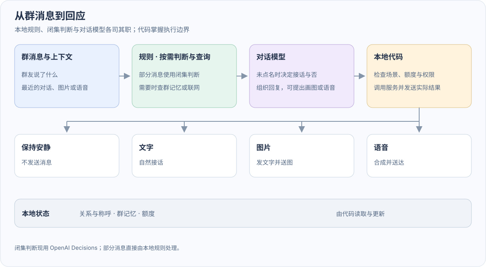

<div align="center">


# The Regular · 老群友 — QQ AI 群聊机器人

**把关系和记忆留在代码里，让模型负责接话。**

[](requirements.txt) [](https://github.com/dubianche123/the-regular-qq-bot/actions/workflows/ci.yml) [](bot.py) [](LICENSE)

**中文** · [English](README_EN.md) · [下载 v0.2.0](https://github.com/dubianche123/the-regular-qq-bot/releases/tag/v0.2.0)

[运行](#快速开始) · [设计边界](#设计边界不做通用-agent) · [消息路径](#一条消息三种去向) · [上下文设计](#上下文为什么要分层) · [模型与成本](#模型怎么接成本怎么控) · [知识库与搜索](#知识库与按需搜索) · [本机面板](#本机维护面板) · [玩法](#-群里怎么玩) · [接下来](#接下来)

</div>

老群友想解决一个很实在的问题：为什么大部分群聊机器人加进群三天就被人嫌烦？因为它们像客服——逢话必接、对谁都一个腔调，而且上下文一滑过去就把前天刚聊过的梗忘得一干二净。

老群友在群里更像一个常驻的活人角色：大部分时候潜水，偶尔看心情接一句话，混熟了之后对不同的人有不同脾气。它有按群隔离的称呼、八档交情、四种相处模式（损友/知心/护短/捧场）、生物钟与起床气、6 小时半衰期的心情、滚动《群史记》和承诺账本。

它的核心不是“让模型接管一切”，而是**把长期关系、记忆、称呼和开不开口的闸门留在本地代码里；模型只在排好序的上下文里接一句话**。平时在群里玩，大量查询和互动是 0 token 的本地操作；需要模型时也只走一条有预算、有超时、有明确候选的调用边界。

## 设计边界：不做通用 Agent

这不是一个套着 QQ 壳的 Agent Harness。群聊机器人不需要、也不应该拿到本机执行权限。

| 不做 | 原因 |
| --- | --- |
| 操作电脑/手机、执行命令 | 群友一句玩笑或一次提示词注入，代价可能是真实文件与隐私。聊天机器人没有这个必要。 |
| 自主多步工具循环、后台规划 | 群里要的是自然接话，不是每轮先规划五步。需求明确时最多做一次本地查询或一次显式搜索，结果只作为证据进上下文。 |
| 插件市场、多平台适配层 | 保持单产品深度和部署简单；本项目只服务 QQ 群聊这一件事。 |
| 向量数据库 / 全量记忆注入 | 一个群的数据量用 JSON + 关键词检索足够；旧事只在被问起时翻，避免模型主动翻旧账成瘾。 |
| 全天候联网 | 默认不联网。配了联网查询后，只在**冲着它问、而且答好要靠新近或专业事实**时才查（分诊判断决定，政治和钓鱼不查）；查不到就明说，不猜。 |

**第一次使用：** [安装](#快速开始)后跟随配置向导启动，再由主人私聊一句完成自动认主。只想先看看效果，直接跑 `regular demo` 即可。

## 可以玩到什么

| 互动体验 | 代码里是怎么做的 |
| --- | --- |
| **越熟越有自己的语气** | 八档关系（从 `distant` 到 `soulmate`）由本地代码记账。单日加减分采用**不对称封顶**（加分放宽、扣分收紧），防止模型某次抽风把聊了好几周的“铁哥们”一把扣回“生疏”。 |
| **跟不同的人处成不同模式** | 不逼模型每轮多吐一行自评 JSON，而是等每日压缩《群史记》时看完整天对话，再提议印象分变化与相处模式（`损友` / `知心` / `护短` / `捧场`），经白名单硬校验后落档。 |
| **有作息、有起床气，知道闭嘴** | 综合 `@`/名字触发、概率、冷却、生物钟、心情与交情决定开不开口。凌晨 0–6 点的消息算“把人吵醒”，插嘴意愿直接打 45 折，被点名回话也会带着起床气；心情按 **6 小时半衰期**自然消退（早上被惹毛，到晚上就消得差不多了）。 |
| **插话看场子，不是瞎掷骰子** | 插话概率按「此刻有没有接话空档」重新分配：距上一条多久、最近 60 秒多热、最近 5 分钟几个人在说、是不是长篇或图片。系数从本机 1,782 条真实群聊归档拟合，按日期留出验证（Brier −14%、AUC 0.655、五分位命中率单调）。乘数按本群均值归一，所以 `BANTER_PROBABILITY` 仍决定整体话量，先验只决定这些话**落在哪些时刻**。纯本地、零模型调用。 |
| **下一句骂你就是反馈** | 不需要任何打分指令。主动插话之后被嫌烦 / 被笑着接梗，会折进每人一个按半衰期衰减的接纳度；它向本群群体层收缩，只有证据条数够**且**与群体层差得够开时才允许改变插话概率，否则一个字不动。它不进提示词、不碰好感度，也不建立永久的「讨厌机器人」标签。 |
| **偶尔让人意外「居然记得」** | 自己凑过来插话时，本地话题闸先挑出本人一条已核实原话，再由原生判断把关此刻端出来是「居然记得」还是「翻档案」；获批才注入，并换用只开这一条缝的插话说明。每人冷却 6 小时、每群每天最多 2 次——要稀才稀奇。判断不可用一律不端出。设计与边界见[何时介入](docs/when-to-intervene.md)。 |
| **近期背景条数跟随玩法档位** | 亲密度只决定带入几条最近闲聊：`soulmate` 看 10 条，`distant` 看 2 条——这是参与感的预算，不是了解一个人的证据。 |
| **称呼按群隔离，不怕模型乱改名** | 本人自报或群主赐名写入按群隔离的档案；模型在日终摘要里写的名字只用于**单向反查 `openid`** 记印象分，绝不覆盖主称呼。 |
| **看懂群友发的图** | 视觉模型读一次图就按消息标识缓存描述，受每日预算与独立识图额度控制，不重复读图。 |
| **问起旧事才翻账** | 只有出现「上次 / 之前 / 答应过 / 还记得」这类线索，并且能提取出具体人名或事由时，才检索本地归档；最多带 2 条进本轮末尾，随机插嘴和对方喊停时都不翻旧账。 |
| **引用本人原话，不猜性格** | 每日压缩时模型只提议「谁说过哪句话 + 话题词」，代码把它逐字绑回本批已处理且归档确认完整的发言（发言人、消息标识、时间都对上才收）。接话时只取当前说话人、当前话题命中且未过期的原话，最多 2 条进本轮末尾；生成的性格推测永远不会变成个人事实。机制与取舍见[交情与个人证据](docs/personal-memory.md)。 |
| **会学群里的口癖，但不复读** | 每日压缩时从原话里统计反复出现的口头禅/语气词，至少在本批出现两次才收录，最多 5 条，以「可选参考」注入每日记忆。 |
| **维护者可以直接改知识库** | `knowledge/all.md` + 每群文件，按关键词命中后只进本轮动态层；改完下一轮生效，不用重新压缩摘要。 |
| **按需联网查询** | 配了 `RESEARCH_PROVIDER`（如 OpenAI `gpt-6-luna` 的 web_search）时，分诊判断说「这句得先查」就查；查询几秒内回不来，先回一句「我去查查」，后台查完再跟进（[慢活](docs/slow-work.md)）。`搜索 关键词` 命令照旧可用；没配时只有命令查 DuckDuckGo。结果都是**不可信外部证据**，按群每日限次。 |
| **自然语言画图** | 群友自然地请它画图时，复用分诊判断是否需要生成，不需要固定命令；只在正常回复门放行且判断有把握时调用一次图像接口。默认 `gpt-image-2.5-flare`、medium、1024×1024；每人基础每天 5 次，好感度高有额外份额，全局每天最多 40 次。配置见 [图像生成](docs/image-generation.md)。 |
| **没有要切的模式** | 叫它「来段猫娘」「发个疯」，它当成一次玩笑顺着演一两句，演完照常说话；烦透了的时候说话冲、会发牢骚，跟着心情走，不是一个要喊口令进出的状态。2026-11-01 以前的五套手动人设和各种查榜、骰子指令 27 天里几乎没人用，全删了（[各自用过几次](docs/DESIGN_NOTES.md#删掉的东西2026-11-01)）。 |

## 一条消息，三种去向



| 输入示例 | 走哪条路 | 背后发生了什么 |
| --- | --- | --- |
| `叫我小林` | 称呼处理流程 | 本地先认出候选，判断可以否决（谐音诱饵 / 其实不是在起名），再过群主锁、敏感词、改名冷却与审核，通过后更新当前群的专属称呼。 |
| `@机器人 今天吃什么` | 生成回复 | 平台 @ 一定回：组装四层前缀上下文，按任务档位调用模型并做输出清洗。 |
| `小王你真蠢` / `小王 今天几号` | 分诊判断 | 正文里有名字不等于欠它一句：一次判断调用分出「在问它」（答）、「在逗它」（接得上才短接一句）、「只是提到它」（当普通消息）。判断不可用就照答。见 [docs/judgment-layer.md](docs/judgment-layer.md)。 |
| `上次阿强说的奶茶是什么来着` | 按需旧账召回 | 分诊判断这句的回答要靠本群旧账时才查本地归档，最多取 2 条放进本轮末尾；没问就不翻。 |
| `搜索 今天的天气` | 按需联网搜索 | 只查一次 DuckDuckGo，把标题/摘要/链接包成不可信资料放进本轮末尾；不抓网页、不自动追问。 |
| 没人 `@` 的日常闲聊 | 激活门控 | 先过冷却、生物钟、心情和亲密度骰子；没摇中就安静潜水并归档底稿。 |

系统侧行为（收到的消息、门控结果、实际送达）会另存一份本地 `interactions/` 按天 JSONL，只进不出——不进提示词、不进摘要、不进召回，可用 `INTERACTION_LOG_ENABLED=false` 完全关闭。这些只是可复盘的观察记录，**不是个性化收益的证据**；设计口径见 [docs/interaction-observations.md](docs/interaction-observations.md)。

插话门的留痕里还会多出 `opening_score` / `opening_shape` / `receptive_multiplier` / `receptive_claimed` 和回忆判断的 `callback`，用于复盘「何时介入」这一层；同样只是观察原料，**不构成效果证据**。设计、离线证据和它**不能**说明的事见 [docs/when-to-intervene.md](docs/when-to-intervene.md)。

`regular --directory . calibration --json` 另有一项本机只读核对：把判断的数值和随后真实发生的事按显式标识拼成标签对，报它平均说的概率、**边缘率偏差**、ECE（带 Bernoulli 零假设）和 Platt 斜率（带自助区间）。它只覆盖「决定开口」的那些判断——选择沉默的时刻没有结果可看（审查，不是负例），没人反应也是缺失标签而不是不受欢迎；样本不足时报条数而不是编出来的比例。判断返回的概率刻度不可用（实测 ECE 0.22、Platt 斜率 0.21），所以这条回路存在的意义是攒出修刻度所需的那十到二十条标签，见 [docs/decision-calibration.md](docs/decision-calibration.md)。

本机可用 `regular --directory . coverage --json` 只读统计个人原话的实际注入覆盖率，按直接接话/随机插话、开关状态和报告内账号别名分层；未知记录不算未注入，没有新日志时返回不可测而非 0%。它不计算个性化收益、不运行随机试验。统计分母与研究边界见 [docs/interaction-observations.md](docs/interaction-observations.md)。

把状态留在代码里，核心好处是**模型改不了账本**——它可以决定这句回复怎么损你，但不能顺手把你的好感度清零。

## 上下文为什么要分层

[get_ai_reply()](bot.py) 拼提示词时，把越稳定的内容放得越靠前，越容易变化的内容压在最末尾：

| 层次 | 放什么 | 为什么这么排 |
| --- | --- | --- |
| 1 · 稳定头 | 人设、群聊铁律、输出规则、可选协议 | 同一个群里完全不变，专门喂给供应商的 Prefix Cache。 |
| 2 · 群长期记忆 | 当前滚动摘要里的共享表达参考（群口癖/语气） | 只有攒够消息触发后台压缩时才刷新一次；不放任何个人材料。 |
| 3 · 会话历史 | 已接纳的近期群聊轮次 | 顺着已有前缀往后追加，减少缓存失效。 |
| 4 · 本轮动态 | 称呼与游戏关系、按亲密度截取的附近闲聊、至多 2 条来源核实的本人原话、按需旧账召回/知识库/搜索、作息/心情状态自述 | 随说话人和时间每轮变化，统一压在最末尾。 |

构造回复与写回历史期间持有会话锁，避免群里多人同时连发把上下文撕裂。这套排布是专门为 Prefix Caching 设计的（不同模型供应商和 TTL 下的真实群聊观测与探针记录见[设计笔记](docs/DESIGN_NOTES.md)）。

## 模型怎么接，成本怎么控

- **一个多模态模型可以全包**：聊天、摘要、审核、读图共用同一个模型；主模型只支持文本时，再单独设 `VISION_MODEL` / `VISION_PROVIDER`。不需要为了“多模型架构”而拆模型。
- **只走显式候选**：SDK 自动重试关闭，失败只进入你明确配置的模型或备用端点；每次调用受尝试上限、单次超时、整轮超时和全局日预算约束。
- **输出上限包含思考 token**：思考模型会先把额度花在 reasoning 上。聊天、接话、审核、摘要、读图各有独立的 `*_MAX_TOKENS`，默认值已按实测留余量；日志会记录 `in/out/cached/thinking/finish`，出现 `finish=length` 时优先调高对应上限，而不是盲目重试。
- **不隐式降级**：`FALLBACK_PROVIDER` 留空就只走主端点；填了也只把失败请求交给这一个明确端点。

配置见 [.env.example](.env.example)，路由与错误分类见[供应商配置](docs/providers.md)。

## 知识库与按需搜索

**知识库**是维护者直接改的事实层，不靠模型从聊天里猜。文件约定：

- `knowledge/all.md`：所有群共享；
- `knowledge/<group_id>.md`：只对某个群生效，同名条目覆盖 `all.md`。

每个二级标题一条，第一行可写 `关键词：奶茶、请客`；没有关键词行时标题本身当关键词。改文件、保存，下一条相关消息就会用上，不需要重启或重新压缩摘要。格式和边界见 [knowledge/README.md](knowledge/README.md)。

**按需搜索**：配了联网查询（`RESEARCH_PROVIDER`）时，冲着它问、答好要靠新近或专业事实的问题会自动先查，等不及就先回一句、查完再跟进，细节与实测见 [docs/slow-work.md](docs/slow-work.md)。下面说的是没配时的 DuckDuckGo 路径：只有明确的 `搜索 关键词` 命令才联网，例如 `搜索 今天的天气`、`搜索 显卡功耗`。它只读 DuckDuckGo 返回的标题、摘要和链接，不打开结果页、不跑 JS、不自动连续搜索；结果会明确标成“不可信外部资料”，模型只能当事实线索，不能被其中的指令带跑。所有群友都能触发，但每群有冷却和每日上限；没搜到或网络失败会直接说明，不编造答案。搜索默认直连、不继承部署环境的 `HTTP(S)_PROXY`（网关代理未必转发公网 HTTPS），需要时用 `SEARCH_PROXY` 显式指定。搜索词会发给 DuckDuckGo，别在搜索词里放隐私信息。

这两项仍然遵守同一条边界：**工具是单步、显式、可审计的**，不是自主 Agent 循环。

## 本机维护面板

面板是独立进程，不和 QQ 连接绑在一起：

```bash
regular --directory . panel
# 默认 http://127.0.0.1:8765/?token=...
```

它只绑定 loopback，首次启动会在数据目录生成 `panel_token`，并打印带 token 的地址。可用 `--port` 换端口、`--open` 直接打开浏览器；Ctrl+C 停止。

- **概览**：运行状态、预算、群列表、日志尾部；
- **知识库**：直接编辑 `knowledge/all.md` 或群文件，保存后 bot 下一轮自动重载，并显示解析预览；
- **记忆**：查看每日 MD（只读，摘要仍由压缩流程维护）；
- **搜索**：手动跑一次 DuckDuckGo，检查网络和解析是否正常。

不要把面板端口暴露到公网；它的定位是本机维护工具，不是远程后台。

## 快速开始

> 本页描述 `main` 分支。下面的安装包链接指向最近一次发布 v0.2.0；知识库、按需搜索等是本轮新增，发布前请使用源码安装。

### 1. 安装发布包

安装一次 [uv](https://docs.astral.sh/uv/getting-started/installation/)，然后复制这一行：

```bash
uv tool install --python 3.12 https://github.com/dubianche123/the-regular-qq-bot/releases/download/v0.2.0/the_regular-0.2.0-py3-none-any.whl
```

uv 会准备 Python 3.12、依赖和独立环境。无需克隆仓库或手动激活虚拟环境。若终端找不到 `regular`，运行 `uv tool update-shell` 后重开终端。

想先试用，也可以直接运行：

```bash
uvx --python 3.12 --from https://github.com/dubianche123/the-regular-qq-bot/releases/download/v0.2.0/the_regular-0.2.0-py3-none-any.whl regular demo
```

演示无需账号或 Key，不连接 QQ，不调用真实模型。直接打字聊，`/help` 查看帮助。已安装后也可直接用 `regular demo`。

<details>
<summary>已有 Python，使用 pip 安装</summary>

需要 Python 3.10+，推荐 3.12。在虚拟环境中安装同一个 wheel：

```bash
python3 -m venv .venv
source .venv/bin/activate
python -m pip install https://github.com/dubianche123/the-regular-qq-bot/releases/download/v0.2.0/the_regular-0.2.0-py3-none-any.whl
```

Windows 使用 `python` 代替 `python3`，激活命令为 `.\.venv\Scripts\Activate.ps1`。后续配置与运行命令相同。

</details>

<details>
<summary>开发或修改源码</summary>

```bash
git clone https://github.com/dubianche123/the-regular-qq-bot.git
cd the-regular-qq-bot
python3 -m venv .venv
source .venv/bin/activate
pip install -e .
```

</details>

### 2. 跟向导填一次配置

准备 QQ 应用的 AppID、AppSecret，以及模型服务的 URL、API Key 和模型名，然后运行：

```bash
regular --directory regular-bot setup
```

`regular-bot` 是你的本地实例目录，向导会自动创建；也可换成自己的绝对路径。向导隐藏密钥输入，创建私有 `.env`，并自动做本地检查。已有 `.env` 时只补空缺，保留已填内容；智谱、Gemini 预设只需对应的 Key。配置完整后会直接给出启动命令。无需手工设置数据库、重试策略或识图配置。

推荐一个支持图片的多模态模型全包聊天、摘要、审核和读图；主模型只支持文本时，再另设 `VISION_MODEL`，跨供应商再设 `VISION_PROVIDER`。各任务的 `*_MAX_TOKENS` 是包含思考 token 的输出上限，默认值通常不用改。`BOT_NAMES` 是可选的群内别名，留空仍可用平台昵称或 `@` 触发。[更多模型配置](docs/providers.md) · [全部配置示例](.env.example)

### 3. 启动，私聊一句认主

QQ 后台开启 C2C、所需群事件，并将使用范围设为预期主人或测试成员。然后启动：

```bash
regular --directory regular-bot run
```

日志显示机器人“已更新上线”后，QQ 连接才算成功。凭据或权限被拒绝会停止启动；首次上线最多等待 60 秒，连续连接失败也会提前退出，并指明需要核对的配置。修正实例目录内的 `.env` 后重新运行上面的命令。

**启动后，主人先私聊机器人说一句话，就自动认主。** 无需口令、没有额外确认，原消息照常回复；主人身份会保存，重启后也保留，其他私聊不会更换主人。QQ 平台支持全量或白名单范围，首次使用前请确认[后台使用范围](https://bot.q.qq.com/wiki/#_10-%E4%BD%BF%E7%94%A8%E8%8C%83%E5%9B%B4%E4%B8%8E%E4%BA%BA%E5%91%98%E9%85%8D%E7%BD%AE)。

拉进群后，在群设置 → 该机器人 → 消息范围中选 **获取群内全部消息**，再 `@它` 试聊。入群 10 分钟仍未认主，会随下一条正常回复提醒一次。群消息本身不会绑定主人。

遇到问题运行 `regular --directory regular-bot doctor`；另一个终端用 `regular --directory regular-bot status` 查看连接与预算。两者默认只读本地状态。数据和配置均保存在所选实例目录下。前台运行用 Ctrl+C 停止，同一实例只启动一份。

<details>
<summary>可选：脚本部署与诊断</summary>

以下命令省略 `--directory` 时，请先进入实例目录。

无需问答时，`regular init` 生成空凭据模板，填好后执行 `regular doctor`。`init` 永不覆盖已有文件；补配用 `regular setup`。真实环境变量优先于 `.env`，包括显式设为空的变量。

`regular doctor --json` 输出结构化本地检查；`regular doctor --network` 额外检查供应商 `/models` 元数据，不调用模型，元数据成功也不代表模型额度或图片能力。`regular status --json` 读取运行中的状态快照。

</details>

<details>
<summary>可选：后台常驻与 Docker</summary>

安装包内已包含服务配置生成器；它使用当前工具环境的 Python 和你指定的实例路径，不安装或启动服务。

macOS：先生成并查看 plist，再自行加载：

```bash
regular --directory regular-bot service launchd --output regular-bot/data/io.github.the-regular.plist
mkdir -p ~/Library/LaunchAgents
cp regular-bot/data/io.github.the-regular.plist ~/Library/LaunchAgents/
launchctl bootstrap "gui/$(id -u)" ~/Library/LaunchAgents/io.github.the-regular.plist
```

Linux：生成用户服务后加载：

```bash
regular --directory regular-bot service systemd --output regular-bot/data/the-regular.service
mkdir -p ~/.config/systemd/user
cp regular-bot/data/the-regular.service ~/.config/systemd/user/
systemctl --user daemon-reload
systemctl --user enable --now the-regular
```

先停止同一实例的前台进程，再启动后台服务。代理等设置放在实例自己的 `.env` 中。

Docker 和源码辅助脚本随[源码包](https://github.com/dubianche123/the-regular-qq-bot/releases/tag/v0.2.0)提供；Docker 步骤在解压后的源码目录执行：

```bash
regular init
# 填写当前目录的 .env
docker compose build
docker compose run --rm regular regular doctor
docker compose up -d
docker compose logs -f
```

容器的配置来自源码目录 `.env`，数据存于 `regular-data` 命名卷。`docker compose down -v` 会删除该卷。

### 数据目录

每个实例的 `.env` 位于实例根目录，状态、主人身份、日志、消息底稿和摘要默认放在该实例的 `data/` 下。可用 `DATA_DIR` 自定数据位置；相对路径从实例目录解析。停止实例后备份 `.env` 和数据目录即可。QQ 使用出站连接，无需暴露 Web 端口。

</details>

---

## 🎮 群里怎么玩？

| 玩法 | 怎么说 | 消耗 Token |
| :--- | :--- | :---: |
| **日常聊天** | `@它` 一定回；直接喊名字（如 `小王 今天吃啥`）时先判断是在问它、逗它还是只是提到它 | 1 次（喊名字另加 1 次判断） |
| **随缘插嘴** | 正常在群里聊天，它会按概率看心情接话 | 1 次 |
| **发图** | `@它` 带一张图（它读一次就记住） | 1 次对话 + 最多 1 次读图（按供应商计费） |
| **自报称呼/改名** | 发送 `叫我阿强` / `我是阿强` / `别叫我了` | 0~1 次 |
| **让它演一段** | 直接说「小王来段猫娘」「小王发个疯」，它顺着演一两句 | 1 次 |
| **问起旧事** | 直接问「上次阿强说的奶茶是什么来着」「你之前答应过啥」 | **0** 本地检索 + 1 次回复 |
| **按需搜索** | 发送 `搜索 关键词` | **0** 搜索 + 1 次回复（搜索本身不耗模型 token） |
| **群主特权** | `@某人 叫他阿珍` / `锁起名` / `解锁起名` | **0** |

---

## ⚙️ 常见配置项速览

在 `.env` 中可按需调整机器人的脾气与成本闸门：

* `BANTER_PROBABILITY`：潜水插嘴概率（默认 `0.12` 即 12%）
* `OWNER_MENTION_PROBABILITY`：聊到群主时的插嘴概率（默认 `0.30`）
* `BANTER_COOLDOWN_SECONDS`：插嘴冷却时间（默认 `120` 秒）
* `DAILY_BUDGET`：每天全群 AI 调用上限总预算（默认 `3000` 次，防刷爆钱包）
* `MEMORY_RECALL_MAX_ITEMS`：一次旧账召回最多带几条本地证据（默认 `2`，只在本轮动态层）
* `MEMORY_RECALL_LOOKBACK_DAYS`：旧账召回回看天数（默认 `30` 天）
* `STYLE_NOTE_MAX_ITEMS` / `STYLE_MIN_REPEATS`：表达学习最多收几条、每条至少在本批出现几次（默认 `5` / `2`）
* `KNOWLEDGE_MAX_ITEMS` / `KNOWLEDGE_MAX_CHARS`：知识库一轮最多注入几条、总字数（默认 `2` / `360`）
* `SEARCH_COOLDOWN_SECONDS` / `SEARCH_DAILY_CAP`：「搜索」命令的每群冷却，和每群每日联网查询上限（默认 `60` 秒 / `60` 次）
* `RESEARCH_PROVIDER` / `ASYNC_REPLY_SECONDS`：联网查询走哪家、线上等几秒就先回一句（见 [docs/slow-work.md](docs/slow-work.md)）

---

## 常见问题排查

| 现象 | 优先检查 |
| --- | --- |
| 进程启动了，却收不到群聊消息 | QQ 沙箱成员配置，以及群设置里的 **获取群内全部消息**。 |
| 在群里喊名字也不接话 | `BOT_NAMES` 是否填了你在群里喊它的名字（留空时只认平台昵称或 `@`）。 |
| 聊天正常，但群主特权命令不生效 | 确认主人是否已经给机器人发过第一条私聊完成认主；主人身份保存在实例目录的 `data/owner.txt`。 |
| 私聊里好像记不得群里的称呼 | 称呼是按群隔离保存的；C2C 私聊没有群上下文。 |
| 缓存命中率或费用和预期差很多 | 检查供应商是否支持 Prefix Caching、模型任务档位、前缀是否稳定，以及会话间隔是否超过了供应商的缓存 TTL。 |

## 代码结构速览

| 文件 | 负责什么 |
| --- | --- |
| [bot.py](bot.py) | QQ 事件路由、本地零成本指令、四层提示词组装、输出清洗与发送 |
| [activation.py](activation.py) | 生物钟（含凌晨起床气）、6 小时半衰期心情、按亲密度截取背景条数 |
| [affinity.py](affinity.py)、[relations.py](relations.py) | 八档交情账本、不对称单日封顶、日终印象分结算与关系排行 |
| [naming.py](naming.py)、[nicking.py](nicking.py) | 按群隔离的称呼体系与单向反查保护 |
| [runtime.py](runtime.py)、[storage.py](storage.py) | 运行时状态单例、会话锁与本地 JSON 持久化 |
| [archive.py](archive.py)、[digest.py](digest.py)、[recall.py](recall.py) | 原始消息底稿、滚动《群史记》压缩、表达学习与按需旧账召回 |
| [knowledge.py](knowledge.py)、[search.py](search.py) | 可编辑知识库与按需 DuckDuckGo 搜索（结果只进本轮动态层） |
| [panel.py](panel.py) | 本机维护面板：状态、知识库编辑、记忆查看、搜索调试 |
| [providers.py](providers.py) | 显式候选、按任务分档路由、统一超时/预算边界与可选备用端点 |
| [wordfilter.py](wordfilter.py)、[qqtext.py](qqtext.py) | 敏感词过滤与 QQ 消息格式渲染 |
| [tests/](tests/) | 离线回归测试与独立的供应商缓存探针 |

---

## 接下来

已落地：可编辑知识库、按需 DuckDuckGo 搜索、本机维护面板。下一步：

1. **多群聊管理**：状态本身已按群隔离；下一步补每群配置、群列表和更清楚的群间边界。
2. **面板维护体验**：知识库结构化编辑与校验、搜索缓存/排错、记忆对比；仍然只在本机运行，不引入完整后台系统。

明确不做：通用 Agent Harness、电脑/手机控制、自主工具循环、插件市场、向量数据库。它们会把“群友”变成“平台”，也会把一次玩笑的代价放大到本机权限。

---

## 📄 开源协议

本项目采用 [MIT License](LICENSE) 开源。
欢迎 Fork、Star 和贡献代码——让每个常聊的群里都有一个记事儿、知趣、有脾气的老群友。
