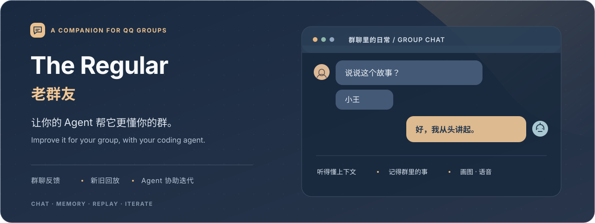
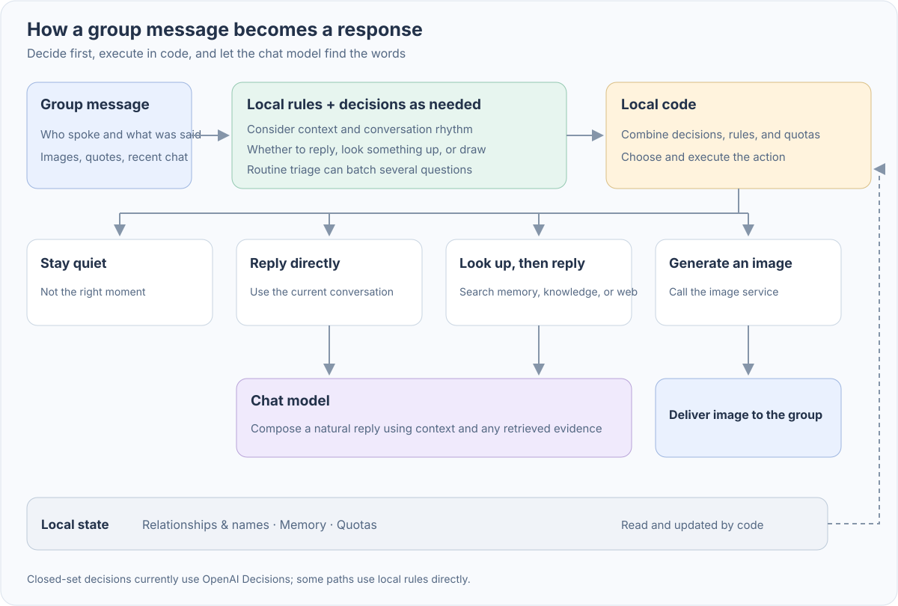
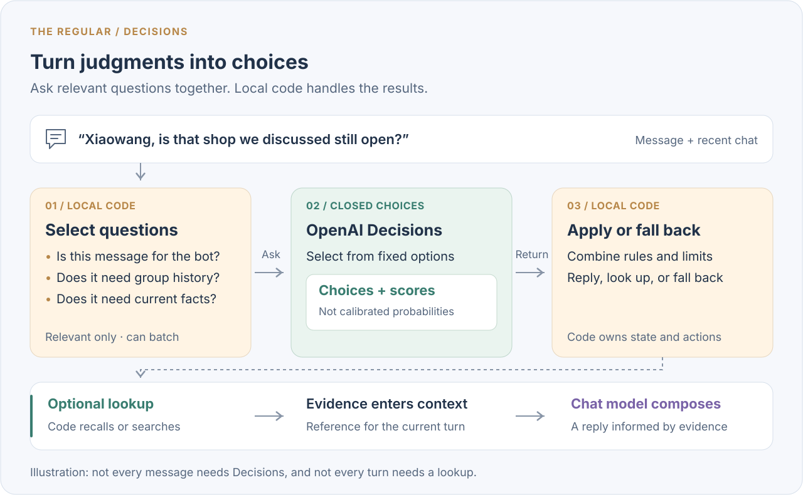
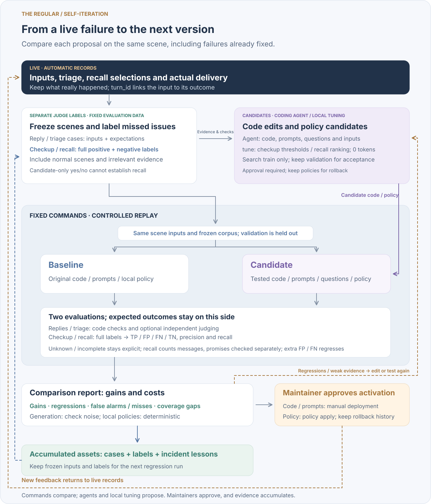

<div align="center">



# The Regular · 老群友

**An AI companion for QQ group chats: it gets to know the people, remembers shared stories, and knows when to join in and when to leave room for others.**

[](requirements.txt) [](bot.py) [](tests) [](LICENSE)

[中文](README.md) · **English** · [Message flow](#one-message-through-the-system) · [Decisions input](#what-decisions-actually-sees) · [Self-iteration](#self-iteration-the-loop-as-commands) · [Quick start](#quick-start) · [Design docs](#design-docs)

</div>

The Regular listens to group chat, answers when addressed, decides whether an unaddressed line is for it, joins jokes and corrections, and backs off when unwelcome. Reading images, hearing voice, looking things up, drawing, speaking and reminders all end in an actual result confirmed by code.

The same system has two connected paths. **The live path handles the message in front of it; the improvement path turns earlier failures into evidence for the next change.** Recorded scenes connect them. A coding agent proposes changes, and a maintainer decides what ships.

| Path | Flow |
| --- | --- |
| Live companion | message → local preparation → optional judgment and reply → execute, deliver, record the outcome |
| Offline improvement | recorded scene → checkup and cases → code or prompt edit → old/new replay → human release decision |

[Conversation examples](docs/readme/conversation.svg) · [Measurements and limits](#measurements-and-limits) · [Implementation and replay design](docs/self-iteration.md)

<a id="design-highlights"></a>
<a id="architecture"></a>
<a id="the-speaker-decides"></a>

## One message through the system

Code deduplicates the event, resolves @ mentions and quotes, and prepares image or voice information. Local rules may end the turn without a model call; Decisions is called when a semantic judgment is needed. The reply model composes from context, code checks and executes, and the session records what was actually delivered.



There are three decisions here: **local code selects the path, Decisions returns a bounded semantic choice, and the reply model chooses what to say, whether to answer and whether to propose an action.** Platform @ mentions and names take different routes; for an unaddressed line, the reply model chooses to answer or return `〔不接〕` (pass). `〔画〕`, `〔语音〕` and `〔提醒 …〕` propose drawing, voice and reminders. Code checks context, services, format, sensitive words and quota before execution. The next turn sees the actual result.

The inputs, judgments and outcomes also become the evidence for [offline improvement](#self-iteration-the-loop-as-commands). For modules, see the [detailed architecture](docs/readme/architecture.svg), [image and voice](docs/media-replies.md), and [quotes and @](docs/quotes.md).

<a id="when-to-speak"></a>
<a id="closed-set-judgment-trust-the-ranking-not-the-scale"></a>

## What Decisions actually sees

Decisions receives **scene `input` plus a list of `questions`**. The input carries the current message, context and the bot's previous reply. Every question has `instructions`, fixed choices and each choice's `description`. This is separate from the reply model's four-part context: stable head → memory → history → current turn.

A synthetic scene: a member asks, "What is this thing?" Atuan replies, "I’m not sure what this is." Without a platform @, the member then says, "Atuan, I think it looks like a teacup." The name and continuation make the intended `addressed` result `answer`: acknowledge the contribution, without treating the teacup guess as fact.



The diagram shows decoded `input`; the HTTP request encodes it as a JSON string. The separate `questions` list carries questions like this one, with shortened wording for the synthetic example:

```json
{
  "type": "choice",
  "name": "addressed",
  "instructions": "Use the conversation to decide whether the bot is being invited to speak. (Shortened example.)",
  "choices": [
    {"value": "answer", "description": "A question, contribution or correction expects the bot to respond"},
    {"value": "quip", "description": "A remark at or about the bot may welcome a short reaction"},
    {"value": "let_it_pass", "description": "Members are talking to one another, or a reply would intrude or repeat"}
  ]
}
```

Question wording, choice descriptions and examples within instructions live in [`regular/decision_prompts.py`](regular/decision_prompts.py), so they can be iterated. **Use triage replay for question edits; use message replay for changes to fields, trimming or context construction.** Relevant questions share one call. Actions use rankings and sufficiently supported choices; probability calibration is checked [separately](docs/decision-calibration.md). See the [Decisions input guide](docs/self-iteration.md#decisions-input) for full packaging and coverage.

<a id="slow-work-answer-first-follow-up-when-done"></a>

## How slow work returns to the group

Image reading, lookups and deeper research may not finish during the first response window. Only tasks on the slow-work path use the waiting and follow-up flow below; code tracks task handles and later delivery.

| When | What the group sees | What code keeps |
| --- | --- | --- |
| Ready immediately | a reply using the result | result and confirmed delivery |
| Longer than the live wait, currently 6 seconds | a short local progress line | an in-flight task or recoverable handle |
| Background work completes | a follow-up; after the passive window, try a proactive post, then carry it with a later message | completion state, task association and delivery outcome |

A reminder is another use of the same job table. The model writes a fixed time tag; code parses, checks and registers it. Each person has one reminder, and a new one replaces it. Job state and quotas persist across restarts. See [slow work](docs/slow-work.md), [image follow-ups](docs/image-before-reply.md), and [reminder formats](docs/reminders.md).

<a id="how-it-evolves-incident--replay--change--regression"></a>

## Self-iteration: the loop as commands

Each iteration produces **a candidate change, new regression cases and an old/new comparison report**. The live bot records inputs, judgments and actual delivery. `checkup` reads those records and flags suspicious scenes; a separate judge model labels them in another maintenance step. An external coding agent diagnoses and edits, evaluation commands replay and compare, and a maintainer decides what ships.



Continue the synthetic teacup scene. **Suppose** "Atuan, I think it looks like a teacup" was classified as `let_it_pass` and went unanswered. Follow that failure through the iteration:

| Part of this iteration | What is saved or compared |
| --- | --- |
| Freeze the problem | save the scene with expected `addressed=answer`; keep the mistaken choice only as a reference |
| Locate the change | edit the question and use triage replay if it misread a contribution; fix input construction and use message replay if the earlier turn was missing |
| Check the fix and its side effects | run both versions on the same scene and old cases such as members merely mentioning Atuan, guarding against answering every name mention |
| Follow the report | revisit the edit if an old case regresses; take more samples for drops within noise; give the maintainer the results and coverage gaps |

New cases join later regression runs. Incident notes and rule provenance inform the next edit. **Code, prompts, cases and the reasons for changes accumulate**, while feedback after release enters the same path again. A person currently starts the coding-agent maintenance workflow. Code edits need relevant offline tests; regressions need explanations and coverage gaps must be listed before a maintainer decides whether to release manually. See the [worked iteration](docs/self-iteration.md#iteration-example).

Wording is only one editable surface. The replay needed depends on where the change takes effect:

| Editable object | Main entry | Validation |
| --- | --- | --- |
| Persona, tone, output rules and action guidance | [`prompts.py`](prompts.py) | generation replay; ledger rules also support ablation |
| Decisions instructions, choice descriptions and semantic examples | [`regular/decision_prompts.py`](regular/decision_prompts.py) | triage replay loads the tested version's questions and checks intended choices |
| Triage thresholds and choice handling | [`regular/decisions.py`](regular/decisions.py) | triage checks usable choices; message replay covers later behavior such as quiet windows |
| Input fields, context trimming, @ / quotes and routing | [`regular/decisions.py`](regular/decisions.py), [`bot.py`](bot.py), [`storage.py`](storage.py), [`quotes.py`](quotes.py) | message replay and directly related offline tests |
| Local checkup signals, thresholds and time windows | [`regular/checkup.py`](regular/checkup.py), [`regular/tune.py`](regular/tune.py) | frozen logs with independent positive and negative labels; compare false alarms and misses with separate training and validation |
| Archive recall matching, ranking and recency | [`recall.py`](recall.py), [`regular/tune.py`](regular/tune.py) | retrieval replay over frozen evidence and a complete relevant-message set; promises have separate checks |
| Memory and other evidence selection and injection | [`digest.py`](digest.py), [`knowledge.py`](knowledge.py) | message replay plus focused tests; summary generation and actual tool execution need separate validation |
| Models, reasoning parameters and task configuration | [`config.py`](config.py), [`providers.py`](providers.py) | comparisons with controlled configuration; replay and task probes have different coverage |

The four replay depths are **generation**, which reruns recorded arguments; **triage**, which reruns recorded input with the tested questions; **retrieval**, which selects evidence again from frozen archive and promise snapshots; and **message**, which feeds archived events to the real handler with fake sending. Day replay regenerates the day's recorded replies to reveal patterns such as repeated phrases; it cannot simulate how members would react to changed replies.

**Checkup and archive recall are themselves evaluated.** Both versions use the same independently labeled set. A false positive flags a non-issue or selects irrelevant evidence; a false negative misses a labeled issue or relevant evidence. Reports show TP / FP / FN / TN, precision, recall and the actual errors. Labeling only detected findings, or requiring only one relevant item, cannot establish overall recall. Unknown labels, incomplete snapshots and empty denominators remain explicit instead of becoming zero misses.

`tune checkup` and `tune recall` search bounded policy parameters locally with zero model tokens. Labels remain independent of the policy being searched, and validation data checks the resulting change. These commands produce reports and proposals; a maintainer applies a policy with `policy apply`, retaining its predecessor for rollback. See [local strategy evaluation](docs/self-iteration.md#local-strategy-evaluation) for scope and data formats.

A message case with preset `triage_choices` freezes those choices; use cases without preset answers to test the full decision path. Message replay also replaces some evidence rendering and media execution, so it does not replace a real-service smoke check.

Built-in wording search currently has only `remind` and `banter` targets. The latter edits the chat model's reply-or-pass instruction; native Decisions questions are edited by a coding agent and then evaluated. Safety, privacy, state ownership and call budgets remain code-enforced constraints. See [editable surfaces and validation boundaries](docs/self-iteration.md#iteration-surfaces).

The [eight Harness² components](docs/self-iteration.md#harness2-components), four prompt layers and four replay depths describe different things. In the bot runtime, system prompt, guardrails, memory and tool guidance have direct counterparts. Fixed local code takes on some script and plugin responsibilities, without exposing model-run shell scripts or a plugin loop. The bot contains no nested subagent or skill framework.

<details>
<summary>For maintainers: commands, statistical decisions and existing checks</summary>

Run from the source checkout. `DEPLOY` contains the live `.env` and `data/`; `--base` / `--cand` select code versions.

```bash
DEPLOY=/path/to/regular-bot
.venv/bin/python -m regular --directory "$DEPLOY" checkup --day today
.venv/bin/python -m regular --directory "$DEPLOY" case add --turn <turn_id> --id <case_id> --must-not "刚醒|洗衣"
.venv/bin/python -m regular --directory "$DEPLOY" eval --base HEAD --cand . --cases all -n 4 --allow-paid
.venv/bin/python -m regular --directory "$DEPLOY" eval --base HEAD --cand . --day today --allow-paid

# Local strategy evaluation and tuning: no model requests
.venv/bin/python -m regular --directory "$DEPLOY" tune checkup --benchmark docs/examples/checkup-benchmark.example.json
.venv/bin/python -m regular --directory "$DEPLOY" eval --base HEAD --cand . --cases retrieve -n 1
.venv/bin/python -m regular --directory "$DEPLOY" tune recall
.venv/bin/python -m regular --directory "$DEPLOY" policy show
```

Without a `turn_id`, use `case add --message <message_id> --id <case_id>`. Triage cases need an intended choice such as `--choice addressed=answer`. `checkup` reads local logs without model calls; a separate judge model performs labeling. Model-based generation, triage and judging require `--allow-paid`; retrieval-only evaluation without a model judge does not. The checkup benchmark above is synthetic command-demo data, not a measurement of live quality.

Generation and judging drops must pass a one-sided test to count as regressions; smaller drops are listed as within noise and can be rerun with a larger `-n`. A single boundary violation counts as a regression. Retrieval is deterministic: a drop in checks or an increase in fully labeled FP / FN counts is a regression without repeated sampling. Ablation gives one of four verdicts: delete, keep, unsure, or cannot tell. Missing cases or incomplete runs cannot support deletion. Prompt or rule changes do not ship automatically.

Small-scale checks so far: the same version against itself, 4 cases with 4 samples each, produced 0 regressions and 2 drops within noise. The first checkup of a real day led from a correction to 4 malformed bookkeeping tags leaking into replies, which were fixed. The full historical case set and longer live observation still need validation. The design borrows recorded-history replay from [Dream-RSI](https://arxiv.org/abs/2609.14858) and old/new comparison from [Harness²](https://arxiv.org/abs/2610.14224); see the [self-iteration design](docs/self-iteration.md) for the full process.

</details>

<a id="four-layer-prompt-ordered-for-the-prefix-cache"></a>
<a id="state-and-memory-code-owns-it-the-model-only-talks"></a>
<a id="cost-privacy-and-reliability"></a>

## Boundaries for state, cost and privacy

| Boundary | How code enforces it |
| --- | --- |
| State has provenance | names, relationships, promises, mood, quotas and jobs stay code-owned; personal quotes bind verbatim to the archive and enter context only when relevant, at most two |
| Context has an order | stable head → daily memory → session history → current turn; person- and turn-dependent content goes last |
| Calls are bounded | SDK auto-retry is off; explicit candidates, attempt caps, request/turn timeouts and global/per-feature daily budgets |
| Evidence has a boundary | explicit, single-step tools; search reads titles, snippets and links only; outside material is wrapped as untrusted evidence |
| Privacy and output checks | no openids or group IDs in model context or replies; memory, archive and knowledge exports pass the sensitive-word check; the panel binds only to 127.0.0.1 |

Conversation content needed for judgment and replies goes to the configured model services, so choose them with group members' expectations in mind. The bot is a resident companion with fixed capability interfaces; an external coding agent changes code and tooling through the maintenance process. See [personal evidence](docs/personal-memory.md), [judgment privacy](docs/judgment-layer.md), and [providers and cost](docs/providers.md).

## Measurements and limits

| Existing evidence | Scope |
| --- | --- |
| 1429 offline regression tests | code behavior, not a guarantee that every reply lands |
| Archive recall passes 8 / 8 case checks, retrieves 7 / 9 relevant messages | [fully labeled synthetic cases](docs/self-iteration.md#local-strategy-evaluation); both versions agree, and the 2 budget-limited misses remain counted |
| 17 / 20 unaddressed lines aimed at it answered, versus 3 / 20 before | [141 messages and 9 prompt variants](docs/when-to-reply.md); answer/pass labels came from a separate judge model |
| 75.6% of reply input tokens hit the prefix cache | [261 calls from one live day](docs/providers.md), tied to that model and traffic |
| 0.71-second median closed-set judgment | [908 judgments](docs/judgment-layer.md), not a service-latency guarantee |
| Reminder times and targets correct in 60 / 60 replays | [10 phrasings, 6 samples each](docs/reminders.md), covering that batch |

Earlier iterations also examined [three image-reading failures](docs/image-before-reply.md), [three-provider roles](docs/model-roles.md), and [hindsight labels from a judge model on 1082 requests](docs/request-sincerity.md). These measurements record gains and costs under specific conditions; sustained effects need later unseen examples and live observation.

## Quick start

You need Python 3.10 or later, a QQ bot, and a compatible model service. The terminal demo runs without QQ credentials or an API key:

```bash
git clone https://github.com/dubianche123/the-regular-qq-bot.git
cd the-regular-qq-bot
python3 -m venv .venv
source .venv/bin/activate
pip install -e .
regular demo
```

To connect a QQ bot, prepare its AppID and AppSecret and your model-service credentials, then run:

```bash
regular --directory regular-bot setup
regular --directory regular-bot run
```

Enable C2C and group events in the QQ Open Platform console. **The first private message to the running bot claims ownership**; send it yourself before inviting others. After adding the bot to a group, allow it to receive all group messages in the group settings. You can address it with an @ mention or a configured name.

| Command | What it does |
| --- | --- |
| `regular demo` | offline demo through the production message handler |
| `regular setup` / `init` | guided setup / only create a private `.env` |
| `regular doctor` / `status` | local checks / read the runtime snapshot |
| `regular panel` | local maintenance panel (127.0.0.1 only) |
| `regular service` | generate a launchd / systemd definition (never installs it) |
| `regular coverage` / `calibration` | read-only stats: personal-quote coverage, judgment probabilities vs. outcomes |

Decisions, search, vision, voice and drawing need the corresponding services. See [provider configuration](docs/providers.md), [.env.example](.env.example) and [image generation](docs/image-generation.md).

## Design docs

| Topic | Docs (Chinese unless noted) |
| --- | --- |
| Who judges what | [Judgment layer](docs/judgment-layer.md) · [Calibration study](docs/decision-calibration.md) · [Called ≠ must answer](docs/addressing.md) · [Quotes and @](docs/quotes.md) |
| When to speak | [When to reply](docs/when-to-reply.md) · [When to intervene (archived)](docs/when-to-intervene.md) · [Real request or a bit](docs/request-sincerity.md) · [Deflect in place](docs/deflection.md) |
| Capabilities and actions | [Image and voice](docs/media-replies.md) · [Image generation](docs/image-generation.md) · [Read images before replying](docs/image-before-reply.md) · [Reminders](docs/reminders.md) |
| Async | [Slow work: answer first, follow up later](docs/slow-work.md) |
| Memory and observation | [Personal memory](docs/personal-memory.md) · [Interaction observations](docs/interaction-observations.md) · [Self-iteration](docs/self-iteration.md) |
| Models and providers | [Three providers, one job each](docs/model-roles.md) · [Provider configuration](docs/providers.md) |
| Overview | [Design notes (English)](docs/DESIGN_NOTES_EN.md) · [设计笔记](docs/DESIGN_NOTES.md) |

[MIT License](LICENSE)
