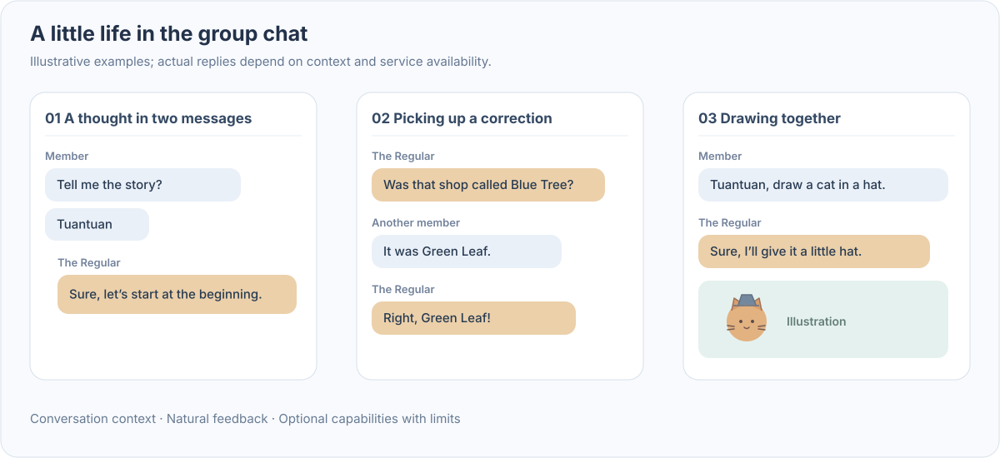
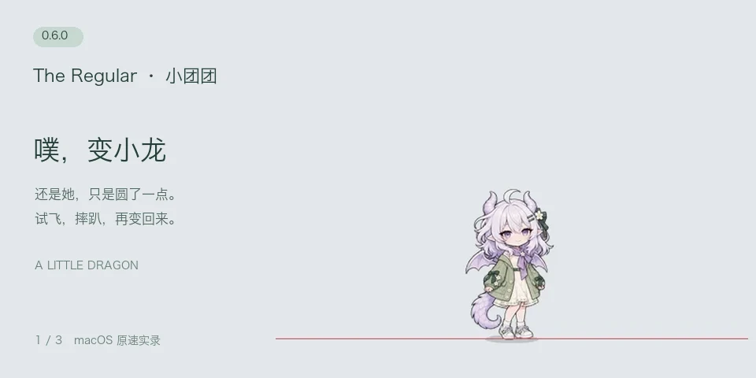
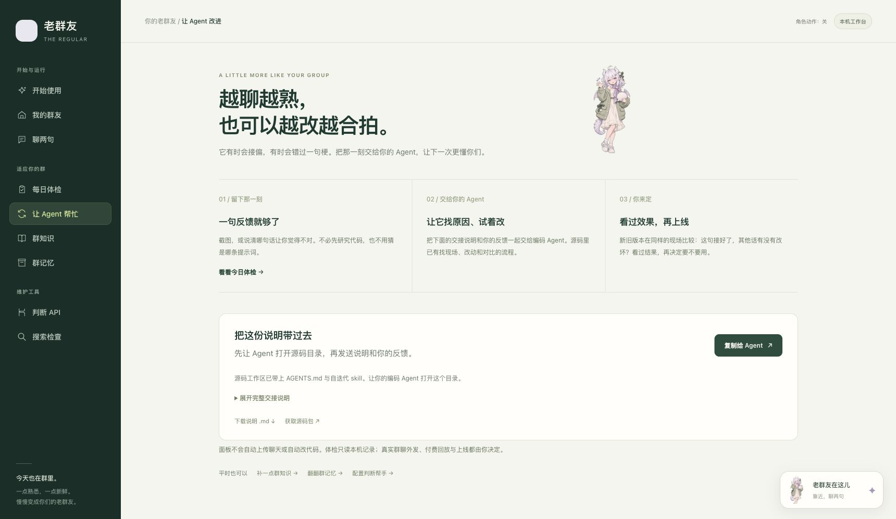
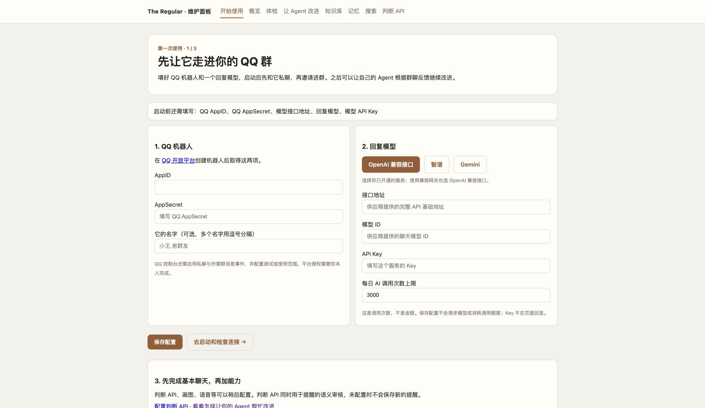
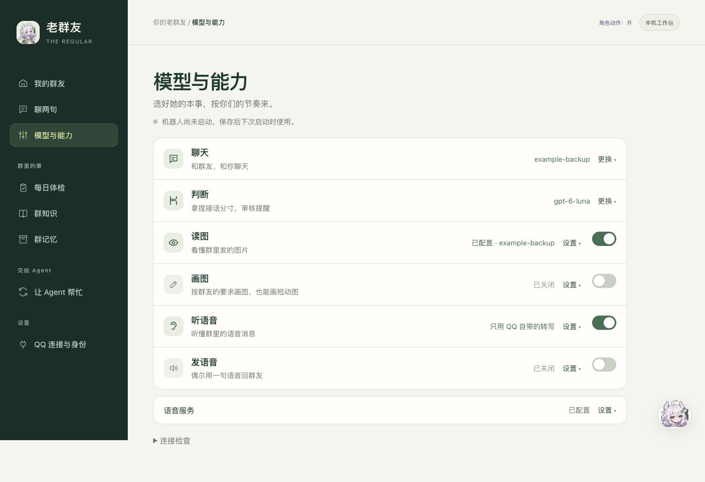
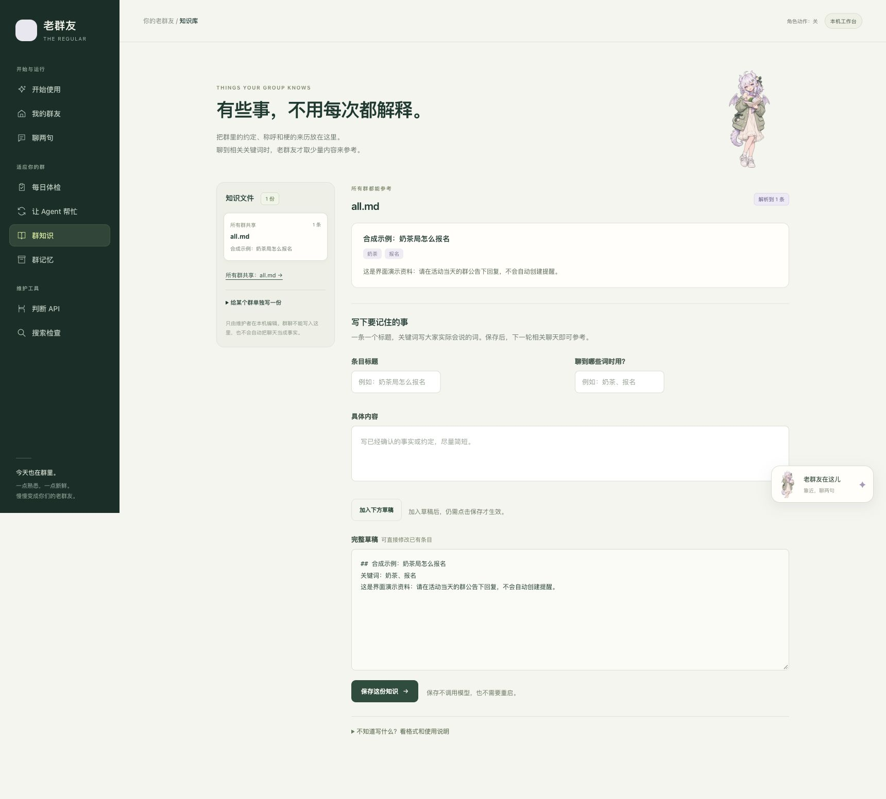

<div align="center">


# The Regular · 老群友

**One more friend in your QQ group: joins the jokes, remembers you, draws animated GIFs, speaks aloud, and hangs out right on your desktop.**

Let your Coding Agent install her in one step—and evolve her over time around your group's real feedback.

**Let Codex / Claude Code install it. Enter one OpenAI key and your QQ bot credentials, then start chatting.** [Copy the install prompt ↓](#quick-start)

[](docs/agent-setup.md) [-E07A3F)](docs/judgment-layer.md) [](docs/companion.md) [](docs/self-iteration.md) [](requirements.txt) [](.github/workflows/ci.yml) [](LICENSE)

[中文](README.md) · **English** · [Download Latest](https://github.com/dubianche123/the-regular-qq-bot/releases/latest) · [Desktop Pet Sync](#meet-at-your-desktop-too) · [Group Self-Iteration](#make-it-your-groups-own) · [Quick Start](#quick-start) · [Under the Hood](#architecture-and-design)

</div>

You chat; she's there too.

She isn't a stiff command bot waiting for `/help` or repeating *"How may I assist you today?"* Call her name and she jumps in; leave her unmentioned and she reads the room to decide whether a follow-up is meant for her. She plays along with running jokes, takes corrections in stride, and gives people space when asked. Nicknames, shared stories, and what she actually said two minutes ago all carry into the next exchange.

Want something fun? Ask her to draw a chicken playing basketball—even as a short looping GIF. Want to hear her voice? Ask for a sleepy good-morning line. **Choose her name and personality, and let your group shape a rhythm of its own.**

### ✨ Why Groups (and Desktops) Love Her

- **🧠 Ultra-Cheap Turn-Taking via Decisions API (`Jev`)**: Group bots usually suffer from noisy regex triggers or burn tokens calling a full LLM just to output `SKIP`. The Regular uses the **Decisions API (`Jev` closed-set judgment endpoint)**—at roughly **0.1 USD / 1M tokens and a 0.71s median latency**—to decide *when to speak* before calling the main chat model: distinguishing direct questions from third-party mentions, catching implicit follow-ups, recalling old quotes, and respecting back-off cues.
- **🔄 Tailored to Your Group via Self-Iteration (Even for *When to Speak*)**: Every friend group has its own humor and conversational pace. When she feels too quiet, too chatty, or too literal, you don't need to dig through Python files—hand a screenshot to your Coding Agent. Both **the judgment layer (Decisions API triage questions & margins)** and **the generation layer (reply prompts)** can be replayed, tuned, and blind-evaluated on real group turns.
- **🐉 Desktop Pet Synced Live with Your Group**: She doesn't just live in a chat window—she's a chibi dragon-girl strolling, sipping tea, reading, and napping along the bottom edge of your screen. **When someone `@`-mentions her in QQ, she pulls out her phone on your desktop; when she replies, she talks; when someone asks for a drawing, she sketches until the image lands in the chat.** You can also pat her head, play high-five rally games, or talk with her hands-free via real-time voice.
- **🤖 Agent-First + Effortless One-Key Setup**: From downloading the release, preparing Python, and building the desktop pet, to running daily health checkups, tuning triage & reply rules, and making the desktop pet jump for joy when evals finish (`regular pet-cue cheer`), **Codex, Claude Code, or Gemini CLI** can handle the heavy lifting. You just enter **one official OpenAI API key** (shared across chat, Jev judgment, vision, image/GIF generation, and voice with pre-selected models) and your QQ bot credentials.

> 💡 **Sitting on monthly ChatGPT Pro / Business API credits and wondering what to build?**
> Give your group a new companion ([OpenAI API credits guide](https://developers.openai.com/api/docs/guides/chatgpt-api-credits)). You can also plug in Zhipu GLM, Gemini, or any compatible model service.

---

## A Little Life in the Group

With the default official OpenAI setup, chat, vision, drawing, voice, and reminders all share the same API key—toggle whatever you want in the local workbench:

| What your group says | How The Regular responds |
| --- | --- |
| “Tuantuan, what do you think?” | Replies using surrounding context—and catches follow-ups without needing an `@` on every message |
| “Draw an animated chicken playing basketball” | Fills in a short looping motion and sends the generated GIF straight to the group |
| “Say good morning like you just woke up” | Writes the line in character, then delivers it as expressive synthesized speech |
| “Remind me about the 9 AM meeting tomorrow” | Clarifies what's needed, confirms and logs the reminder locally, and `@`s you right on time |
| “That wasn't a question for you” | Steps back immediately—and logs the moment as feedback for future tuning |

<details>
<summary>🎬 See an illustrated group conversation</summary>



</details>

Three things shape the everyday experience:

- **Conversation with room for others.** No slash commands required. She considers conversational turn-taking before chiming in, and respects quiet time whenever someone asks her to chill.
- **Continuity between conversations.** Local deterministic code tracks nicknames, rapport scores, and source-backed quotes alongside her own delivered messages—linking back to original lines when revisiting older topics.
- **A built-in loop to fix what feels off.** Your Coding Agent can turn *"why did she miss that?"* or *"why did she answer the wrong person?"* into a replayable regression case and benchmark a proposed fix against the current version.

---

## Meet at Your Desktop, Too

<p align="center"></p>

The desktop companion is your default entry point: **a chibi dragon-girl who lives along the bottom edge of your screen**—she strolls around, sits down for tea or a book, naps when sleepy, dangles her legs when you pick her up, and plops back down when you let go.

Best of all, **her desktop animations mirror what Tuantuan is doing in your QQ group in real time**:
- Someone `@`-mentions her in the group → she pulls out her phone on your desktop;
- She sends a reply → she talks;
- Someone requests a drawing → she grabs her sketchbook and draws until the picture is sent;
- The bot service stops or late night arrives → she yawns and curls up to sleep.

**Interactive desktop perks & local butler controls:**
- **Headpats, snacks & high-five rallies**: Hover near her and she turns to look at you, revealing a five-button radial ring (`Play / Chat / Voice / Activity / More`). Patting her head or feeding her cookies boosts her mood and walking pep; click *Play* for a multi-tap high-five combo game.
- **Hands-free continuous voice chat**: Click *Voice* on the radial ring to speak naturally—she detects when you finish, replies aloud, and lets you interrupt anytime without holding a button (no QQ connection required).
- **One-sentence capability switches & Coding Agent cues**: Tell her *"stop drawing for now"* and she offers a confirmation card for you to approve; ask *"what did you do today?"* for a summary of today's group activity. When your Coding Agent finishes an evaluation run in the background, it can run `regular pet-cue cheer --say "eval finished"` to make her celebrate on your screen!

Launch her via the starter script or `regular --directory ~/.the-regular pet`. Size, position, and motion preferences persist automatically. [Desktop companion & local chat guide →](docs/companion.md)

---

## Make It Your Group's Own

Every friend group has its own inside jokes and rhythm. When Tuantuan replies too literally, chimes in at the wrong moment, misses an implicit follow-up, or needs tuning to fit your group's style, **you never have to dig through code or hand-edit prompts**—just hand a screenshot or note to your Coding Agent:

> *“Look at Tuantuan's last reply. Why did she answer the wrong person? Follow the repository's self-iteration workflow, try a fix, and compare it with the current version.”*

```text
Keep live triage & reply scenes → Agent diagnoses Judgment (Decisions) vs. Reply layer → Paired replay & blind A/B judging → You decide what goes live
```

**Tune both *how she speaks* and *when she speaks*:**
- **Triage Layer (`Decisions / Jev`) Iteration**: If she chimes in too often or stays too quiet in your group, your agent can replay historical triage logs (`regular eval --layer triage`) to refine the closed-set decision questions, option phrasing, or confidence margins.
- **Generation Layer Iteration**: If her tone feels stiff or repetitive, your agent can replay real conversation windows, run independent blind A/B judging, and prune redundant prompt rules with `--ablate`.

The repository ships with replay tools and **[`.agents/skills/regular-iterate/SKILL.md`](.agents/skills/regular-iterate/SKILL.md)**. Open **“让 Agent 改进” (Improve with your agent)** in the local workbench to download a ready-to-use handoff brief telling Codex, Claude Code, or Gemini CLI exactly where the source and data live and how to begin.

<details>
<summary>🛠️ See how the workbench hands feedback to your Coding Agent</summary>



</details>

[Walk through a complete self-iteration cycle →](docs/self-iteration.md#iteration-example) · [See all 8 customizable surfaces →](docs/self-iteration.md#iteration-surfaces)

---

## Quick Start

### Option 1: Let Your Coding Agent Install & Open Everything (Recommended)

**Copy the prompt → Codex / Claude Code installs and opens it → enter your credentials locally and complete QQ authorization → connect and chat.** Recommended models are pre-selected out of the box.

Copy and paste this into Codex, Claude Code, Gemini CLI, or any local coding agent:

```text
Install and open The Regular on this computer:
https://github.com/dubianche123/the-regular-qq-bot

Read the repository's docs/agent-setup.md, then download its latest stable source
release. Prepare Python, install dependencies, build the pet, and launch it.
Reuse my existing instance and settings if present. Verify that the pet is
visible and the local workspace opens; resolve ordinary installation errors.
Use the project's recommended OpenAI model settings. I will enter my official
OpenAI key and QQ AppID / AppSecret locally and complete QQ authorization.
Handle the remaining setup for me,
apart from account actions or system permissions that require my input.
Once I confirm configuration and QQ authorization are complete, start the bot
and verify its connection.
```

**Your agent handles download, Python setup, desktop pet build, and launch; you only enter credentials locally and scan for QQ authorization.** [Full agent installation workflow →](docs/agent-setup.md)

---

### Option 2: Do It Yourself in 3 Steps

Prepare **Python 3.10+, a model service API key, and your QQ bot's AppID / AppSecret**:

#### 1. Download & Meet Her on Your Desktop

[**Download the latest release →**](https://github.com/dubianche123/the-regular-qq-bot/releases/latest) Choose **Source code (zip)**, extract it, and run your OS launcher:

| Windows | macOS | Linux |
| --- | --- | --- |
| Double-click `start.bat` | Double-click `start.command` (or `bash start.sh`) | Run `bash start.sh` in the project directory |

The first launch installs dependencies and places the chibi dragon-girl on your desktop. Move your pointer near her to reveal the radial ring (`Play / Chat / Voice / Activity / More`).

#### 2. Enter Your OpenAI and QQ Credentials

Choose **“更多 → 打开工作台” (More → Open workspace)** from the ring and complete two quick cards:
- **“QQ 连接与身份” (QQ connection and identity)**: Enter your QQ bot credentials and give her a group name (e.g., *Tuantuan* / *小团团*);
- **“模型与能力” (Models and capabilities)**: Connect your official OpenAI key at the top to unlock all recommended chat, judgment, and multimodal presets at once (or expand *Chat* to pick Zhipu GLM, Gemini, etc.).



#### 3. Start the Bot & Say Hello

On **“我的群友” (My companion)**, click **“启动机器人” (Start bot)** and wait for **“已连上 QQ” (Connected to QQ)**. Send her a first private message (C2C) to automatically claim owner permissions, then invite her to your group and say hi!

> Private settings and group memories live in **`~/.the-regular`** and persist across updates. [Full setup & troubleshooting →](docs/getting-started.md) · [Services & keys →](docs/providers.md) · [Config example →](.env.example)

<details>
<summary>🧪 No QQ bot or API key yet? Try the offline terminal demo</summary>

After installing dependencies, run:

```bash
# macOS / Linux; on Windows use .venv\Scripts\python.exe
.venv/bin/python -m regular demo
```

Runs 100% offline with zero model calls so you can explore message routing, rapport ledgers, and local commands.

</details>

---

## One Key, with Capabilities You Can Switch On or Off

With the default official OpenAI setup, **chat, judgment, vision, images, and voice all share the single key you entered at the start—and models are already pre-selected.** Just choose which capabilities to enable and set their daily call limits.

Open **“模型与能力” (Models and capabilities)** to view each row's status, model, and daily quota at a glance. Toggles save immediately; expand any row when you want to customize its model or limit. See the [settings guide](docs/capabilities.md).

| What you want | How the default setup works |
| --- | --- |
| **👀 Understand pictures & memes** | Enabled by default using the chat model; toggle off or pick a dedicated model under *Vision* |
| **🎨 Draw still art or looping GIFs** | Shares the OpenAI connection; adjust switches, GIF animation, and daily limits under *Images* |
| **🎧 Transcribe QQ voice notes** | Enabled by default; the preset transcription model fills in whenever QQ omits text |
| **🎙️ Send voice replies in QQ** | Off by default; ask your install agent to prepare local audio dependencies, then enable *Speech* |
| **🗣️ Continuous voice chat with the pet** | Open *Voice* from the desktop pet's ring; independent of QQ speech and needs no QQ connection |
| **⏰ Set timed reminders** | Judgment model is pre-configured; ask for a reminder and it saves after clarification and review |
| **📒 Group rules & inside jokes** | Add, preview, and save lore entries under *Group knowledge* with zero extra services |

<details>
<summary>🎛️ Preview the Models & Capabilities workbench</summary>



</details>

<details>
<summary>📖 Preview the Group Lore & Knowledge editor</summary>



</details>

<details>
<summary>🔌 Want different models or another provider?</summary>

Expand *Chat* to choose Zhipu GLM, Gemini, or another compatible endpoint; capabilities on the official OpenAI connection keep sharing your original key. Existing custom models, dedicated providers, and disabled capabilities are preserved.

[Models and services](docs/providers.md) · [Images](docs/image-generation.md) · [QQ voice and audio components](docs/getting-started.md#语音单独开启) · [Media behavior](docs/media-replies.md) · [Reminders](docs/reminders.md)

</details>

---

## Architecture and Design

Beneath the friendly group regular and live desktop pet is a compact **Agent Harness** engineered around deterministic state boundaries, prefix-cache economics, and regression-proof self-evolution:

- **⚡ 0.71s Closed-Set Judgment Layer (`Decisions API / Jev`)**: Replaces brittle regex rules and costly full-LLM `SKIP` calls with ultra-cheap (~0.1 USD / 1M tokens) closed-set Decisions API checks for intent triage, back-off detection, memory recall, and reminder screening while the chat model focuses on writing replies; [908 historical triage calls recorded a 0.71-second median latency](docs/judgment-layer.md).
- **🧱 Four-Layer Context Layout for Prefix Caching**: Structured strictly as `Stable Instructions → Daily Memory → Session History → Current-Turn Facts`. Speaker- and turn-specific data always goes last, preserving a stable prefix for [prefix caching](docs/DESIGN_NOTES_EN.md) (75.6%–98% measured hit rates).
- **🔄 Controlled Self-Evolution with Blind Judging & Rule Ablation**: Combines zero-token daily health scans (`regular checkup`), [generation / triage / retrieval / message replays](docs/self-iteration.md), independent blind pairwise judging, and single-rule ablation (`--ablate`) so weak candidates are rejected and obsolete prompt rules get pruned.
- **🛡️ 2,100+ Offline Regression Cases Protect State Boundaries**: Rapport scores, nicknames, promises, and daily quotas live strictly in deterministic local Python code. [CI](.github/workflows/ci.yml) covers Python 3.10 / 3.12 / 3.13 and desktop audio pipelines across Windows and macOS.

Explore the full message flow diagrams, Decisions calibration data, self-iteration walkthroughs, and design notes in **[Architecture and Design (`docs/architecture-en.md`)](docs/architecture-en.md)**.

### Practical Notes

- **Predictable quotas**: Set independent daily call limits per capability in the workbench so group banter never burns through your budget.
- **Local-first privacy**: Credentials, state ledgers, and logs stay on your machine under `~/.the-regular` with the workbench bound to `127.0.0.1`. For 24/7 operation, see [persistent operation](docs/getting-started.md#以后如何再打开).
- **Customizable identity**: The original dragon-girl mascot, name, and persona can be customized freely ([Visual identity & prompts](docs/visual-identity.md)).

[Contributing](CONTRIBUTING.md) · [MIT License](LICENSE)

---

<p align="center">
  If your group could use a companion who knows when to chime in, when to chill, and how to hang out on your desktop, give her a try—and drop a <b>⭐ Star</b> to help more groups find her!
</p>
