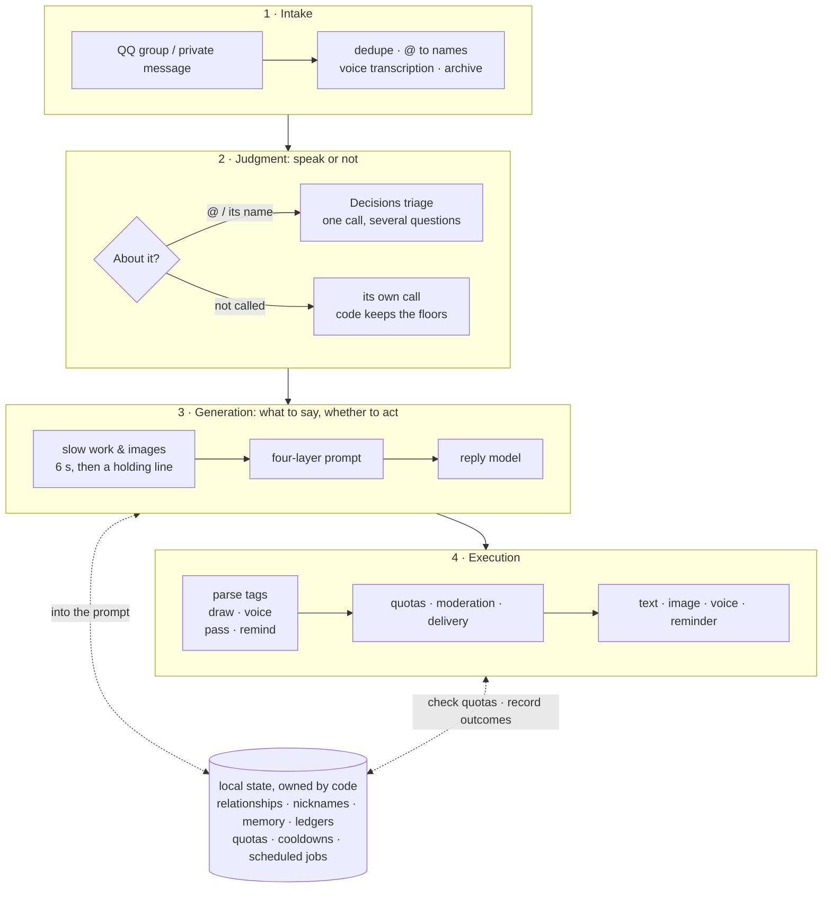
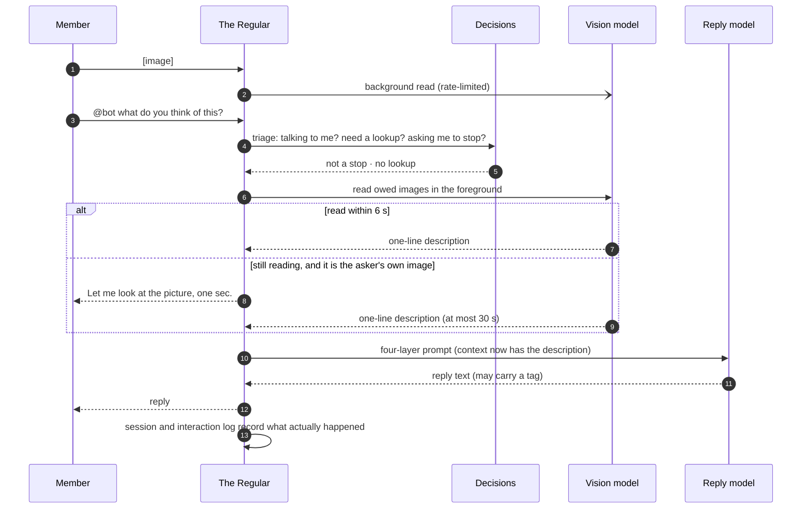
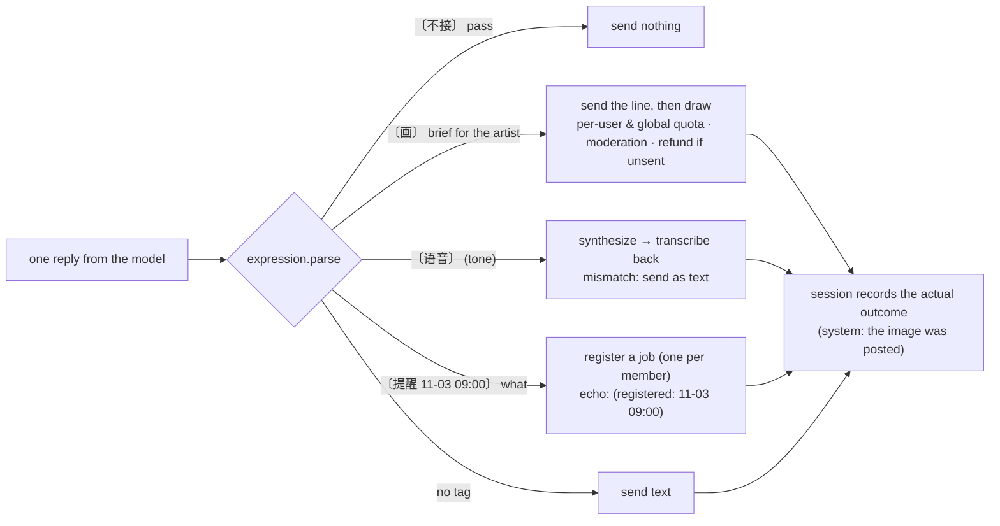
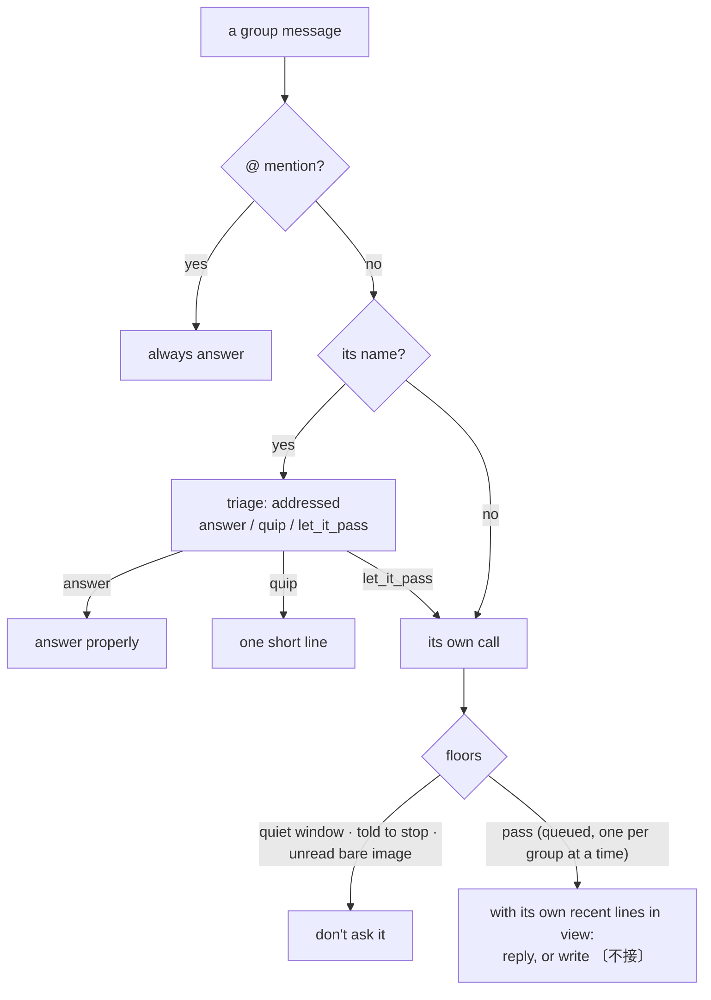
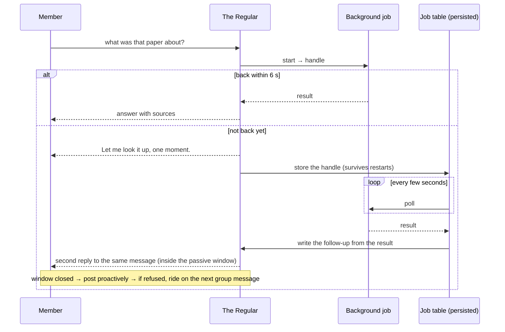
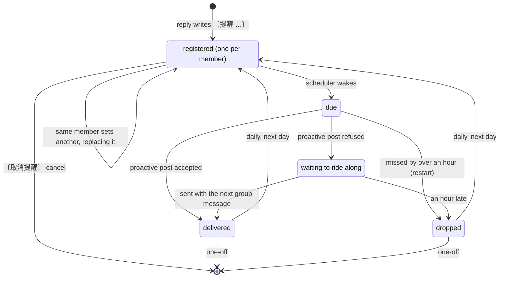
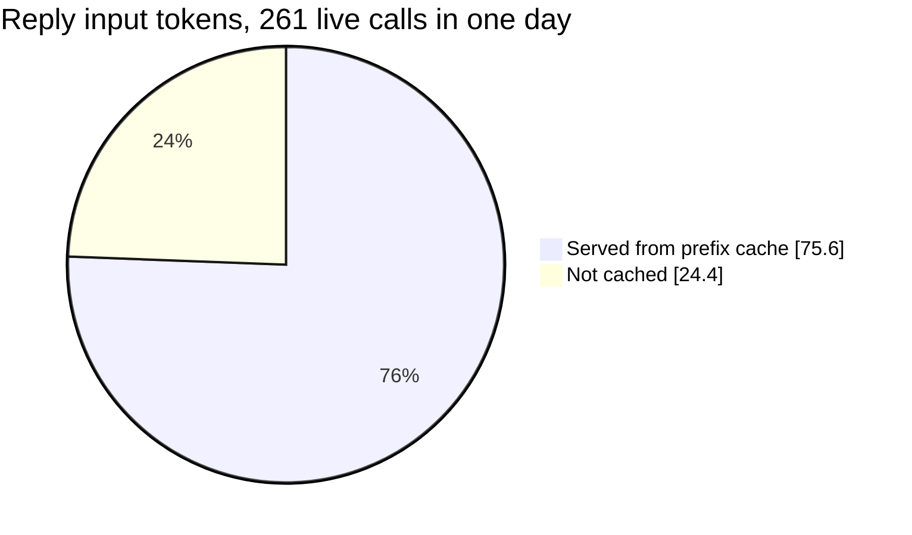
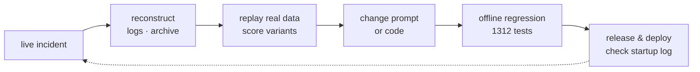

<div align="center">


# The Regular · 老群友

**An AI companion for QQ group chats: it gets to know the people, remembers shared stories, and knows when to join in and when to leave room for others.**

[](requirements.txt) [](bot.py) [](tests) [](LICENSE)

[中文](README.md) · **English** · [Highlights](#design-highlights) · [Architecture](#architecture) · [Quick start](#quick-start) · [Design docs](#design-docs)

</div>

The Regular is not an assistant waiting for commands. It listens to the group, answers when called, and decides for itself whether an unaddressed message is meant for it. It can take a joke or a correction, and it backs off when people find it annoying. It reads images, transcribes voice messages, looks things up, draws, speaks, and sets reminders. It keeps its own nicknames, relationships and memory for every group.

The hard part is not getting a model to produce a sentence. It is the chain of judgments and boundaries around it. Is this message for me? Should I speak right now? If the bot says "let me draw that", a picture has to follow. If it agrees to "remind everyone at 9", the reminder has to exist. Slow work cannot leave people waiting. Memory cannot be invented, and cost cannot run away. Every design below grew out of something that went wrong in a real group chat, and each one is backed by replay data or offline tests.

<table>
<tr>
<td align="center"><strong>1312</strong><br><sub>offline regression tests</sub></td>
<td align="center"><strong>17 / 20</strong><br><sub>messages clearly aimed at it without its name, answered (3 / 20 under the old dice)</sub></td>
<td align="center"><strong>75.6%</strong><br><sub>of reply input tokens served from the prefix cache (261 live calls in one day)</sub></td>
<td align="center"><strong>0.71 s</strong><br><sub>median closed-set triage latency (908 calls)</sub></td>
<td align="center"><strong>60 / 60</strong><br><sub>reminder replays with the right time and person</sub></td>
</tr>
</table>

## Life in the group

<table>
<tr>
<td width="50%" valign="top"><strong>💬 Follow split messages</strong><br>Send "tell the story of Haihu" and then just its name. It reads the earlier message to understand the question.</td>
<td width="50%" valign="top"><strong>🤝 Take a joke or correction</strong><br>It can pick up on a correction, play along with a joke, and step back when someone wants quiet.</td>
</tr>
<tr>
<td width="50%" valign="top"><strong>🌿 Be part of the group</strong><br>When nobody calls it, it judges whether the message is for it; when told to be quiet, it goes quiet for a while.</td>
<td width="50%" valign="top"><strong>🎨 More than text</strong><br>Ask naturally for a picture, a voice reply, a search, an old story or a timed reminder (one per member; a new one replaces the old).</td>
</tr>
</table>


These are illustrative scenarios and design goals, not a guarantee for every reply. Results depend on the model, the conversation, and whether the configured services are available.

## Design highlights

| | Problem | Approach | Evidence |
| --- | --- | --- | --- |
| 🗣️ | **Words and actions diverged.** When a judgment layer decided to draw, the reply model never knew. For a whole night it sent pictures while saying "I can't draw." | **The speaker decides.** The reply model writes `〔画〕` (draw), `〔语音〕` (voice), `〔不接〕` (pass) or `〔提醒 …〕` (remind) in its own reply. Code parses the tag, enforces quotas, executes, and writes the actual outcome back into the session. | [Image and voice](docs/media-replies.md) |
| 🎯 | **Whether to answer unaddressed messages.** It used to roll dice (12% × closeness × time of day × rhythm…). Of 20 messages clearly aimed at it, it caught 3. | The reply model judges for itself, with the message re-framed so it no longer reads as "the user is talking to you". Code only keeps the floors: a stop request, a quiet window, one consult per group at a time. | 141 real messages replayed: **17 / 20**, [when to reply](docs/when-to-reply.md) |
| ⚖️ | **Which judgments go to a model.** | Intent and routing go to OpenAI Decisions as closed-set triage. Each message gets one call carrying every relevant question, and each option is a code action. **Trust the ranking and confident answers, not the probability scale.** | [Judgment layer](docs/judgment-layer.md), [calibration study](docs/decision-calibration.md) |
| ⏳ | **Slow work cannot leave people waiting.** | Lookups and image reading share one rhythm. Wait 6 s inline; if the work isn't done, send a short local line and follow up when it is. Job handles persist across restarts. When QQ's passive-reply window has closed, it posts proactively, and if that is refused, the message rides on the next group message. | [Slow work](docs/slow-work.md), [read images before replying](docs/image-before-reply.md) |
| ⏰ | **A promise has to be recorded.** | The model writes `〔提醒 11-03 09:00〕`, and code parses that fixed format. One reminder per member; a new one replaces the old. The reply echoes the registered time so people can check it on the spot. | 10 phrasings × 6 samples: **60 / 60**, [reminders](docs/reminders.md) |
| 🧠 | **Memory must not be invented.** | Code owns relationships, nicknames, ledgers and quotas; the model cannot write them. A personal quote is only kept if it is bound verbatim to the archive (speaker, message id and time all match). It is only brought in when the current topic matches. | [Personal memory](docs/personal-memory.md) |
| 💰 | **Bounded cost.** | A four-layer prompt ordered by stability keeps the cached prefix long. SDK auto-retry is off; candidates are explicit, with attempt caps, a whole-turn timeout, and global and per-feature daily budgets. | **75.6%** of live input tokens cached, [providers](docs/providers.md) |
| 🔬 | **Prompt changes by gut feeling break things.** | Every change is first replayed on the real archive in production format and scored. Conclusions and limits are written down. | [9 variants compared](docs/when-to-reply.md), [three providers, one job each](docs/model-roles.md) |

## Architecture


Three layers, each doing what it is good at:
- **Closed-set judgment** (Decisions) answers "what is this message for".
- **The reply model** decides what to say and whether to act.
- **Local code** owns state, keeps boundaries, and executes.

In more detail:



One "post an image, then ask about it" message, end to end:



## The speaker decides

**Problem.** In the first version, a judgment layer decided to draw and code called the image API directly. The reply model never knew it could draw, whether it drew this turn, or what it drew. It sent pictures while saying "I can't generate images here", and a voice message literally said "I can't send voice". When it agreed to "remind everyone at 9 tomorrow", nothing in the code recorded it.

**Approach.** Capabilities go into the stable prompt head, which stays byte-identical while the switches don't change, so it doesn't break the cache. Actions are written by the reply model in its own reply. Code only checks the format, enforces quotas, executes, and writes the actual outcome back into the session. Next turn, the model sees what it really did.



| Tag | The model decides | Code enforces |
| --- | --- | --- |
| `〔画〕` draw | whether to draw, what, and the full brief for the image model | 5 images per member per day (more at higher closeness), 40 globally; it declines suggestive or political-innuendo requests itself and never claims it "can't draw" |
| `〔语音〕` voice | whether to speak and in what tone | a daily limit; after synthesis the audio is transcribed back and compared with the text (two filler characters tolerated); a mismatch is sent as text |
| `〔不接〕` pass | whether an unaddressed message is its business | floors: quiet window, stop requests, one consult per group at a time |
| `〔提醒 …〕` remind | whether to remember, when, and what for whom | fixed-format parsing, within 30 days, sensitive-word check, one per member; the reply echoes the registered time |

## When to speak

Most of a group chat isn't addressed to the bot. The old approach rolled dice: 12% base, multiplied by closeness, time of day and mood, a rhythm prior, an "is interrupting OK" judgment, and receptiveness. Over two days of live traffic, there were 20 messages clearly aimed at it without its name: follow-ups to what it just said, pushback, a bare "?", errands for it. The dice caught 3.

Now unaddressed messages go straight to the bot's own judgment. Code only states facts and keeps the floors:



Two details came out of the replays:
- In chat format, a "user" turn always reads as addressed to the model; sent as-is, it answered 93%. So the line is re-framed as "something just said in the group, not addressed to you".
- The context has to include the bot's own recent lines, marked as "you". Without them, it can't tell whether a message is a follow-up to it.

| Variant (141 live messages replayed, luna low) | Aimed at it, answered | Not its business, skipped | Answered overall |
| --- | --- | --- | --- |
| Live dice + continuation judgment | 3 / 20 | 63 / 69 | 20% |
| Only "your call", message sent as-is | 20 / 20 | 9 / 69 | 93% |
| **Final: check your own recent lines + neutral frame + queue** | **17 / 20** | **47 / 69** | **51%** |

The costs are stated, not hidden. It talks more (20% → 51% of unaddressed messages). Each unaddressed message costs one reply call: the prefix is cached, and a pass is only a few tokens. In exchange, the per-message triage call is gone. Two knobs for making it quieter are in [docs/when-to-reply.md](docs/when-to-reply.md).

## Closed-set judgment: trust the ranking, not the scale

[OpenAI Decisions](docs/judgment-layer.md) sits between regex and a full model. It only "puts one human sentence into a closed set of options": billed on input, deterministic, sub-second. Three rules govern its use:

- **One call per message.** A message that concerns the bot gets a single payload carrying every relevant question: is it talking to me, is it a stop request, is it feedback on my last line, does it need a lookup… A message that doesn't concern the bot, outside a feedback window, triggers no judgment call at all.
- **Every option is an action.** When the judgment is unavailable or unsure, the fallback is chosen by what it costs to get that action wrong.
- **Trust ranking and confident answers only.** Measured on the real archive: the ranking is usable, but the scale drifts with the base rate, so it can't be read as a probability ([calibration study](docs/decision-calibration.md)).


## Slow work: answer first, follow up when done

People in a group wait a few seconds at most. Web lookups, deep research and image reading can all take longer, so they share one protocol ([`slowwork.py`](slowwork.py): `start → handle`, `poll → status`) and one rhythm:



Reminders live in the same job table:



## Four-layer prompt, ordered for the prefix cache

Everything that changes with the speaker or the turn goes last. The earlier a layer, the more stable it is, so every member and every turn in a group shares a byte-identical prefix. Reordering requires [`tests/test_harness.py`](tests/test_harness.py) to pass.

| Layer | Content | Changes |
| --- | --- | --- |
| 1. Stable head | persona, shared rules, output rules, capabilities (draw / voice / reminders) | per deployment |
| 2. Daily memory | the group's catchphrases and expressions (counted during the daily digest, kept only if seen twice) | daily |
| 3. Session | this member's exchanges with the bot, with "(system: …)" lines recording actual outcomes | appended per turn |
| 4. Turn | group context (every line labeled by speaker), nickname and relationship, knowledge, search results, old stories, personal quotes, the current time, what is available this turn | every turn |



## State and memory: code owns it, the model only talks

| State | Written by | Used for |
| --- | --- | --- |
| Eight closeness tiers (blacklist → soulmate), capped daily | local code; the model only gives a direction (-1 / 0 / 1) | tone and how much context it sees (10 lines at the top tier, 2 at "distant") |
| Nicknames | self-claimed or given by the owner, isolated per group | the model cannot change the main nickname; new nicknames are screened for homophones of political names |
| Personal quotes | the model only proposes "who said what + topic words"; code binds them verbatim to the archive | used only for the current speaker, a matching topic, and while fresh; at most 2 |
| Group digest and promise ledger | daily digest | promises made in the group are chased after a day, at most twice, never at night |
| Quotas, cooldowns, scheduled jobs | local code, persisted in `state.json` | restored after restarts |
| Raw archive | written on receipt | daily digest, "remember when…" lookups, verifying quote sources |
| Interaction log | append-only | replays and calibration; never enters a prompt |

It also has a daily rhythm and moods. Woken up after midnight, it is grumpy; when fed up, it is curt. These follow its state rather than being "modes" switched by commands.

## Cost, privacy and reliability

- **Bounded cost.** SDK auto-retry is off. Candidate models are explicit, with attempt caps and per-call and whole-turn timeouts. There is a global cap of 3000 calls a day, plus separate daily limits for search, deep research, image reading, drawing and voice. Reasoning tokens count against the output cap; when a reply is truncated, the fix is to raise the cap, not to retry blindly.
- **Privacy.** OpenIDs and group IDs never enter the model context or group replies. Memory, archive and knowledge-base outputs pass a sensitive-word filter. Search results are wrapped as untrusted external material. The maintenance panel binds to `127.0.0.1` only. Messages concerning the bot are sent to the decision service, and unaddressed messages are sent to the reply model so it can decide whether to answer. Choose services that match your group's expectations; see the [judgment layer's privacy notes](docs/judgment-layer.md).
- **Reliability.**
  - A gateway watchdog reconnects after 90 s of silence.
  - Failed sends go to a retry queue.
  - Delivery falls back from passive reply to proactive post to riding along with the next message.
  - Reads of the same image share one in-flight task, and descriptions are cached, so each image is read once.

## How it evolves: incident → replay → change → regression

Every design decision traces back to a live incident and a set of data. The docs follow "before → what went wrong → now → replay → costs and limits", not just conclusions.



A few examples:

- **[When to reply](docs/when-to-reply.md)** compared 9 prompt variants on 141 real messages, using 89 hand-labeled clear cases, for recall, false replies and volume.
- **[Read images before replying](docs/image-before-reply.md)** started from seven "I can't see the image" lines in one minute. Logs showed three separate causes; each was fixed, and each fix has a test that fails without it.
- **[Three providers, one job each](docs/model-roles.md)** compared a local gateway, OpenAI and Gemini on the same real prompts for replies and nickname moderation, then fixed the roles and per-model call parameters.
- **[Real request or a bit?](docs/request-sincerity.md)** compared live judgments against hindsight labels on 1082 messages addressed to the bot.

The detailed design docs are in Chinese.

## Quick start

You need Python 3.10 or later, a QQ bot, and a compatible model service. The terminal demo runs without QQ credentials or an API key:

```bash
git clone https://github.com/dubianche123/the-regular-qq-bot.git
cd the-regular-qq-bot
python3 -m venv .venv
source .venv/bin/activate
pip install -e .
regular demo
```

To connect a QQ bot, prepare its AppID and AppSecret and your model-service credentials, then run:

```bash
regular --directory regular-bot setup
regular --directory regular-bot run
```

Enable C2C and group events in the QQ Open Platform console. **The first private message to the running bot claims ownership**; send it yourself before inviting others. After adding the bot to a group, allow it to receive all group messages in the group settings. You can address it with an @ mention or a configured name.

| Command | What it does |
| --- | --- |
| `regular demo` | offline demo through the production message handler |
| `regular setup` / `init` | guided setup / only create a private `.env` |
| `regular doctor` / `status` | local checks / read the runtime snapshot |
| `regular panel` | local maintenance panel (127.0.0.1 only) |
| `regular service` | generate a launchd / systemd definition (never installs it) |
| `regular coverage` / `calibration` | read-only stats: personal-quote coverage, judgment probabilities vs. outcomes |

Decisions, search, vision, voice and drawing need the corresponding services. See [provider configuration](docs/providers.md), [.env.example](.env.example) and [image generation](docs/image-generation.md).

## Design docs

| Topic | Docs (Chinese unless noted) |
| --- | --- |
| Who judges what | [Judgment layer](docs/judgment-layer.md) · [Calibration study](docs/decision-calibration.md) · [Called ≠ must answer](docs/addressing.md) |
| When to speak | [When to reply](docs/when-to-reply.md) · [When to intervene (archived)](docs/when-to-intervene.md) · [Real request or a bit](docs/request-sincerity.md) |
| Capabilities and actions | [Image and voice](docs/media-replies.md) · [Image generation](docs/image-generation.md) · [Read images before replying](docs/image-before-reply.md) · [Reminders](docs/reminders.md) |
| Async | [Slow work: answer first, follow up later](docs/slow-work.md) |
| Memory and observation | [Personal memory](docs/personal-memory.md) · [Interaction observations](docs/interaction-observations.md) |
| Models and providers | [Three providers, one job each](docs/model-roles.md) · [Provider configuration](docs/providers.md) |
| Overview | [Design notes (English)](docs/DESIGN_NOTES_EN.md) · [设计笔记](docs/DESIGN_NOTES.md) |

[MIT License](LICENSE)
