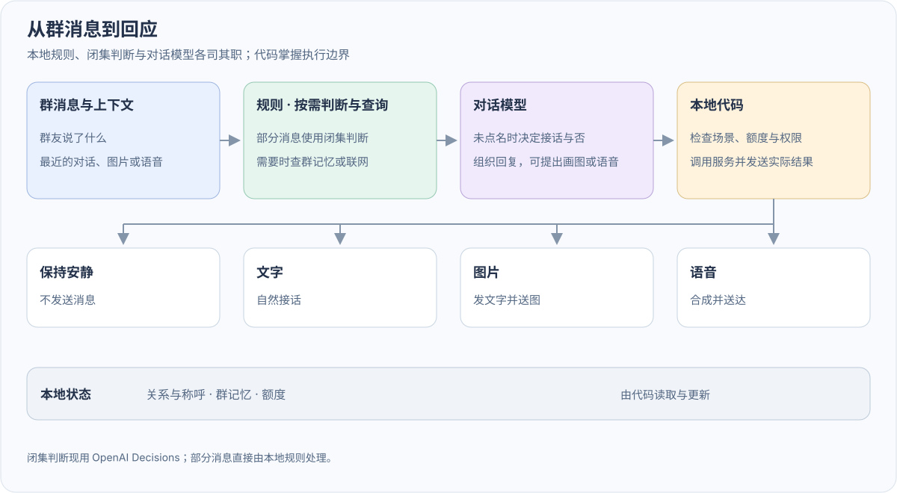
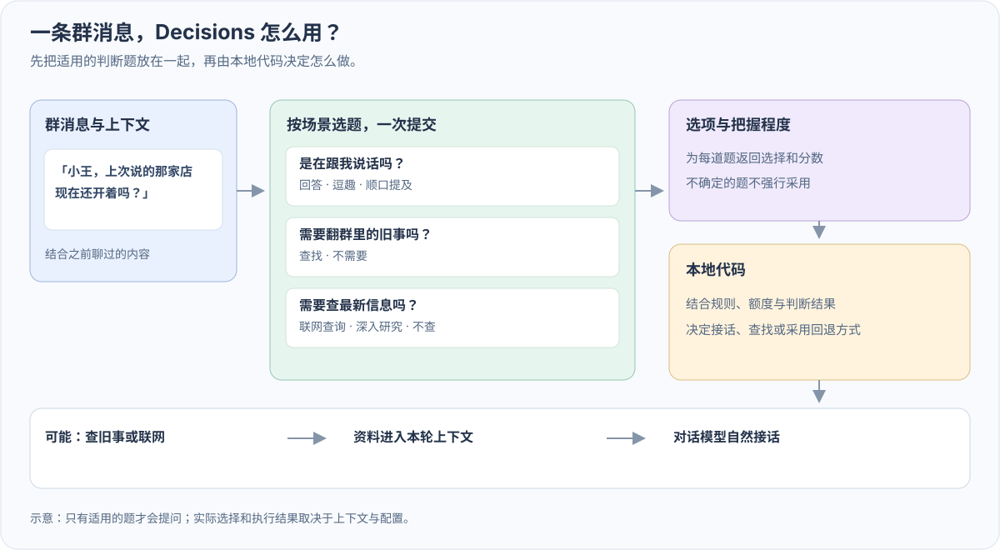
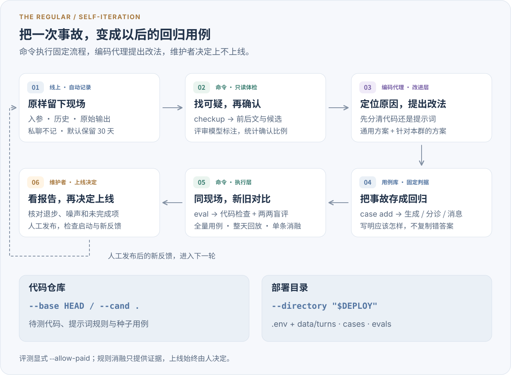
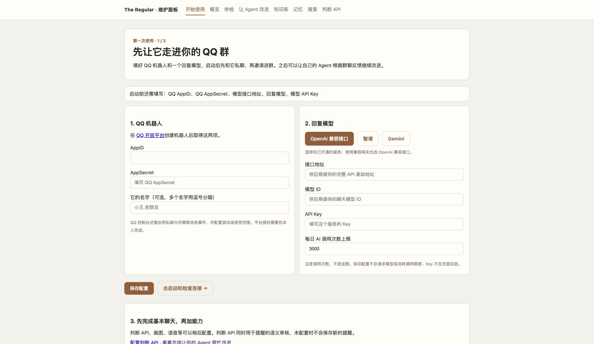
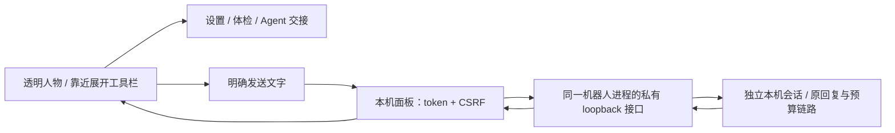
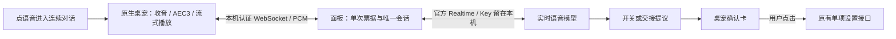

# 架构与设计

[返回项目首页](../README.md) · [第一次使用](getting-started.md)

这里收录旧版 README 的完整技术介绍：消息流、Decisions 输入、自迭代、实现边界、验证依据与文档索引。面向使用者的介绍与快速开始见项目首页。

老群友住在你的 QQ 群里，认识大家、记得群里的事，也判断什么时候该接话、什么时候该安静。它能接玩笑和纠正，在被嫌烦时退一退；看图、听语音、查资料、画静图或短循环动图、发语音、到点提醒，都要落到代码确认的实际结果。

**每个群都有自己的梗、称呼和相处方式。** 老群友把现场输入、判断和实际结果留下来，让你的编码 Agent 根据这个群的反馈定位问题、修改代码或提示词，再用同一份现场对比新旧版本。你决定哪些改动上线，让它逐步适应你们的群。

这把日常陪伴和持续改进连在了一起：**线上接好眼前这句话，离线把出过的问题变成下一次改动的证据。**

| 链路 | 怎样走 |
| --- | --- |
| 线上群友 | 消息 → 本地整理 → 按需判断与回复 → 执行、送达、记下实际结果 |
| 离线改进 | 现场记录 → 体检与用例 → 改代码或提示词 → 新旧回放 → 人决定上线 |

[群聊互动示意](readme/conversation-cn.svg) · [已有测量与限制](#已有的测量与限制) · [实现与回放设计](self-iteration.md)

<a id="设计亮点"></a>
<a id="架构总览"></a>
<a id="谁说话谁决定"></a>

## 一句话进来之后

代码先去重、认出 @ 和引用，准备图片或语音里的信息。本地规则可以直接结束一轮，不必调模型；需要理解意图时才问 Decisions。回复模型结合上下文决定怎么说，代码负责检查和执行，最后记下真正送达的内容。



这里有三个不同的决定：**本地代码选择路径，Decisions 给出有边界的语义判断，回复模型决定说什么、是否回应，以及要不要提出动作。** 平台 @ 与只喊名字走不同路径；没点名的消息由回复模型自己选择接话或 `〔不接〕`。`〔画〕`、`〔动图〕`、`〔语音〕`、`〔提醒 …〕` 是动作意图，服务、格式、词表、额度和执行结果都由代码核对。模型下一轮看到的是实际结果。

比如「画个打篮球的鸡的动图」：回复模型自己补全短循环动作，代码按 `〔动图〕` 请求 GIF；群友不必提供分镜、帧数或时长。静图和动图共用画图额度，默认使用 GPT Image 2.6 Flare，见[画图与动图配置](image-generation.md)。 已用这句短请求完成真实生成和 QQ 群投递，见[实测记录](gif-acceptance-2026-11-05.md)。

隔一阵主动接话时，模型看到有称呼、时间顺序的近期现场，包括群友原话和机器人实际送达的文字、图片或语音结果；失败和送达未确认会明确区分。针对旧话可以引用原句，群聊恢复活动就跳过本轮，主动发言冷却也会跨重启保留。**主动选择画图或语音暂缓，本次先把现场和文字接话接准。** 见[主动引用](quotes.md#proactive-quote)和[现场修复说明](self-iteration.md#proactive-scene)。

这些决定和当轮输入一起留下来，供[离线改进](#自己迭代把这一圈做成命令)重放。要看模块细节，可展开[详细架构图](readme/architecture-cn.svg)，或读[画图与语音](media-replies.md)、[引用与 @](quotes.md)。

<a id="什么时候开口"></a>
<a id="闭集判断只信排序不信刻度"></a>

## Decisions 究竟看到了什么

Decisions 收到的是**现场 `input` + 一组 `questions`**。`input` 装当前消息、前后文和机器人上一句；每道题有 `instructions`、固定选项及各自的 `description`。它不使用回复模型的「稳定头 → 记忆 → 历史 → 本轮动态」四层格式。

看一个合成场景：群友先问「这个东西是什么？」，机器人阿团答「我不确定这是什么。」；群友没有平台 @，随后说「阿团，我觉得像个茶杯。」。这句点了名字、也在补充上一轮，`addressed` 的期望是 `answer`：接住补充，不等于认定它一定是茶杯。



图中的 `input` 展示的是解码后内容，实际 HTTP 请求会把它编码成 JSON 字符串。`questions` 则另带这样的判断题（下面只展示一道题，题面按原意缩写；内容是合成示例）：

```json
{
  "type": "choice",
  "name": "addressed",
  "instructions": "结合前后文，判断是否轮到机器人接话。（示意缩写）",
  "choices": [
    {"value": "answer", "description": "在向机器人提问、补充或纠正，期待回应"},
    {"value": "quip", "description": "逗它或提起它，短接一句也可以"},
    {"value": "let_it_pass", "description": "群友互聊，或回应会打扰、重复"}
  ]
}
```

题面、选项说明和说明里的语义例子在 [`regular/decision_prompts.py`](../regular/decision_prompts.py)，提醒审核题在 [`regular/reminder_review.py`](../regular/reminder_review.py)，都属于可迭代对象。**改题面用分诊回放；改它能看到的字段、裁剪或前后文构造，要用消息回放。** 题目按场景组合进一次调用，排序和有把握的结果才用于动作，概率刻度另做[校准验证](decision-calibration.md)。完整封装与覆盖范围见 [Decisions 输入说明](self-iteration.md#decisions-input)。

<a id="慢的事先回一句做完再跟进"></a>

## 慢任务怎样回到群里

回复模型也能提出 `〔搜索〕关键词`：代码查一次，把真实结果交回来再让它说话，不必等分诊提前安排。查询草稿不发群，只有任务实际启动后才说在查；命令、分诊和回复模型共用当轮机会，结果阶段不会继续搜。查完仍能接着画图。具体协议见[查询动作与消息时序](lookup-and-timeline.md)。

读图、联网查询和深度研究可能来不及当场完成。只有走慢活路径的任务才进入下面的等待与跟进流程，代码管理任务把手和后续送达。

| 时机 | 群里发生什么 | 代码留下什么 |
| --- | --- | --- |
| 当场能完成 | 直接结合结果回复 | 结果与实际送达 |
| 超过线上等待时间（当前 6 秒） | 先回一句本地进度说明 | 在途任务或可恢复的把手 |
| 后台完成 | 跟进原任务；被动窗口过了尝试主动发言，再不行捎在后续消息上 | 完成状态、关联关系与投递结果 |

到点提醒也用这张任务表，一人每群一条，重启后恢复。现有分诊先识别是否需要问清楚，再由模型提出时间和事项，代码在保存前另做一次语义审核：正常事项和无害玩笑照常记；有实际歧义先问清楚，本轮不存、旧提醒保留；明确借提醒整人或播不当内容，可以接梗，但要说清“这条没记”。审核使用本机面板配置的原生 Decisions，未配置、禁用或暂不可用时先不存，确认并审核通过的新提醒才顶掉旧的。旧版未审核或审核后内容已失效的任务会暂停，重新说清并重定后才继续。

群友可以取消自己的提醒；群主明确说“停止所有定时任务”，会实际清掉**本群所有群友创建的到点提醒**，包括每日提醒和待捎带消息，并作废取消前仍在处理的旧请求和旧确认。其他群、后台维护和承诺催债继续运行，之后仍能新建提醒。协议、读图时序和提醒格式分别见[慢活](slow-work.md)、[先读图再回话](image-before-reply.md)、[到点提醒](reminders.md)。

<a id="怎么迭代的事故--回放--改--回归"></a>

## 自己迭代：把这一圈做成命令

你可以让自己的编码 Agent 围绕这个群的真实反馈改进机器人。一次迭代会产出**候选改动、新的回归用例和新旧对比报告**。线上留下输入、判断与实际送达；`checkup` 只读这些记录、列出可疑片段，独立评审模型另行标注。编码 Agent 据此定位原因并修改，评测命令负责重放与比较，维护者决定是否发布。

**让你的 Agent 接手这一圈**：仓库自带一份自迭代 skill，[`.agents/skills/regular-iterate`](../.agents/skills/regular-iterate/SKILL.md)。Claude Code、CodeX、Gemini CLI 可以读取这份流程（Claude Code 从 `.claude/skills/` 指过去，Gemini CLI 另由 `.gemini/settings.json` 读 `AGENTS.md`）。把小团团出岔子的截图丢给 Agent，或者说一句「看看今天的体检」，它便有找现场 → 存用例 → 新旧回放 → 读报告的现成工具和步骤；上线仍然等你一句话。



沿用前面的茶杯合成场景，**假设**「阿团，我觉得像个茶杯」被判成 `let_it_pass`，最后没接住。可以沿着这条错误看完整个流程：

| 这一轮 | 具体留下什么、比较什么 |
| --- | --- |
| 固定问题 | 保存现场，写明期望 `addressed=answer`；原来的错误选择只作参照 |
| 找到改动位置 | 若题面误解了补充句，改题面并跑分诊回放；若上一句没进入输入，修输入构造并跑消息回放 |
| 同时看修好和改坏 | 新旧版本跑同一份现场，也跑「群友只是提到阿团」等旧用例，防止变成逢名必答 |
| 根据报告再走一圈 | 原例改善但旧例退步，就回到修改；噪声内下降就补抽样；把结果和未覆盖项交给维护者决定 |

每次修复留下的用例会加入后续回归，事故记录和规则出处也供下次修改查阅。**积累的是代码、提示词、用例和改动依据**；发布后的新反馈再进入同一条链。当前维护流程由人触发编码代理：代码改动要跑相关离线测试，回放报告中的退步要交代原因，覆盖缺口要列明，再由维护者决定是否手动上线。完整走读见[一次迭代怎样走完](self-iteration.md#iteration-example)。

可改的不只有聊天措辞。选择什么回放，要看改动发生在哪个边界：

| 可迭代对象 | 主要入口 | 怎样验证 |
| --- | --- | --- |
| 回复人设、语气、输出规则与动作说明 | [`prompts.py`](../prompts.py) | 生成层回放；有账本的规则可单条消融 |
| Decisions 的题面、选项描述与语义例子 | [`regular/decision_prompts.py`](../regular/decision_prompts.py) | 分诊层按待测版本重新取题，检查期望选项 |
| 分诊阈值与选项处理 | [`regular/decisions.py`](../regular/decisions.py) | 分诊层检查有效选择；收敛等后续状态用消息层 |
| 输入字段、上下文裁剪、@ / 引用与路由 | [`regular/decisions.py`](../regular/decisions.py)、[`bot.py`](../bot.py)、[`storage.py`](../storage.py)、[`quotes.py`](../quotes.py) | 消息层回放与直接相关的离线测试 |
| 本地体检的信号、阈值与时间窗 | [`regular/checkup.py`](../regular/checkup.py)、[`regular/tune.py`](../regular/tune.py) | 冻结日志和独立正负标注，对比误报、漏报；训练与验证分开 |
| 旧账检索的匹配、排序与时效 | [`recall.py`](../recall.py)、[`regular/tune.py`](../regular/tune.py) | 检索层重跑冻结语料，对照完整相关消息集合；承诺另用专门判据 |
| 记忆与其他资料的选择、注入 | [`digest.py`](../digest.py)、[`knowledge.py`](../knowledge.py) | 消息层与定向测试；摘要生成和真实工具执行另做验证 |
| 模型、推理参数和任务配置 | [`config.py`](../config.py)、[`providers.py`](../providers.py) | 控制实验配置做对照，回放与任务探针各有覆盖范围 |

四种回放分别是：**生成层**重跑记下来的完整入参，**分诊层**重跑当时的输入与待测题目，**检索层**在冻结归档与承诺快照上重选证据，**消息层**把归档消息交给真实入口、使用假发送。整天回放把当天记录过的回复逐条重新生成，用来找口头禅等整体模式；它不会模拟群友听到新回复后会怎样反应。

**体检器和旧账检索器本身也接受考核。** 新旧策略在同一份独立完整标注上比较：误报是多报了问题或选入无关证据，漏报是没找到已标明的问题或相关证据。报告给出 TP / FP / FN / TN、查准率与召回率，并列出具体错误。只给已检出候选标 `yes/no`、只指定某条证据必须取到，都不足以计算总体漏报率；未标注、快照不全和分母为空会单列，避免把“没有证据”写成“零漏报”。

`tune checkup` 和 `tune recall` 在本地搜索有界的策略参数，0 token；评测与搜索使用的标注保持独立，验证集用于核对改动效果。它们只出报告与提案，维护者执行 `policy apply` 后策略才生效，旧策略保留供回退。范围和数据格式见[本地策略评测](self-iteration.md#local-strategy-evaluation)。

消息用例若预置了 `triage_choices`，会固定那些选择；验证分诊整条链要使用没有预置答案的用例。消息回放也替换了部分资料渲染和媒体执行，不能代替真实服务的 smoke。

内置的自动措辞搜索目前只有 `remind` 和 `banter` 两个目标；后者改的是聊天生成的接话说明，Decisions 题面需要编码代理修改后再评测。安全、隐私、状态归属和调用预算仍是代码守住的硬约束。详细边界见[可迭代对象](self-iteration.md#iteration-surfaces)。

[Harness² 的八类组件](self-iteration.md#harness2-components)与这里的四层提示词、四种回放是不同维度。按机器人运行时严格对应，系统提示、约束、记忆、工具说明四类有直接对应；脚本和插件的部分职责由固定本地代码承担，不代表开放了模型执行脚本或插件循环；机器人内部没有再放一套子代理与技能系统。

<details>
<summary>维护者：回放命令、统计判定与已有验证</summary>

在代码仓库中执行，`DEPLOY` 指向线上 `.env` 和 `data/` 所在；`--base` / `--cand` 选择代码版本。

```bash
DEPLOY=/path/to/regular-bot
.venv/bin/python -m regular --directory "$DEPLOY" checkup --day today
.venv/bin/python -m regular --directory "$DEPLOY" case add --turn <turn_id> --id <case_id> --must-not "刚醒|洗衣"
.venv/bin/python -m regular --directory "$DEPLOY" eval --base HEAD --cand . --cases all -n 4 --allow-paid
.venv/bin/python -m regular --directory "$DEPLOY" eval --base HEAD --cand . --day today --allow-paid

# 本地策略评测和调参：不请求模型
.venv/bin/python -m regular --directory "$DEPLOY" tune checkup --benchmark docs/examples/checkup-benchmark.example.json
.venv/bin/python -m regular --directory "$DEPLOY" eval --base HEAD --cand . --cases retrieve -n 1
.venv/bin/python -m regular --directory "$DEPLOY" tune recall
.venv/bin/python -m regular --directory "$DEPLOY" policy show
```

没有 `turn_id` 时可用 `case add --message <message_id> --id <case_id>`；分诊用例要用 `--choice addressed=answer` 这类判据写明应该怎样。`checkup` 只读本地日志、不调模型；标注另由独立评审模型完成。生成、分诊、盲评等会调用模型的 `eval` 需要 `--allow-paid`；仅含本地检索且没有模型评审的评测无需授权付费。上面的体检示例是合成数据，用来体验命令，不代表线上效果。

生成与盲评的下降要过单侧检验才算退步，够不上的单列「噪声内下降」，可加大 `-n` 再看；越线一次就算退步。检索是确定性计算，判据通过率下降或完整标注下 FP / FN 增加直接记退步，不用重复抽样消噪。规则消融给出「可删除 / 仍需保留 / 说不准 / 判断不了」四种结论，缺用例或没跑完都不能建议删除。人设和规则的修改不会自动上线。

已有小规模验证：同一版本对同一版本（4 条用例各抽 4 次），0 条退步、2 条噪声内下降；第一次体检真实一天，顺着「被纠正」找到当天 4 条记账标签泄漏并修复。完整历史用例集与更长时间的线上观察仍待验收。设计借鉴 [Dream-RSI](https://arxiv.org/abs/2609.14858) 的历史回放和 [Harness²](https://arxiv.org/abs/2610.14224) 的新旧对比，完整流程见[自迭代设计](self-iteration.md)。

</details>

<a id="四层提示词按稳定度排吃满前缀缓存"></a>
<a id="状态与记忆代码持有模型只负责说人话"></a>
<a id="成本隐私与可靠性"></a>

## 状态、成本与隐私的边界

| 边界 | 代码怎样守住 |
| --- | --- |
| 状态有来源 | 称呼、关系、承诺、心情、额度与任务由本地代码维护；个人原话逐字绑回归档，最多按需带入两条 |
| 上下文有顺序 | 稳定头 → 每日记忆 → 会话历史 → 本轮动态；随人和轮次变化的内容只放最后 |
| 调用有上限 | SDK 自动重试关闭；显式候选、尝试上限、单次与整轮超时，以及全局和各能力日预算 |
| 资料有边界 | 工具单步、显式，搜索只读结果标题 / 摘要 / 链接；外部资料按不可信证据包装 |
| 隐私与出口 | openid、群号不进模型上下文和群回复；记忆、归档、知识库出口过敏感词；维护面板只绑定 127.0.0.1 |

判断和回复所需的群聊内容会发给相应模型服务，部署前应结合群成员预期选择服务。机器人定位是常驻群友，具备固定接口的能力；改代码和工具链由外接编码代理在维护流程里完成。具体取舍见[交情与个人证据](personal-memory.md)、[判断层隐私说明](judgment-layer.md)和[供应商与成本](providers.md)。

## 已有的测量与限制

| 已有证据 | 测量范围 |
| --- | --- |
| 2,100+ 项离线回归用例 | 2026-11-07 收集 2143 项；验证代码行为，不等于每句话都能接对；各环境执行结果见 [CI](https://github.com/dubianche123/the-regular-qq-bot/actions/workflows/ci.yml) |
| 旧账检索 8 / 8 用例判据通过，相关证据取回 7 / 9 | [合成完整标注集](self-iteration.md#local-strategy-evaluation)；新旧结果一致，预算约束造成的 2 条漏检如实计入 |
| 接住 17 / 20 条没带名字但冲它说的话，旧方案 3 / 20 | [141 条消息、9 种写法回放](when-to-reply.md)；「该接 / 不该接」由独立评审模型标注 |
| 回复输入 token 的 75.6% 命中前缀缓存 | [线上一天 261 次调用](providers.md)，与该模型和当时流量有关 |
| 闭集分诊中位延迟 0.71 秒 | [908 次判断](judgment-layer.md)，不作为服务时延保证 |
| 到点提醒时间与对象 60 / 60 | [10 种说法各 6 次回放](reminders.md)，覆盖的是该批样本 |

更早的迭代还包括[读图故障的三种原因](image-before-reply.md)、[三家模型分工对比](model-roles.md)和[1082 条请求的模型事后标注](request-sincerity.md)。这些数据记录的是具体条件下的改进与代价，持续效果仍需后续未见样本和线上观察。

## 开始使用

先安装 **Python 3.10 或以上**，再从 [GitHub Releases](https://github.com/dubianche123/the-regular-qq-bot/releases/latest) 下载 **Source code (zip)** 并解压。也可以用 Git 克隆仓库。启动文件需要完整源码，wheel 安装包不包含这套源码入口。

1. **打开桌宠，从工作台进入面板。** Windows 双击 `start.bat`；macOS 双击 `start.command`；Linux 在解压目录运行 `bash start.sh`。首次启动会创建本地 `.venv` 并安装依赖，先显示透明人物；靠近后点击「工作台」。原生组件不可用时提示使用网页。安装和排错见[新手指南](getting-started.md)。
2. **完成两个连接。** 在「QQ 连接与身份」填写 QQ `AppID`、`AppSecret` 与名字，在「模型与能力 → 聊天」连接服务、选择模型。接口地址、备用模型和用量放在展开项里，判断也在同页配置。保存不调用模型；密码留空会保留已有值，QQ 与聊天新配置下次启动机器人时生效。
3. **明确点击启动。** 在「我的群友」点击「启动机器人」，等页面显示实际 **已连上 QQ**。仅打开网页、保存配置都不会连接 QQ。保持面板服务的终端开启；关网页不停止机器人，退出面板服务会停止它自己启动的机器人。
4. **由你先私聊，再进群。** 在 QQ 开放平台启用私聊与所需群消息事件、配置测试或使用范围；首次非空私聊会认主，请你先发。拉进群并允许接收群消息后，用 @ 或配置的名字试一句。

默认私有实例放在 **`~/.the-regular`**，与下载的源码分开；重复启动沿用该目录，不自动接管已有部署。也可用 `REGULAR_INSTANCE_DIR` 或启动器 `--directory` 指定。完整安装、Windows 命令、再次启动和问题排查见[第一次使用指南](getting-started.md)。



安装完成后，可以先离线体验，不需要 QQ 账号或 API Key：

```bash
# macOS / Linux；Windows 使用 .venv\Scripts\python.exe
.venv/bin/python -m regular demo
```

面板「体检」只读本机记录；「让 Agent 改进」提供操作步骤和可下载的交接说明，把源码目录、实例目录和迭代流程交给你自己的编码 Agent，不会自动控制 Agent。源码 ZIP 没有 Git 历史，比较时使用基线与候选目录；wheel 用户先获取源码工作区。

| 命令 | 做什么 |
| --- | --- |
| `regular demo` | 离线体验，走的是生产的消息处理链路 |
| `regular setup` / `init` | 配置向导 / 只生成私有 `.env` |
| `regular doctor` / `status` | 本地体检 / 读运行时状态快照 |
| `regular --directory ~/.the-regular panel --open` | 打开本机配置与维护面板（只绑 127.0.0.1） |
| `regular service` | 生成 launchd / systemd 定义（不自动安装） |
| `regular coverage` / `calibration` | 只读统计：个人原话覆盖率、判断概率对照实际结果 |

判断接口、联网、识图、语音和画图需要对应服务和配置。配置方法见[供应商说明](providers.md)、[示例配置](../.env.example)和[画图说明](image-generation.md)。

面板只会停止它自己启动的机器人；已有终端、launchd 或 systemd 进程在这里仅查看状态，由原来的方式管理。

发布后用 `regular --directory <部署目录> status --json` 核对运行进程写出的 `code.release`、`code.source_root` 和 `image_generation`。除 QQ 网关就绪外，代码版本、来源目录和动图能力也应与预期一致；固定发布目录的服务还要同步更新 `PYTHONPATH` 并重新加载服务定义。

## 设计文档

| 主题 | 文档 |
| --- | --- |
| 判断交给谁 | [判断层](judgment-layer.md) · [概率校准实测](decision-calibration.md) · [叫到我不等于要我答](addressing.md) · [引用和 @](quotes.md) |
| 什么时候开口 | [没叫它的时候](when-to-reply.md) · [何时介入（旧方案存档）](when-to-intervene.md) · [真托付还是整活](request-sincerity.md) · [岔开话题别换台](deflection.md) |
| 能力与动作 | [画图与语音](media-replies.md) · [图像生成配置](image-generation.md) · [先读图再回话](image-before-reply.md) · [画图前看一眼](drawing-guard.md) · [到点提醒](reminders.md) |
| 异步 | [慢活：先回一句，做完再跟进](slow-work.md) |
| 记忆与观察 | [交情与个人证据](personal-memory.md) · [互动观察](interaction-observations.md) · [自己迭代](self-iteration.md) |
| 模型与供应商 | [三家模型各司其职](model-roles.md) · [供应商配置](providers.md) |
| 总览 | [设计笔记](DESIGN_NOTES.md) |

[MIT License](../LICENSE)


## 本机聊天与桌宠

桌宠是默认入口，网页工作台承接设置与维护。`regular pet`（或无子命令）先认证并复用同实例面板；没有时才启动一个仅本机 UI 服务，有界等待就绪，不启动 QQ。关闭人物后，本次新建服务继续在原终端受管理，Ctrl+C 结束；已有外部面板不受影响。

网页和桌宠只负责显示与输入。机器人进程在同一个事件循环里开启一个仅监听 `127.0.0.1` 的私有接口；面板转发明确发送的文字，回复仍走已有会话锁、四层提示词、Provider 预算和实际送达提交。面板不会再创建一份聊天状态。



本机会话没有 QQ 身份，不走 C2C 自动认主，不附带 QQ 群目标，也不执行模型输出的媒体或提醒动作。连接文件含随机私有 token、PID 和本机临时端口，仅本机读取且权限为 0600；面板核对进程和状态新鲜度，不跟随重定向，不自动重试。开启、关闭人物不会启动或停止机器人。

桌宠实时语音走独立链路，直接使用官方 Realtime 音频会话，不先转成文字再调用普通聊天。打开语音卡后持续收音，单个全双工声卡流使用实际播放内容作为 AEC3 回声参考；面板持有 Key，原生端通过 CSRF 换取 30 秒单次票据，再用认证 WebSocket 双向传音频。服务端 VAD 判断一句话是否说完；插话时立即停播，并按实际播放时长截去尚未听到的部分。浏览器聊天仍使用上面的文字链路。



协议由 `regular/realtime_voice.py` 管理，票据和生命周期在 `regular/panel_voice.py`，原生声卡与网络在 `regular/desktop_voice.py`。不保存录音，不加载 QQ 聊天原文；语音历史只在本次会话内。`voice_budget.Budget` 的独立 `desktop_realtime` 类别按轮持久预留；持续模式在创建回复前计次，纯静音等待或取消不耗轮数，旧按住模式仍在上传前计次；每轮输入 20 秒、输出 30 秒，整段 180 秒、12 轮，默认日限 30 轮。这是调用次数与时长边界，不能视作金额预算；断线或失败不会自动重连。语音管理只返回确认卡，不执行工具循环，点击确认后才写配置。[使用方法](companion.md#直接和她说话)。

语音卡打开即连接并收音，静音阻止麦克风音频外发，关闭才释放声卡。10ms 的全双工回调使用 WebRTC AEC3 抵消扬声器回声，校准 ADC/DAC 时间差；不以静音假装能边听边说。播放器保留 120ms 起播缓冲及 100ms 声卡目标延迟，短回复直接播放尾包。打断按实际 DAC 语音帧计算，不把缓冲静音算成已听内容；异常日志仅含设备欠载、网络缺料及帧数。流式字幕在同一气泡更新累计文字，不重新启动打字动画。[AEC 封装与示例](https://github.com/strands-labs/pywebrtc-audio)。

本机聊天同时承担有限的管家入口：每轮动态层附上能力状态与今日交互数量，模型最多提出一项开关调整或 Agent 交接。`regular/local_chat.py` 解析固定提议，网页与桌宠显示确认卡；用户点确认后才通过本机认证与 CSRF 写入单项开关。`regular manage` 为编码 Agent 提供同一份状态与配置接口，代码修改、评测与部署仍由外部编码 Agent 按自迭代流程完成。能力开关对新请求生效，聊天、读图、画图、语音的服务地址、模型和额度等在机器人下次启动时加载，判断配置由后续判断动态读取，详见[模型与能力](capabilities.md)。

桌宠分两层：`regular/pet_brain.py` 是纯计算的大脑，持有行为计划、站/坐/躺过渡、重力与落地、拖拽单摆、摸头/戳/投喂和 agent 事件映射，不依赖 Qt；`regular/desktop_pet.py` 是 Qt 外壳，每帧把指针和时间喂给大脑，再按 `pose()` 画精灵帧与程序变换。人物、点击穿透的特效层、对话气泡和侧边快捷栏是独立透明窗口；人物窗口只在落地静止时按当前帧 alpha 设遮罩，拖拽和下落时取消遮罩以免旋转被裁。静止 30 fps、移动 60 fps。

agent 状态只读：面板的 `/companion/presence` 由 `regular/presence.py` 读 `status.json`（在线与新鲜度）、`state.json` 的 `mood`（`activation.mood_from_state` 同一半衰期）、作息和当天交互日志尾部 128 KB，映射成 `mention / replying / said / chimed / proactive / searching / drawing / drew / singing / voice / media_end` 与群内 5 分钟消息数（`searching` 来自查询转后台时的 `lookup` 行，`drawing / singing / media_end` 来自机器人在开始画、开始录和没发成时记的 `media` 行），不返回文字、群号、openid 或消息 ID。`POST /companion/cue`（token + CSRF）让编码 Agent 在固定动作表内让桌宠表态，只存在面板内存，不触达 QQ。

大小、地面横坐标、「待在原地」和动作偏好只写实例的 `data/desktop-pet.json`，调整或退出时原子保存，不随每一帧写盘；旧版 `position` 格式自动迁移。地面取人物所在屏幕的可用区域底边，外屏断开也会落回现有屏幕。

动作素材是 `regular/assets/pet` 的 24 条 WebP 动作条与 `sprites.json`（统一 360px 画布、头部列与脚底锚点），由 `tools/pet_sprites.py` 从生成的动作表切帧对齐；帧序列与 fps 在 `pet_brain.CLIPS`，网页端渲染同一份表。关闭动态效果时不走动、不跳跃、不出粒子，只切姿势。退出用 `QApplication.exit()`：macOS 上 `quit()` 经 NSApp terminate 直接结束进程，启动器来不及停掉本次开启的面板。使用说明和参考项目见[桌宠与本机聊天](companion.md)。

控制台按用途收成两个入口：「QQ 连接与身份」（`/setup`）和「模型与能力」（`/capabilities`）。QQ 表单通过 `instance_settings.save_identity` 只改身份字段，改名字不会切换聊天服务。模型页将聊天、判断和四项媒体能力列在一起，默认显示摘要，需要编辑时才展开；旧 `/decision` 书签转到同页的判断行，搜索检查保留诊断路径，不占主导航。

聊天选择对应实际 `CHAT_PROVIDER` 与该家 `*_MODELS` 的首项。控件使用真正的 `select`，候选来自本机已配置调用链；「填写其他模型」才展开自定义 ID 输入，不为生成列表请求模型元数据。把旧备用提为首选会保留原首选为备用，显式修改备用列表时以用户输入为准。保存同步聊天服务，避免旧覆盖项悄悄指向别家。聊天页从新鲜且 PID 匹配的状态行显示运行进程的首选，与待下次启动生效的配置区分。

判断仍使用独立的原生 Decisions 协议，但凭据只有一份：聊天设置里的 `OPENAI_API_KEY`（或 `api_keys_openai.txt`）。`decision_api.json` 只存 endpoint / model 和 `credential: "shared"`，不复制 Key；判断请求在发出时才由 `capabilities.key_for_endpoint()` 读取当前 Key，所以换 Key 只改一处、下一次请求就生效。读图、画图、语音与桌宠连续语音同样从这一处解析。仅当目标端点与聊天 `OPENAI_BASE_URL` 完全相同时才交出 Key，指向别家服务一律拒绝，避免凭据外发；确需另一家服务时仍可在 `.env` 里配置专用 Key。密钥不回显到页面、日志或仓库。旧版 `decision_api.json` 里已经存过的 Key 按专用凭据继续读取。

知识库仍是维护者管理的 Markdown 文件，不新增群聊写库权限或向量数据库。默认界面按适用范围列条目；新增或编辑经过预览、确认保存，删除也先确认，完整原文编辑收在高级入口。条目修改按原始标题区段替换，保留其他区段、注释及未解析的原文；保存核对预览时文件的版本，冲突要求重新预览。模板只是未保存的草稿。按现有标题、关键词与群内/共享优先级检索，敏感条目仍在解析出口跳过。
