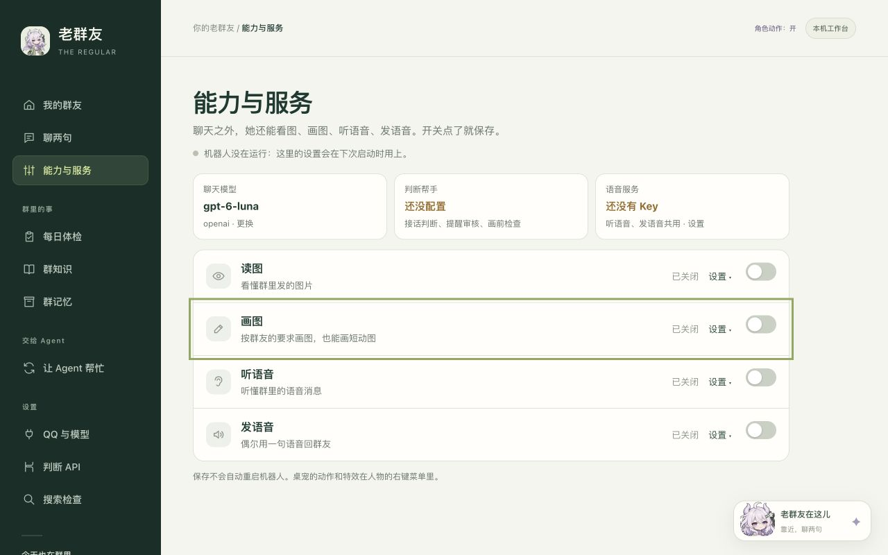

# 能力与服务

在控制台左侧打开「能力与服务」。一屏能看完：顶上三条是共用的服务（聊天模型、判断帮手、语音服务），下面四项能力一行一个——名字、一句话状态、开关。

## 怎么用

- **开关点了就保存**，只写那一项。运行中的新版机器人对新消息立即生效；旧进程要更新并重启后才认。页面顶部那一行会说清楚现在是哪种情况。
- **状态一句话**：「已配置 · 模型名」「还差生图 Key」「已关闭」。点开那一行才看到设置；缺什么在展开后列全。
- **设置单独保存**：模型、每日上限这类在展开的表单里，点「保存××设置」才写入，下次启动机器人时读取。保存设置不会动开关。
- **高级**：接口地址、尺寸、Node 和 SILK 路径收在每项的「高级」里，平时用不到。
- 动图、模型转写是子开关：父开关关掉时它们变灰，也不会单独生效。

## 共用的服务

| 项 | 在哪里改 | 说明 |
| --- | --- | --- |
| 聊天模型 | 设置 → QQ 与模型 | QQ 与本机聊天共用 |
| 判断帮手 | 设置 → 判断 API | 接话判断、提醒审核、画前检查；没配时照常画 |
| 语音服务 | 本页「语音服务」那一条 | 听语音和发语音共用一份官方 OpenAI 语音 Key，只填一次 |

“已配置”表示参数齐备；账号的模型权限和额度以实际服务返回为准，页面不会为检查这些调用模型。

## 只想文字聊天

把读图、画图、听语音、发语音四个开关关掉即可。听语音开着、关掉「QQ 没带文字时用模型转写」，就只用 QQ 随消息带的转写，不额外花钱。

## Key

密码框从不显示已有密钥，留空保存会保留原值；关掉能力不会删除密钥。生图可填专用 Key；只有地址对应时才沿用已有 OpenAI 或判断服务的 Key，换接口地址时要一起填新 Key。

## 也可以让她或编码 Agent 来开关

桌宠和「聊两句」里说「先别画了」，她会弹出确认卡，你点了才执行（见[桌宠说明](companion.md#本机聊天她也是你的管家)）。编码 Agent 用 `regular manage` / `regular manage set image off` 读写同一套开关。

配置只保存在实例的私有 `.env`，密码和 Key 不进入模型上下文。启动环境覆盖的项会在那一行提示，开关变灰，保存文件无法覆盖它们。
