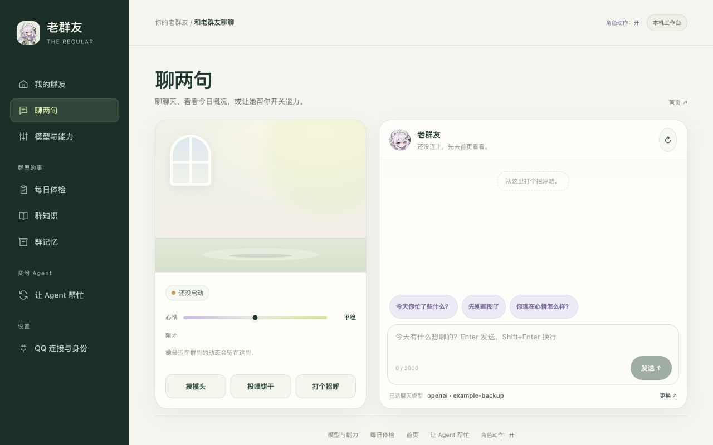

# 在桌边也见到老群友

双击启动文件，Q 版老群友从屏幕上方掉下来，落在 Dock / 任务栏上方。之后她自己过日子：走来走去、坐下喝茶、看书、抱着电脑敲字、伸懒腰、困了就趴下睡一觉。她演的不是随机动画，而是**小王此刻在 QQ 里的真实状态**：群里有人@她，她掏出手机；她在群里接了话，她开口；群友让她画图，她捧着速写本一直画到图发出去；让她发语音，她拿起麦克风唱到发出去；机器人停了或夜深了，她打着哈欠睡过去。

鼠标靠近，她转头看你，身旁浮出一个小圆盘：来击个掌（玩一下）、聊两句、语音、她最近在忙什么、更多（投喂、大小、工作台都在「更多」里）。通知和「更多」都是点开看一下就走的浮层，点别处或切到别的应用会立刻收起。切换到其他应用，人物仍留在桌面。

## 第一次打开

按[第一次使用](getting-started.md)下载、解压，运行系统对应的启动文件。启动器准备本机服务和桌面组件，不会自动连接 QQ 或调用模型。

macOS 的源码启动器会准备独立的「老群友.app」，使用角色头像与自己的应用名称。首次需要安装构建组件，之后复用本机缓存，源码更新时重建；它使用当前安装环境，并非可搬到另一台机器的公证安装包。开发时可用启动器 `--no-app` 保留 Python 调试入口。普通命令行和无桌面服务器不需要应用构建组件。

1. 靠近人物，从「更多」打开工作台。在「QQ 连接与身份」填 QQ 凭据和名字；官方 OpenAI 在「模型与能力」顶部填 Key，先沿用项目预设，其他服务再展开「聊天」选择模型。
2. 保存后回到「我的群友」，点击「启动机器人」。
3. 等实际显示「已连上 QQ」，由你先发第一条非空 QQ 私聊完成认主。

缺少原生组件或没有图形桌面时，会提示使用网页入口。网页版提供相同文字对话和设置，角色同样会动（呼吸、眨眼、悬停挥手、跟着小王的状态换动作），但不是系统透明悬浮人物。也可以把[安装提示词](agent-setup.md)交给自己的编码 Agent。

已安装的环境可以直接运行：

```bash
# macOS / Linux；Windows 使用 .venv\Scripts\python.exe
.venv/bin/python -m regular --directory ~/.the-regular pet
```

不需要预先打开面板。若同一实例的面板已经运行，会认证后复用；没有时先开启仅监听 `127.0.0.1` 的本机面板。端口不同时加 `--port`；`pet --browser` 使用紧凑网页。服务器只需网页时，运行 `regular panel --open`，无需安装桌面组件。

wheel 安装用户需要桌面时选择 `the-regular[desktop]`；源码用户可运行 `.venv/bin/python -m pip install ".[desktop]"`。

## 和她怎么玩

「聊两句」里的摸头、投喂和桌宠共用一份心情，刷新网页也不会抹掉刚刚的效果。
这是几分钟内会慢慢回落的好心情；群里的关系与好感仍由平时相处积累。

| 操作 | 她的反应 |
| --- | --- |
| 鼠标靠近 | 停下脚步、转头看你；旁边浮出一圈五个按钮（玩 / 聊 / 听 / 她在忙啥 / 更多），移开 0.7 秒后收起。待久了会挥手打招呼 |
| 「玩一下」 | 一局**连点**的击掌接龙：点一次圆盘开局，她会一次次抬手，你一直点，反应窗口越来越短；停手就结算这一轮（连击数 + 最高纪录），满 8 下自动收工。一局里所有点击都归游戏，不会再顺手放别的小动作 |
| 双击 | **不再弹出聊天输入条**。连点和击掌接龙都靠点击，双击绑对话框会抢走它们；聊天只走下面那个「聊两句」按钮 |
| 单击头上 / 身上 / 脚边 | 头上＝被摸头眯眼笑；脚边＝歪头看你；身上＝从上面那组小动作里轮一个。所有反应都只动头、一只手和眼皮，**不抬脚、不背过身、不指人、不生气**；连点也只会换个动作，坐着时原地一抖、应一声 |
| 摸头 / 喂一块饼干 | 不只是播动画：会真的抬高她此刻的心情，影响接下来随机做什么、走路多快。摸头 45 秒、饼干 90 秒各自冷却，总加成最多 +0.6，约 5 分钟自己消退；冷却中、到顶了、吃撑了她都会直接说出来。群里那份心情统计始终只读，不会被桌宠改写 |
| 在头顶来回晃鼠标 | 和点击头上一样，被摸头、冒小心心 |
| 圆盘的「聊两句」 | 头顶弹出输入条；发出去后她托腮思考，回复用对话气泡逐字说出来。打开聊天会取消正在进行的击掌接龙，但不算失手、纪录保留 |
| 「语音」 | 打开后直接聊，说完自动回应，也能插话；按钮静音，关闭结束 |
| 拖起来 | 举着双手被拎在半空，腿跟着拖动方向晃；松手按重力掉回地面，甩太狠只会哆嗦一下；往上甩会撞到屏幕顶（菜单栏下沿）弹回来，不会飞出视野 |
| 「她在忙啥」 | 她最近在忙什么：被@、接话、画图、本机聊天和连接变化（只记类型，不显示群聊原文）。再点一次、点别处或切到别的应用都会收起 |
| 「更多」/ 右键 | 同一个自绘面板：人物大小（点一下换一档，60%–150%）、待在原地不乱跑、动作和特效开关、投喂一块小饼干、刷新状态、打开工作台、退出。和通知互斥，再点一次或点别处就收起 |

大小、位置（在地面上的横坐标）、「待在原地」和动作开关记在实例的 `data/desktop-pet.json`。旧版保存的位置会自动迁移。

### 直接和她说话

在「模型与能力」顶部连接官方 OpenAI，换这把共享 Key 不会更换聊天服务；在「发语音」选实时语音模型和音色。点桌宠旁的「语音」，首次允许麦克风后就能**直接说话**：说完自动回应，她没说完也可以开口插话。按钮可随时静音或取消静音，右上角 × 结束会话。连接失败时，同一个按钮可以重新连接。

语音卡打开后持续收音，切到其他应用也能继续聊。音频在本机做回声消除后送到你配置的官方 OpenAI 服务，回复边生成边播放；字幕直接补充新文字，不会从头重播。静音时不上传麦克风音频，系统麦克风指示可能仍亮；关闭语音卡才会释放设备。桌宠不保存录音，也不把对话发到 QQ。浏览器的「聊两句」保留文字入口。

每次连接最多 3 分钟、12 轮，每轮最多说 20 秒，回复最多 30 秒；默认每天 30 轮。日限在「模型与能力 → 桌宠语音」调整，设为 0 可停用。它与 QQ 的「听语音 / 发语音」开关独立，不需要 QQ 在线，也不依赖 QQ 的 SILK 编码组件。失败后不会自动重连或补发。

语音可以提出能力开关或 Agent 交接建议，仍然要你点确认卡才执行。语音会话独立于文字聊天和 QQ 历史，只参考本机开关及今日活动计数；不要把它当作读过群聊全文的总结。

关闭聊天条只收起聊天，退出人物不停止面板或机器人。若这次启动新开了面板，原终端会继续托管服务；要结束本次服务，在该终端按 Ctrl+C（或向它发 SIGTERM），会连同本次开启的面板一起退出。退出面板会停止它自己启动的机器人；外部 launchd / systemd 或其他终端管理的机器人仍由原入口管理。

## 她演的是小王的真实状态

桌宠每 3 秒向本机面板读一次 `/companion/presence`。面板只读机器人本来就写在本机的文件，压成几个粗粒度信号，**不返回任何聊天文字、群号、openid 或消息 ID**，也不调用模型：

| 小王那边 | 来源 | 桌宠 |
| --- | --- | --- |
| 群里有人@她 / 喊她名字 / 引用她的话 | 交互日志 `incoming`（`at` + `call`） | 掏出手机、头顶冒「!」，三种叫法说的话不一样：「群里有人@我，我去看看。」「嗯？好像有人在说我。」「有人引用了我刚才那句。」旧版机器人不记 `call`，只说「有人在群里叫我！」 |
| 决定接话、正在生成 | 交互日志 `decision`（`selected`） | 低头敲手机（坐着时敲电脑），直到发出去或 40 秒超时 |
| 当场没查完，先回了「我去查查」 | 交互日志 `lookup`（`background`） | 「我去查查～」，坐下抱着电脑查，直到查完那句发出去（最长 5 分钟）；查完要画就接着拿速写本 |
| 回了一句 / 没人叫她也插了一句 / 主动开话头 | 交互日志 `delivery`（`reply` / `banter` / `proactive`） | 开口说话；只有真插嘴才说「插了句嘴」 |
| 开始画图 / 动图 | 交互日志 `media`（`started`） | 捧着速写本一直画；先发出的「我画画看」和中途有人@她都不打断，只抬头冒个「!」。被戳、被拎起来或本机聊完，会接着画 |
| 图发到群里了 | `delivery` 的 `image` 路线 | 举起速写本给你看，冒星星：「画好啦，发群里了！」 |
| 开始录语音 | 交互日志 `media`（`voice`、`started`） | 拿麦克风唱，头顶飘音符 |
| 语音发到群里了 | `delivery` 的 `medium: voice` | 收个尾：「（在群里发了条语音）」 |
| 图或语音没发成 | `media` 的 `failed` / `unconfirmed` | 放下本子或麦克风；小王在群里补的那句照常开口说。最长陪画 200 秒、陪唱 90 秒，超时也会放下 |
| 心情（-1 烦 ~ +1 顺） | `state.json` 的 `mood`（只读，按同一半衰期回中）；摸头 / 投喂另叠一层会消退的 `warmth` | 心情好更爱蹦跳、唱歌、走得快；烦了多张望、走得慢 |
| 作息 | `activation.circadian` | 深夜、午后更容易犯困睡觉；早上爱伸懒腰。但她就是小王：群里刚有她的动静（被@、在回、刚说完、在查、在画）的 3 分钟内不会挑打盹，睡着时小王在群里一有动作就醒 |
| 群里热不热闹 | 最近 5 分钟收到的消息数 | 越热闹越常低头看手机 |
| 机器人停了 / 状态过期 | `status.json` | 说一句「我先眯一会儿」然后睡觉；恢复后揉着眼睛坐起来、爬起来打个哈欠 |

旁白气泡按类型限频（被@至少隔 40 秒、接话隔 75 秒），不会盖住你们的本机聊天回复。

`lookup` 行在查询转后台时记一笔，只有慢活种类（`search` / `research`），不含要查的话；`media` 行由机器人在开始画、开始录和没发成时各记一笔，只有媒介和状态，不含画面描述或要念的字。旧版机器人不写这两种行：图发出去后她照样比划一下，但过程中不会拿本子，语音也认不出来（旧版送达行不带 `medium`）——更新机器人后才有。

## 让编码 Agent 也能叫她

CodeX、Claude Code 这类编码 Agent 维护小王时，可以让桌宠跟着表态。只发给本机已运行的桌宠，不会进 QQ，也不会启动面板或机器人：

```bash
regular --directory ~/.the-regular pet-cue cheer --say "回放评测跑完了，新版更好"
```

可用动作：`wave hop cheer talk think phone laptop draw sing read tea stretch lookaround shy pout startle eat sleep`。不带动作只说一句话也可以；一句最多 120 字。接口是 `POST /companion/cue`，和其他面板写操作一样需要 token 与 CSRF。

## 动画怎么做的

- **素材**：以原画 `regular/assets/mascot.png` 为身份参考，用 GPT Image 2.6 Flare 生成 Q 版定稿，再以定稿和走路表为参照，生成 22 组整张动作表（同一张图里的几帧一致性远好于逐帧重画）。眨眼只编辑待机帧眼睛区域并合回原图，身体零变化。
- **切帧**：`tools/pet_sprites.py build` 按 512px 格子切帧，以头部重心定横向锚点、脚底定纵向锚点，按待机身高统一比例（坐姿特写缩到 0.8），导出 WebP 动作条和 `sprites.json`；`--only wake getup` 只重切指定的几条，别处挑好的动作条原样保留。
- **醒来**：睡着时被戳不再从躺着直接跳到站着跺脚，而是一帧帧演完：抽一下、睁一只眼、揉着眼睛坐起来、迷糊地看你一眼、抱膝、单膝撑起、挠头、打哈欠。坐着打瞌睡时被戳跳过躺下的帧；起身途中再戳只嘟囔一句，不会倒回去重来。慢动作和换姿势的帧之间有 0.1–0.5 秒的淡入，眨眼、走路、跳和被吓到仍然是硬切。
- **互动**：连戳、起床、喂太多、摔狠了这四条路径过去都会触发同一套「抬脚跺地 → 抱臂背身 → 转回来指人生气」的大幅动作，现在全部换成小幅反应：`pout` / `point` 与 `startle` 的转身帧退役，`startle` 只留吓一跳的两帧。新增 `pat` / `highfive` / `peek` / `nod` 四张只动头手眼皮的素材；点击位置（头 / 身 / 脚）从 8 个小动作里用洗牌袋轮换，一轮不重复；「玩一下」改成一局带连击和计时窗口的击掌接龙，不再重复点击的动作池。通知卡与「更多」面板改成点外面即收、互相排斥、失焦也收的浮层。
- **入口冲突**：双击原本会弹聊天输入条，和连点 / 击掌接龙抢同一批点击。现在第二次按下也交给正常点击路径，快速双击仍记两次；聊天只走圆盘「聊两句」和网页工作台。一局进行中所有点击都归游戏，聊天 / 语音 / 投喂打开时取消本局但不算失手。
- **闪烁**：之前每换一帧都做一次交叉淡入，且两帧都按半透明叠画，整个人会短时间变透、出现双影（`pat` 一个动作里连闪 4 次）。现在淡入只在换姿势和起床/入睡演出时发生，同一姿势的动画帧一律硬切；淡入时旧帧保持不透明、只让新帧淡进来，整体不透明度不再掉下去。
- **运行**：`regular/pet_brain.py` 是纯计算的大脑（行为选择、站/坐/躺过渡、重力与落地、拖拽单摆、摸头/戳/投喂、agent 事件映射），不依赖 Qt、可单测；`regular/desktop_pet.py` 只负责画和输入：呼吸起伏、落地压扁、跳跃弧线、拖拽旋转和粒子（z、♪、心、汗、星星）是程序绘制的，静止时 30 fps、移动时 60 fps。
- **网页**：本机工作台的「聊两句」是她的小房间：左边场景里的她跟着 presence 换动作，头顶气泡说她刚做了什么，下方是在线/QQ/作息/群热度胶囊、心情条、「刚才」时间线和互动按钮。摸头、投喂与桌宠共用本机照顾状态，打招呼只播本页动画；右边是对话面板，话题建议只填进输入框、Enter 发送，长回复只在对话区内滚动。每页右下角小助手用同一套动作条和动作表，遵循系统减弱动态和页面上的「角色动作」开关。

在「更多」里关闭「动作和特效」，或启动前设置 `REGULAR_REDUCE_MOTION=1`：不再走动、跳跃和冒粒子，只保留姿势切换。角色动作、拖动和读取状态都不调用模型。

## 本机聊天：她也是你的管家

本机文字复用正在运行的机器人的回复模型、人设、调用上限和会话处理。历史使用独立的本机会话，不与某个 QQ 账号的私聊合并，也不会通过本机输入自动认主。

最近是否被投喂、摸头，以及当前照顾带来的心情，会作为代码提供的只读事实送入这轮本机聊天。
模型可以据此接话，不能自行增加心情或修改关系。



在桌宠或「聊两句」里，她能帮你打理自己，但**只提议、你点了才算数**：

| 你说 | 她会 | 你点确认之后 |
| --- | --- | --- |
| 「今天画太多了，先别画了」 | 回一句，旁边弹出确认卡「关掉『画图』？」 | 和能力页的开关一样写入配置；运行中的新版机器人对新消息立即生效 |
| 「今天群里怎么样」「总结一下日志」 | 照着本轮附上的今日概况说：几个群、多少消息、被叫到几次、回了几句、画了几张…… | — |
| 「这个毛病你改一下」 | 提议交给编码 Agent | 打开交接页，复制说明给你常用的 Agent |

可以调整读图、画图、动图、听语音、模型转写和发语音；你点确认后才保存。今日概况会参考消息数、回复数等记录，不会凭这些数字编出群聊话题。要更换模型或 Key，打开「模型与能力」；画图、语音和群提醒仍在 QQ 使用。

编码 Agent（CodeX、Claude Code 等）用同一套控制，不必打开网页：

```bash
regular --directory ~/.the-regular manage            # 开关、一句话状态、今日概况（JSON）
regular --directory ~/.the-regular manage set image off
```

文字发送给该实例配置的回复模型，和 QQ 回复共用 AI 调用次数上限。一次最多 2000 字；上一句未完成时不会重复发起请求，超时也不自动补发。需要运行支持本机对话接口的新版机器人；旧进程只显示尚未就绪，桌宠不会偷偷更新或重启它。

## 交互参考与实现

交互参考了 OpenAI 的 [Pets 文档](https://learn.chatgpt.com/docs/pets)（透明人物、拖动和独立控件）、Shimeji 一类桌宠的「住在屏幕底边、会走会掉落」，以及 [Open-LLM-VTuber-Web](https://github.com/Open-LLM-VTuber/Open-LLM-VTuber-Web) 的多区域悬停与拖动状态处理。

macOS 上 Qt 工具窗口默认随应用失去激活而隐藏，需显式设置 [`WA_MacAlwaysShowToolWindow`](https://doc.qt.io/qt-6.12/qt.html#WidgetAttribute-enum)；退出时用 `QApplication.exit()` 而不是 `quit()`，后者在 macOS 上会经 NSApp terminate 直接结束进程，来不及停掉本次开启的面板。人物、特效层（点击穿透）、对话气泡和快捷栏是各自独立的透明窗口。状态与数据流见[架构与设计](architecture.md#本机聊天与桌宠)，形象来源见[视觉说明](visual-identity.md)。
