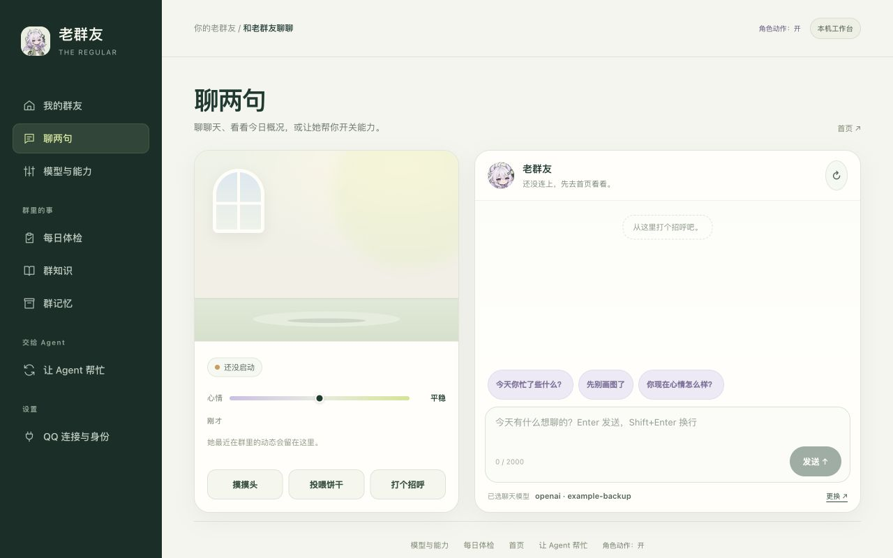

# 在桌边也见到老群友

双击启动文件，Q 版老群友从屏幕上方掉下来，落在 Dock / 任务栏上方。之后她自己过日子：坐下喝茶吃点心、看书犯困、戴耳机听歌、玩掌机、抱着尾巴梳理鳞片，也会趴着托腮看你。群里有事，她就去忙：有人@她，她掏出手机；在读图、听语音，就举图端详、侧耳听；开始画图，她捧着速写本一直画到图发出去。

鼠标靠近，她转头看你，身旁浮出一个小圆盘：换个节目、聊两句、语音、她最近在忙什么、更多（投喂、大小、工作台都在「更多」里）。通知和「更多」都是点开看一下就走的浮层，点别处或切到别的应用会立刻收起。切换到其他应用，人物仍留在桌面。

接下来的人物性格与演出方向见[小团团角色设定](character.md)。

## 第一次打开

按[第一次使用](getting-started.md)下载、解压，运行系统对应的启动文件。启动器准备本机服务和桌面组件，不会自动连接 QQ 或调用模型。

macOS 的源码启动器会准备独立的「老群友.app」，使用角色头像与自己的应用名称。首次需要安装构建组件，之后复用本机缓存，源码更新时重建；它使用当前安装环境，并非可搬到另一台机器的公证安装包。开发时可用启动器 `--no-app` 保留 Python 调试入口。普通命令行和无桌面服务器不需要应用构建组件。

1. 靠近人物，从「更多」打开工作台。在「QQ 连接与身份」填 QQ 凭据和名字；官方 OpenAI 在「模型与能力」顶部填 Key，先沿用项目预设，其他服务再展开「聊天」选择模型。
2. 保存后回到「我的群友」，点击「启动机器人」。
3. 等实际显示「已连上 QQ」，由你先发第一条非空 QQ 私聊完成认主。

缺少原生组件或没有图形桌面时，会提示使用网页入口。网页版提供相同文字对话和设置，角色同样会动（眨眼、悬停挥手、跟着小团团的状态换动作），但不是系统透明悬浮人物。也可以把[安装提示词](agent-setup.md)交给自己的编码 Agent。

已安装的环境可以直接运行：

```bash
# macOS / Linux；Windows 使用 .venv\Scripts\python.exe
.venv/bin/python -m regular --directory ~/.the-regular pet
```

不需要预先打开面板。若同一实例的面板已经运行，会认证后复用；没有时先开启仅监听 `127.0.0.1` 的本机面板。端口不同时加 `--port`；`pet --browser` 使用紧凑网页。服务器只需网页时，运行 `regular panel --open`，无需安装桌面组件。

wheel 安装用户需要桌面时选择 `the-regular[desktop]`；源码用户可运行 `.venv/bin/python -m pip install ".[desktop]"`。

## 和她怎么玩

「聊两句」里的摸头、投喂和桌宠共用一份心情，刷新网页也不会抹掉刚刚的效果。
照顾带来的好心情和被摔后的惊吓都会在几分钟内逐渐消退；群里的关系与好感仍由平时相处积累。

| 操作 | 她的反应 |
| --- | --- |
| 鼠标靠近 | 停下脚步、转头看你；旁边浮出一圈五个按钮（换个节目 / 聊 / 听 / 她在忙啥 / 更多），移开 0.7 秒后收起。待久了会挥手打招呼 |
| 「换个节目」 | 看腻了就换一件事做：从动作库选下一段日常或小剧场。她正在回消息、画图或和你聊天时，会先忙完手头的事 |
| 双击 | 两次点击都有反应；聊天走圆盘里的「聊两句」按钮 |
| 单击头上 / 身上 / 脚边 | 头上＝被摸头；脚边＝看你一眼；身上＝轮换小反应。平常连点不会升级成生气；已经闹别扭时，会轻哼、缩手进袖子或护紧尾巴。坐着、躺着和待在家具上也能摸头加心情，不必站起来；家具上的轻触保持同一姿态 |
| 摸头 / 喂一块饼干 | 不只是播动画：会真的抬高她此刻的心情，影响接下来随机做什么、走路多快。摸头 45 秒、饼干 90 秒各自冷却，总加成最多 +0.6，约 5 分钟自己消退；冷却中、到顶了、吃撑了她都会直接说出来。群里那份心情统计始终只读，不会被桌宠改写 |
| 在头顶来回晃鼠标 | 和点击头上一样，被摸头、冒小心心 |
| 光标在她身前来回大幅晃 | 伏低、晃屁股、扑过去；在她头顶上方晃，她飞起来追。只认故意的来回晃（每次横向至少约 1/8 身高、1.6 秒内折返 3 次），平常移动、手抖、路过都不算 |
| 光标停在她头顶 / 脸前，或在尾巴边逗留 | 歇着的时候：踮脚去够（抓了个空），凑过去戳一戳，或者甩尾巴扫一下。不是每次都理你，同一种十分钟一回 |
| 光标绕着她转两圈 | 转晕了，晃两下 |
| 圆盘的「聊两句」 | 头顶弹出输入条；发出去后她托腮思考，回复用对话气泡逐字说出来 |
| 「语音」 | 打开后直接聊，说完自动回应，也能插话；按钮静音，关闭结束 |
| 拖起来 | 被拎在半空，拖到顶部或底部会换接触动作。贴着四边松手会藏进去，留出可以点击的脑袋；躲久了会打盹。点一下，迷糊地醒醒，再扑翼出来；也可以直接拖走。其他位置松手按重力落下，往上甩碰顶后会继续下落。从离地至少 1.6 个身位的高度松手或抛到同样高度，会明确表现害怕，落地后腿软坐下、抱着翅膀壮胆再站起来。高处摔落或重摔会降低本机心情，惊吓最多 0.6、约 5 分钟恢复；摸头和投喂能安抚她。正常低处挪动、自己飞行和启动入场不扣心情 |
| 点击或拖动小道具 | 有花纹的是球，圆环是金币，菱形是宝石；三种都能拖动，球还能点弹，金币和宝石点一下就收好。右键直接还给她。她闲着也会自己去踢球或捡宝物；星光等短暂特效不挡鼠标 |
| 「她在忙啥」 | 她最近在忙什么：被@、接话、画图、本机聊天和连接变化（只记类型，不显示群聊原文）。再点一次、点别处或切到别的应用都会收起 |
| 「更多」/ 右键 | 同一个自绘面板：人物大小（点一下换一档，60%–150%）、待在原地不乱跑、动作和特效开关、久坐和深夜提醒开关、投喂一块小饼干、刷新状态、打开工作台、退出。和通知互斥，再点一次或点别处就收起 |

大小、位置（在地面上的横坐标）、「待在原地」、动作开关和提醒开关记在实例的 `data/desktop-pet.json`。旧版保存的位置会自动迁移，没有提醒开关的旧文件按开启处理。

### 直接和她说话

在「模型与能力」顶部连接官方 OpenAI，换这把共享 Key 不会更换聊天服务；在「发语音」选实时语音模型和音色。点桌宠旁的「语音」，首次允许麦克风后就能**直接说话**：说完自动回应，她没说完也可以开口插话。按钮可随时静音或取消静音，右上角 × 结束会话。连接失败时，同一个按钮可以重新连接。

语音卡打开后持续收音，切到其他应用也能继续聊。音频在本机做回声消除后送到你配置的官方 OpenAI 服务，回复边生成边播放；字幕直接补充新文字，不会从头重播。静音时不上传麦克风音频，系统麦克风指示可能仍亮；关闭语音卡才会释放设备。桌宠不保存录音，也不把对话发到 QQ。浏览器的「聊两句」保留文字入口。

每次连接最多 3 分钟、12 轮，每轮最多说 20 秒，回复最多 30 秒；默认每天 30 轮。日限在「模型与能力 → 桌宠语音」调整，设为 0 可停用。它与 QQ 的「听语音 / 发语音」开关独立，不需要 QQ 在线，也不依赖 QQ 的 SILK 编码组件。失败后不会自动重连或补发。

语音可以提出能力开关或 Agent 交接建议，仍然要你点确认卡才执行。语音会话独立于文字聊天和 QQ 历史，只参考本机开关及今日活动计数；不要把它当作读过群聊全文的总结。

关闭聊天条只收起聊天，退出人物不停止面板或机器人。若这次启动新开了面板，原终端会继续托管服务；要结束本次服务，在该终端按 Ctrl+C（或向它发 SIGTERM），会连同本次开启的面板一起退出。退出面板会停止它自己启动的机器人；外部 launchd / systemd 或其他终端管理的机器人仍由原入口管理。

## 天气、屏幕边和起飞

**天气联动。** 在控制台首页的「桌宠 · 天气」选一个城市（或和她聊天时打 `/天气 杭州`），她按那里的实际天气挑应景的小动作，二十分钟最多一回；天气刚变（开始下雨、下雪）时先演这个：

| 天气 | 她会 |
| --- | --- |
| 下雨 | 把一只翅膀撑到头顶当伞，伸手接雨，雨从翅膀尖滴下来 |
| 下雪 | 仰头、伸舌头、捧手接雪花 |
| 体感 30°C 以上 | 坐在地上瘫着扇风，然后吹一口冰息冰一杯可乐 |
| 体感 5°C 以下 | 抱着胳膊发抖，往手心呵一口小火暖手，再烤个棉花糖或烘烘围巾 |
| 晴天白天 | 像小龙晒石头一样，坐着张开翅膀晒太阳 |

「变个魔法」也跟着天气走：热天先冰可乐，冷天先烤棉花糖、烘围巾。天气只向 Open-Meteo 发城市名和经纬度，最多半小时查一次，不带群聊或身份；查不到就当没有天气。设置存在实例的 `data/weather.json`。

**屏幕边的小时刻。** 走到屏幕边时，偶尔背靠屏幕边抱着胳膊站一会儿、敲敲屏幕边贴耳朵听听，或者飞上去像蝙蝠一样倒挂在屏幕顶上、裹着翅膀冲你挥手。为了不打扰，二十五分钟最多一回，安静模式下不做。

**起飞。** 先屈膝、把翅膀高高展开，蹬地离地，离地后快速拍翼爬升，平飞和下降换成慢拍；每段接着上一段的速度飞，不在拐点停住再起步。

**魔法看得懂。** 五种日常魔法重画成六拍（想要、准备、施展、见效、享受、收好），道具画大；冰息、火苗、热气、金线这些效果由程序在那一拍从嘴边或指尖发出来，小尺寸也看得清，开场先说一句想做什么（「好热……来点冰的！」）。

## 她会自己过日子

日常活动会连着演：喝茶配点心，读书累了打个盹，四处看看再画几笔。看书、听歌、掌机和理尾巴会陪她待上一阵；活动之间顺着站、坐、趴的姿势接续，最近做过的节目会少选。

新增的日常素材各有四帧：

| 活动 | 小动作 |
| --- | --- |
| 吃瓜看戏 `popcorn` | 抱着爆米花，左右看看、取一粒吃；群里热闹时更常出现 |
| 戴耳机 `headphones` | 闭眼听一会儿，指尖和尾巴轻轻打拍子 |
| 玩掌机 `gamepad` | 双手握着掌机按键，专注一会儿又偷偷笑 |
| 理尾巴 `tail_care` | 抱着尾巴轻抚鳞片，翅尖小幅张开再收好 |
| 趴着托腮 `lie_chin` | 双手托腮看你，眨眼、交替晃晃脚尖 |
| 展开小龙翼 `wing_stretch` | 站稳、稍伸胳膊，轻轻展开翅膀再收好 |
| 扒边框探头 `edge_peek` | 走到屏幕左边或右边，身体藏在外侧、探头看你，待一会儿再走回来 |

除了上面这些经典动作，桌宠还有散步、龙翼与尾巴护理、小魔法、财宝、玩具、乐器、手作和休息。日常轮播经过精选：看书、玩掌机或弹一件乐器时多待一会儿，读到有趣处会笑，也可能夹好书签；擦亮宝石后有时递给你。游戏会赢、会输，再来一局也不保证赢。她可以成功得意、真有点失落，也可以安静分享，不必每次失手后圆场。近期活动和结果会尽量错开，一次性动作只演一遍。

这些小剧场跟着日常自然发生：她会主动分点心，或把最后一块饼干留给你；被摸头后偶尔露一手，喝茶可能刚好，也可能太心急。你投喂的饼干则是另一件完整的小事：她抬眼伸手、接住、咬一口，再满足地回应，全程保持同一套人物比例。偶尔她「噗」地变成圆滚滚的小龙，蹦跶几步、试飞、护宝或试着拆糖，再一团云变回来；只有拿糖的那段会在回来后检查糖果。剧场保持原有间隔，陪伴仍以安静长驻为主。素材与生成流程见[桌宠动作库](pet-repertoire.md)。

她会用龙族能力解决日常的小愿望：想喝冰的就对可乐吹一口冰息、嘴馋就吐小火苗把棉花糖烤成金黄、围巾湿了哈口暖气吹干、够不着尾巴弯处就让小木刷悬浮起来梳理、书角折裂了用指尖金线修平，忙完再把小物件收回身后。她醒着、空闲且开启动作时，可以点「更多 → 变个魔法」让她露一手：首次成功请求优先变成圆滚滚的小龙，之后轮换日常小魔法、小龙和有目标的传送。主动要求的传送只会去找远处真实存在的玩具球、金币或宝石，落地后真的踢球或收好宝物；她也会在被戳太多次时溜走、从屏幕顶边回到地面，或在群里有人 @ 她而光标离得很远时，传送到光标下面看消息。打喷嚏会喷出一小团火，偶尔把自己打进阵里传走。光标在她面前来回晃，她会伏低身子扑过来抓。小团团在群里画图时，她变出一块画布一直画，图发出去时把画转过来给你看；查资料时召来一本魔法书翻找，答完说「找到了」。

自然变龙保持稀有：启动后的十分钟内不发生，两次至少相隔二十五分钟，精力不足或开启「待在原地」时不选。达到门槛也不保证马上出现；主动「变个魔法」可以提前看到，真实忙碌和睡眠仍优先。

她有时会展开翅膀，真的在屏幕内起飞、横移再落下；也可能从屏幕下边探身，或从左右边缘探头后退回。活动受当前屏幕范围约束。打开「待在原地」、关闭「动作和特效」，或鼠标靠近时，不会主动出发飞行或探边。关闭动作和特效也会收起桌面的互动小道具。

只有合适的玩具或财宝活动偶尔会留下小球、金币或宝石；桌面最多留两个，20–60 秒后收起，右键也能立即还给她。星光、羽毛等特效几秒便淡出。她会注意到你拿走道具，闲着也会走去踢球、收好金币和宝石。

坐着陪工时，她也会偶尔看一眼已经落地的小道具，不会等整段活动演完才去捡。正在回消息、画图、睡觉或和你互动时，先照顾手头的事。

这些日常由本机调度。被喊到、正在回话、画图和本机互动会优先响应；她忙完再接着过日子。

走到左右边上时，她会朝屏内探头，两边镜像播放；打开「待在原地」就不主动跑去边上。边缘动作结束后，她先走回屏内，再接下一件事。

你把她藏到四边后，她会在那里看着鼠标，过一阵再打盹：侧边抓住边框闭眼，下边枕着手臂或小枕头趴睡，顶边倒挂着只露脑袋和必要手部。点击先用同源帧逆序醒来；左右会收翼蓄力、沿小弧线扑翼跃出，下边会蹦上来再落地。顶部仍在探头的位置开好入口和地面出口，再松脚转进法阵，从地面的另一端冒出来。鼠标靠近或群里有动静不会把她自动叫出屏幕边缘。关闭动作和特效时，点击后直接回位。

### 一天怎么过：作息、心情和群里气氛融成一份状态

她挑下一件事之前，先看一份「此刻的状态」（`regular/pet_brain.py` 的 `Vitals`）：作息段、困不困、有多来劲、心情、群里热不热闹。作息段沿用群里那个她自己的作息表，桌宠和群里是同一个钟；来劲程度 = 作息段的底子 × 她自己的体力，再让心情和群里热闹推一把。所有日常选择、动作库挑套路、回消息的姿态、躲在屏幕边多久睡着，都只读这一份，不各自另算一遍「困不困」。

| 此刻 | 她会 |
| --- | --- |
| 深夜（0–6 点）你不在 | 睡整觉，一直睡到你回来或天亮。群里有人叫她就醒来去看，回完话接着睡，不起来变身、飞行、打游戏 |
| 深夜你还在 / 熬到 23 点后 | 只做安静的事（不变身、不飞、不蹦、不跑去屏幕边，动作库只给喝茶、看书这类），隔一阵坐着打个瞌睡 |
| 早上刚醒 / 午后犯困 | 多伸懒腰，少跑动；午后偶尔眯一会儿 |
| 心情好 | 更常起来活动、蹦跳唱歌、变魔术；站着的那段更长 |
| 心情烦 | 少表演，多理尾巴、张望，坐着的那段更长 |
| 群里热闹 | 更常看手机、抱爆米花看热闹 |

日常编排成「一段一段」：坐下来就连着做几件坐着的事（4–10 分钟，困了更久），再起来活动一阵（1.5–4 分钟，精神时更久）。段内更常挑同一姿势的事，动作库也优先挑和这段姿势一致的套路；两件事之间的停顿跟着这一段的姿势，坐着就荡荡腿，站着就托腮想想或四下看看，不为歇一口气站起来又坐下。

**歇着是常态。** 常见桌宠平时就是待机、眨眼，偶尔张望一下，自己起意做件事要隔上几分钟。她也一样：自己挑的一件事做完，就在原来的姿势里歇一阵，白天约 1–3 分钟；困了、没精神时更久，群里热闹时短一点。站着就眨眨眼、看看光标，中途张望一下或活动活动肩膀；坐着就静静坐着眨眼，光标过来时拿眼睛跟一下，偶尔荡几下腿，或者抱着尾巴歇会儿；趴着就继续托腮。歇的时候不站起来也不坐下。

- **体力**：歇着不掉体力，做事才累。
- **不用等歇完**：群里真有动静、你戳她、和她聊天、点「换一个」，她都马上动。
- **你不在时**：到了该歇的时候，她多半直接睡过去。
- **小台词**：「赢啦！」「烫烫烫！」这类她自己冒的话，十分钟最多一句。被叫到、提醒你、你点的事不受这个限制。
- **睡相**：睡长觉时隔 6–14 分钟翻个身，换一种躺着的睡姿；每种睡姿都冒 z，z 从躺着的头顶冒出来。
- **呼吸**：歇着、睡着时胸口一起一伏，只往下压一点；走路、做事、藏在屏幕边时不呼吸动画。
- **起身**：自己起意从坐着换成站着做事时，先抬眼看看，慢慢撑起来（约 0.7 秒），站稳停一两秒才开始，不从静坐一下弹起来。被叫、被戳、群里有事照样马上起来。
- **犯困**：坐着歇又正犯困时，有时真的打起盹来，而不是眼皮打架完又突然站起来。你在跟前时，睡醒、被戳醒都先歇一会儿，不一睁眼就去找事做。
- **边上睡醒**：在屏幕边睡着时点她一下，她慢慢睁眼，先在边上看看你、眨眨眼（底边还会打个哈欠），两三秒后才爬出来；落地伸个懒腰，然后歇着。再点一下就不磨蹭；群里有人叫她时醒了就出来。

用 11-12 一整天的真实互动日志（只取不含内容的信号）重放进大脑量了两轮，都是离线模拟，屏幕上实际看着顺不顺还要你看一阵再说。

- **第一轮**（11-15，作息并成一份状态）：
  - 深夜没人在时，0–6 点有 91–100% 的时间在睡。改前她每半小时醒一次，凌晨还会变龙、飞行。
  - 你在电脑前时，每小时站起坐下从 100–135 次降到 36–70 次。
- **第二轮**（同日，歇着成了常态）：
  - 你在电脑前的钟点，每小时换动作从约 310 次降到约 140 次，站起坐下从约 53 次降到 23 次。
  - 冒的话从约 18 句降到 8 句，这里含群里真有动静时的旁白。
  - 你不在的钟点，她睡着的时间从 65% 升到 81%。
- **第三轮**（同日，加上起身、犯困打盹、边上慢慢醒和呼吸）：你在电脑前的钟点每小时换动作约 155 次（上一轮 152），冒的话约 7.5 句；你不在的钟点睡着 86%（上一轮 88%）。多出来的几次是起身前抬眼、站稳那一下这类过渡，不是新节目。

## 她会留意你，也藏不住心情

她知道你在不在电脑前，依据只有一个数：**键盘和鼠标多久没动了**。macOS 上读系统的空闲时钟，不需要任何权限；其他系统只看光标有没有动。她不读你按了什么键、开着哪个窗口或屏幕上的内容；这个数不落盘、不进提示词，也不交给模型。

| 发生了什么 | 她会 |
| --- | --- |
| 五分钟没动静 | 当你走开了：不再对着停在身边的鼠标挥手，圆盘自己收起，她接着过自己的日子。没人看着她也歇了，多半很快找个地方睡下，一直睡到你回来（白天一觉最长半小时，深夜睡到天亮）；群里有她的动静照样会醒 |
| 你回来了 | 转过来朝着鼠标那边。离开不到半小时，歪头看你一眼：「回来啦？」；半小时以上，挥手或贴到玻璃上：「你回来啦！」；三小时以上，蹦起来冒小心心：「去了好久，等你半天了。」睡着的话揉着眼睛爬起来：「唔……你回来啦。」正在回消息、画图或和你聊天时不打断；藏在屏幕边上时只冒个「!」，不自己跑出来 |
| 连续坐了 50 分钟 | 她先看一眼怀表，自己伸个懒腰、展展翅膀，再说「坐了 50 分钟啦，起来动一动？」。说的是真实的累计时长；一直没歇，就每 50 分钟一次。中途离开五分钟以上，重新计时 |
| 你埋头干了一刻钟以上，停下来歇口气（45 秒没动） | 她正歇着的话，抬头朝你那边看一眼：站着就歪头看你，坐着就拿眼睛看过来，不说话。半小时最多一次；她在忙、在睡或者你们在聊天时不打扰 |
| 你在埋头干活（连续十分钟以上，中间没停过一分钟） | 她多挑看书、敲电脑、画画这些安静的事陪着你，少在旁边蹦跶跑动 |
| 深夜（23 点到 6 点）你还在 | 坐稳十分钟后打个哈欠：「这么晚还不睡？」，然后自己先躺下睡一会儿；一小时内不说第二遍。群里刚有她的动静时只催不睡 |
| 心情转好 / 转差 | 心情（只读的群聊心情，加上摸头和投喂的加成，减去被摔后的惊吓）跨过「心情不错」或「有点烦」那条线时演一次：抓着尾巴转一圈「今天心情不错～」，或抱着尾巴缓一缓「……有点烦。」同一个方向十分钟内只演一次，刚连上时的心情只当底色 |
| 心情好 / 烦的这段时间 | 好的时候头顶不时飘一个音符，烦的时候嘴边叹出一小团气，站着坐着都跟着头的位置。她在群里被惹烦了，摸摸头、喂块饼干真能哄好一阵：加成还在时不再叹气 |
| 群里突然热闹 | 五分钟消息数在三分钟内从 2 条以下涨到 8 条以上：冒「!」张望一下，抱出爆米花看热闹；正睡着就被吵醒，嘟囔一句再爬起来看。一刻钟内只反应一次，机器人刚上线时群里本来就热闹不算 |

这些都是她闲着时自己提起的：你刚戳过她、她在忙群里的事、在和你聊天或睡着时，都先等一等。久坐和深夜两句提醒可以在「更多 → 久坐和深夜提醒」关掉；关闭「动作和特效」后不再冒音符和叹气，迎接与提醒照常。

## 她也会演出群里的真实忙碌

桌宠每 3 秒向本机面板读一次 `/companion/presence`。面板只读机器人本来就写在本机的文件，压成几个粗粒度信号，**不返回任何聊天文字、群号、openid 或消息 ID**，也不调用模型：

| 小团团那边 | 来源 | 桌宠 |
| --- | --- | --- |
| 正在看群友发的图片 | `perception` 的 `image` 开始 / 结束 | 举起图端详；读完放下，缓存命中不会重复演 |
| 正在识别群里的语音 | `perception` 的 `voice` 开始 / 结束 | 侧耳听；识别结束后回到日常或接着处理下一件事 |
| 群里有人@她 / 喊她名字 / 引用她的话 | 交互日志 `incoming`（`at` + `call`） | 掏出手机、头顶冒「!」，三种叫法说的话不一样：「群里有人@我，我去看看。」「嗯？好像有人在说我。」「有人引用了我刚才那句。」旧版机器人不记 `call`，只说「有人在群里叫我！」 |
| 决定接话、正在生成 | 交互日志 `decision`（`selected`） | 低头敲手机（坐着时敲电脑），直到发出去或 40 秒超时 |
| 当场没查完，先回了「我去查查」 | 交互日志 `lookup`（`background`） | 「我去查查～」，坐下抱着电脑查，直到查完那句发出去（最长 5 分钟）；查完要画就接着拿速写本 |
| 回了一句 / 没人叫她也插了一句 / 主动开话头 | 交互日志 `delivery`（`reply` / `banter` / `proactive`） | 开口说话；只有真插嘴才说「插了句嘴」 |
| 开始画图 / 动图 | 交互日志 `media`（`started`） | 捧着速写本一直画；先发出的「我画画看」和中途有人@她都不打断，只抬头冒个「!」。被戳、被拎起来或本机聊完，会接着画 |
| 图发到群里了 | `delivery` 的 `image` 路线 | 举起速写本给你看，冒星星：「画好啦，发群里了！」 |
| 开始录语音 | 交互日志 `media`（`voice`、`started`） | 拿麦克风唱，头顶飘音符 |
| 语音发到群里了 | `delivery` 的 `medium: voice` | 收个尾：「（在群里发了条语音）」 |
| 图或语音没发成 | `media` 的 `failed` / `unconfirmed` | 放下本子或麦克风；小团团在群里补的那句照常开口说。最长陪画 200 秒、陪唱 90 秒，超时也会放下 |
| 心情（-1 烦 ~ +1 顺） | `state.json` 的 `mood`（只读，按同一半衰期回中）；本机另加会消退的照顾 `warmth`、减去摔落惊吓 `distress` | 推高或压低来劲程度：心情好更爱蹦跳、唱歌、走得快；烦了少表演、多张望、走得慢。跨过 ±0.3 时演一次转变，之后不时哼歌或叹气（见上一节） |
| 作息 | `activation.circadian` | 定下作息段和来劲程度的底子（见「一天怎么过」）。但她就是小团团：群里刚有她的动静（被@、在回、刚说完、在查、在画）的 3 分钟内不会挑打盹，睡着时小团团在群里一有动作就醒 |
| 群里热不热闹 | 最近 5 分钟收到的消息数 | 越热闹越常看手机、抱着爆米花看热闹；突然热闹起来会抬头张望（见上一节） |
| 机器人停了 / 状态过期 | `status.json` | 说一句「我先眯一会儿」然后睡觉；恢复后揉着眼睛坐起来、爬起来打个哈欠 |

处理真实状态时也会从对应动作中挑选变化：例如回消息可根据心情、困意和是否允许运动选择平静、精神或困倦的动作；睡觉、看图和听语音也有不同姿态。正在进行的群聊状态优先于随机日常，被打断后仍会尝试回到正在做的事。

旁白气泡按类型限频（被@至少隔 40 秒、接话隔 75 秒），不会盖住你们的本机聊天回复。

`lookup` 行在查询转后台时记一笔，只有慢活种类（`search` / `research`），不含要查的话；`media` 行由机器人在开始画、开始录和没发成时各记一笔，只有媒介和状态，不含画面描述或要念的字。旧版机器人不写这两种行：图发出去后她照样比划一下，但过程中不会拿本子，语音也认不出来（旧版送达行不带 `medium`）——更新机器人后才有。

读图与语音识别使用配对的 `perception` 开始 / 结束记录；同时处理多件事时，各自收尾。面板只给桌宠「正在看图 / 正在听」这类状态。

## 让编码 Agent 也能叫她

CodeX、Claude Code 这类编码 Agent 维护小团团时，可以让桌宠跟着表态。只发给本机已运行的桌宠，不会进 QQ，也不会启动面板或机器人：

```bash
regular --directory ~/.the-regular pet-cue cheer --say "回放评测跑完了，新版更好"
```

可用动作包括 `wave hop cheer talk think phone laptop draw sing read tea stretch lookaround shy startle eat sleep`，以及 `popcorn headphones gamepad tail_care lie_chin wing_stretch`。扒边框由原生桌宠按屏幕位置安排。不带动作只说一句话也可以；一句最多 120 字。接口是 `POST /companion/cue`，和其他面板写操作一样需要 token 与 CSRF。

想在 Codex 或 Claude Code 每轮回复结束时自动提醒，按[编码 Agent 的本机提示](agent-notifications.md)接入客户端 hook；Claude Code 请求权限时也能叫你回来处理。

## 动画怎么做的

- **素材**：以原画 `regular/assets/mascot.png` 为身份参考，用 GPT Image 2.6 Flare 生成 Q 版定稿，后续动作沿用定稿和既有动作表作参照。每组动作一次画出四帧，眨眼只编辑待机帧眼睛区域并合回原图。坐着歇的那一帧（`sit_rest`）同样只改眼睛：半闭、全闭两张用来眨眼，朝左、朝右两张用来看光标；`build` 先把原图格子对准已上线的 `sit` 动作条，再把眼睛合上去，和荡腿的那一帧严丝合缝。新动作库还覆盖飞行、屏幕边缘、群聊状态和龙娘日常。
- **切帧**：`tools/pet_sprites.py build` 按格子切帧，以头部重心定横向锚点、脚底定纵向锚点；趴睡和挂睡沿用固定支撑线，避免低头时整个人上下漂。参考对应形态的头部尺寸校准比例，必要时逐帧校正，导出 512px 透明画布上的 WebP 动作条和 `sprites.json`；`--only wake getup` 只重切指定的几条，别处挑好的动作条原样保留。
- **醒来**：睡着时被戳不再从躺着直接跳到站着跺脚，而是一帧帧演完：抽一下、睁一只眼、揉着眼睛坐起来、迷糊地看你一眼、抱膝、单膝撑起、挠头、打哈欠。坐着打瞌睡时被戳跳过躺下的帧；起身途中再戳只嘟囔一句，不会倒回去重来。慢动作和换姿势的帧之间有 0.1–0.5 秒的淡入，眨眼、走路、跳和被吓到仍然是硬切。
- **互动**：摸头、戳身上和点脚边有各自的小反应，动作池尽量不重复；偶尔会变个小把戏，设有冷却。投喂固定使用同源的接饼干、吃完回应四拍，服务回执不会再触发第二遍吃；分享点心是独立日常。长睡眠会轮换睡姿。圆盘里的「换个节目」按正常节奏选下一段活动，手里的电脑、乐器和家具会先收好。
- **入口冲突**：双击的第二次按下也交给正常点击路径，快速双击仍记两次；聊天只走圆盘「聊两句」和网页工作台。
- **闪烁**：之前每换一帧都做一次交叉淡入，且两帧都按半透明叠画，整个人会短时间变透、出现双影（`pat` 一个动作里连闪 4 次）。现在淡入只在换姿势和起床/入睡演出时发生，同一姿势的动画帧一律硬切；淡入时旧帧保持不透明、只让新帧淡进来，整体不透明度不再掉下去。
- **运行**：`regular/pet_brain.py` 是纯计算的大脑（行为选择、站/坐/躺过渡、重力与落地、拖拽单摆、摸头/戳/投喂、agent 事件映射），不依赖 Qt、可单测；`regular/pet_props.py` 管理临时道具的简单物理；`regular/desktop_pet.py` 负责画和输入。飞行经过准备、斜向扑翼上升、持续拍翼巡游、扑翼下降、伸脚触地和缓冲收翼，位移有加减速。按压和落地反馈不再缩放整张人物图；歇着、睡着时的呼吸只在绘制时从脚底往下压不到 1.5%，人物比例 sx/sy 仍是 1，也不改点击区域；跳跃、拖拽旋转和粒子仍保留。
- **留意你**：外壳每帧把「键盘鼠标多久没动」这一个秒数交给大脑的 `owner_idle()`，用墙上时钟计，合盖睡一夜也算离开。大脑据此判断走开、回来和连续坐了多久，再和心情转变一起放进每两秒一次的 `_notice()`：只在她闲着时演，一次只提一件。迎接、提醒和心情转变都用现成动作拼成（怀表、伸懒腰、抓尾巴、抱尾巴、爆米花），没有新画的帧；叹气是程序画的一小团气。
- **屏幕边缘**：靠边、探头、退回三个步骤共享一侧的临时边距，脚底锚仍在当前屏幕内。人物、点击区域和特效按这块屏幕裁切；相邻显示器不会露出藏起来的半边。退回普通边距后继续下一项活动。
- **藏起来休息**：探头时身体留在屏幕外，眼睛会看鼠标。底边把脸枕在手臂或小枕头上；侧边扒住边框闭眼，顶部倒挂着只露脑袋和必要手部。入睡演一次，睡熟保留轻微小动作；旧的全身侧边蜷睡和睡滑片段已退出日常调度。点击用同源帧逆序醒来，也可以直接拖走；顶部醒后仍在原位开好入口与地面出口，再松脚转入魔法阵。
- **网页**：本机工作台的「聊两句」是她的小房间：左边场景里的她跟着 presence 换动作，头顶气泡说她刚做了什么，下方是在线/QQ/作息/群热度胶囊、心情条、「刚才」时间线和互动按钮。摸头、投喂与桌宠共用本机照顾状态，打招呼只播本页动画；右边是对话面板，话题建议只填进输入框、Enter 发送，长回复只在对话区内滚动。每页右下角小助手用同一套动作条和动作表，遵循系统减弱动态和页面上的「角色动作」开关。

桌宠按需解码当前使用的动作条，并限制原图和缩放图缓存；动作库扩充后不需要启动时把全部图片解码到内存。素材目录中只有已经列入 `sprites.json` 的动作才会参与选择。

在「更多」里关闭「动作和特效」，或启动前设置 `REGULAR_REDUCE_MOTION=1`：不再走动、跳跃和冒粒子，只保留姿势切换。角色动作、拖动和读取状态都不调用模型。

## 被吓到之后怎么缓过来

高处摔落后的情绪会延续：先落地坐稳、抱翅膀壮胆，再抱臂鼓脸或侧过身闹一会儿小别扭。她不会刚站起来就立即切到音乐、游戏或魔法表演。生气保持可爱的小动作，不跺脚、不指责人。

心情低时也有自己的陪伴动作：抱臂抿嘴、侧身偷看、坐着抱自己的尾巴。素材的停留帧保留委屈或不高兴的表情，不用一个笑脸强行收尾。摸头、喂食和聊天照常能打断这段；照顾生效或情绪自然消退后，再恢复平常活动。

互动也读取这份心情。被戳身体时会把手缩进袖子，被碰脚边时轻哼一下，坐着会护紧尾巴；鼠标在旁边停一会儿，她偶尔偷偷看回来。摸头请求尚未确认时仍可以嘴硬，确认安抚生效后才缓缓松肩，不会因为点了按钮就立刻灿笑或炫技。新素材与[生成提示词](pet-mood-interactions-prompts.json)一同保留。

## 休息的地方也是状态

站着、坐地上、趴着之外，躺椅和沙发也有自己的持续休息状态。进入时只展开、坐下或靠下一次，之后留在同一家具中眨眼、呼吸，休息调度继续沿用当前姿态，不再在一段小剧场结束时自动收走。其他已采用的静息循环也可作为休息状态续用。

轻戳、摸头与聊天气泡都可以留在原处；椅子正在展开时会先把入座做完，已经开始收起时也不会因为新消息又把它摆回来。换节目、移动或投喂等不兼容行为先走对应起身、收纳过渡。身体几何仍使用站、坐、躺，休息地点单独由 `regular/pet_rest.py` 描述，新增姿态不需要改碰撞或到处增加分支。

## 本机聊天：她也是你的管家

本机文字复用正在运行的机器人的回复模型、人设、调用上限和会话处理。历史使用独立的本机会话，不与某个 QQ 账号的私聊合并，也不会通过本机输入自动认主。

最近是否被投喂、摸头或被摔，以及当前照顾和惊吓带来的心情，会作为代码提供的只读事实送入这轮本机聊天。
模型可以据此接话，不能自行增加心情或修改关系。



在桌宠或「聊两句」里，她能帮你打理自己，但**只提议、你点了才算数**：

| 你说 | 她会 | 你点确认之后 |
| --- | --- | --- |
| 「今天画太多了，先别画了」 | 回一句，旁边弹出确认卡「关掉『画图』？」 | 和能力页的开关一样写入配置；运行中的新版机器人对新消息立即生效 |
| 「今天群里怎么样」「总结一下日志」 | 照着本轮附上的今日概况说：几个群、多少消息、被叫到几次、回了几句、画了几张…… | — |
| 「这个毛病你改一下」 | 提议交给编码 Agent | 打开交接页，复制说明给你常用的 Agent |

| 「把天气换成杭州」「让她安静点」 | 提议〔天气 杭州〕或〔桌宠 安静 开〕 | 换城市、开安静模式（桌宠下次心跳时生效） |

也可以直接打**斜杠命令**，不经过模型、不花调用次数，桌宠聊天条和网页「聊两句」都能用：

| 命令 | 作用 |
| --- | --- |
| `/天气 杭州`、`/天气 关`、`/天气` | 换天气联动的城市、关掉、看现在 |
| `/开关 画图 关` | 开关读图、画图、动图、听语音、模型转写、发语音 |
| `/安静 开`、`/动效 关`、`/大小 1.2` | 桌宠的安静模式、动作和特效、大小（0.5–1.6） |
| `/魔法`、`/换一个` | 让她变个魔法、换个节目 |
| `/状态`、`/帮助` | 在不在线、今日概况、能力开关、天气；命令列表 |

可以调整读图、画图、动图、听语音、模型转写和发语音；你点确认后才保存。确认卡执行的就是对应的斜杠命令。今日概况会参考消息数、回复数等记录，不会凭这些数字编出群聊话题。要更换模型或 Key，打开「模型与能力」；画图、语音和群提醒仍在 QQ 使用。

编码 Agent（CodeX、Claude Code 等）用同一套控制，不必打开网页：

```bash
regular --directory ~/.the-regular manage            # 开关、一句话状态、今日概况（JSON）
regular --directory ~/.the-regular manage set image off
```

文字发送给该实例配置的回复模型，和 QQ 回复共用 AI 调用次数上限。一次最多 2000 字；上一句未完成时不会重复发起请求，超时也不自动补发。需要运行支持本机对话接口的新版机器人；旧进程只显示尚未就绪，桌宠不会偷偷更新或重启它。

## 交互参考与实现

歇着时的活人感（坐着眨眼、视线跟着光标、睡长觉翻身、你停下来时抬头看你一眼）参考了 [Desktop Mate](https://store.steampowered.com/app/3301060/Desktop_Mate/) 和 [Mate Engine](https://store.steampowered.com/app/3625270/MateEngine/) 的视线跟随与摸头反馈，以及陪伴型桌面小物「安静待着、在合适的时候主动一下」的做法。呼吸 11-08 为统一人物大小去掉过；同日群主确认可以加回，现在只从脚底往下压一点（醒着 0.8%、睡着 1.4%），从不比原姿势高。

交互参考了 OpenAI 的 [Pets 文档](https://learn.chatgpt.com/docs/pets)（透明人物、拖动和独立控件）、[VPet](https://github.com/LorisYounger/VPet/blob/main/VPet-Simulator.Core/Graph/GraphInfo.cs) 的起始／持续／结束动画、[Shimeji](https://github.com/logany20/shimeji-ee/blob/master/conf/actions.xml) 的动作序列与位移，以及 [Open-LLM-VTuber-Web](https://github.com/Open-LLM-VTuber/Open-LLM-VTuber-Web) 的多区域悬停与拖动状态处理。

macOS 上 Qt 工具窗口默认随应用失去激活而隐藏，需显式设置 [`WA_MacAlwaysShowToolWindow`](https://doc.qt.io/qt-6.12/qt.html#WidgetAttribute-enum)；退出时用 `QApplication.exit()` 而不是 `quit()`，后者在 macOS 上会经 NSApp terminate 直接结束进程，来不及停掉本次开启的面板。人物、特效层（点击穿透）、对话气泡和快捷栏是各自独立的透明窗口。状态与数据流见[架构与设计](architecture.md#本机聊天与桌宠)，形象来源见[视觉说明](visual-identity.md)。

窗口显示或原生句柄重建时，还会配置 macOS [原生浮动层](https://developer.apple.com/documentation/appkit/nswindow/level-swift.struct/statusbar)与[跨 Space／全屏辅助行为](https://developer.apple.com/documentation/appkit/nswindow/collectionbehavior-swift.struct)，保留正在输入的窗口焦点。法阵远层、人物、特效、法阵近层和控件各守自己的前后顺序；层级调整由窗口事件触发。
