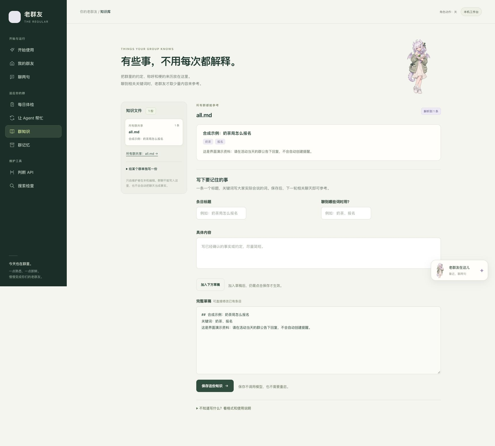

# 第一次使用老群友

先让它在你的 QQ 群里接住一句话，再按需加画图、语音和提醒。之后，你可以把群聊反馈交给自己的编码 Agent，让它按仓库自带的流程找现场、修改并对比。

第一次只做三件事：**打开桌宠 → 从设置填好 QQ 和回复模型 → 启动并打个招呼**。画图、语音和自迭代都可以等聊天跑通以后再加。也可以把[安装提示词](agent-setup.md)交给你的编码 Agent。

## 开始前的准备清单

- **Python 3.10 或以上。** 启动器会安装项目依赖，不会代装 Python。
- **自己的 QQ 开放平台机器人。** 准备 AppID、AppSecret；确认你能配置事件订阅、测试成员或使用范围。这里不使用个人 QQ 的账号密码。
- **一个回复模型服务。** 准备 API Key、接口地址和该账号可用的模型 ID。这不是 ChatGPT 的登录密码，也不是把订阅页面的网址填进去。

用官方 OpenAI API 时，兼容接口地址填 `https://api.openai.com/v1`，Key 和模型权限以你的 API 组织为准。领到 Pro / Business 的 API 额度后，要先完成订阅与 API 组织的关联，再使用该组织的项目 Key；资格和到期规则见 [OpenAI 官方说明](https://developers.openai.com/api/docs/guides/chatgpt-api-credits)。使用其他服务，就按该服务提供的接口参数填写。

## 下载与安装

需要 Python 3.10 或以上，以及可以下载 Python 依赖的网络。接入 QQ 还需要你自己的 QQ 机器人和回复模型服务凭据。启动器会安装项目依赖，不会替你安装 Python。

从 [Releases](https://github.com/dubianche123/the-regular-qq-bot/releases/latest) 下载 **Source code (zip)** 并完整解压；不要在压缩包预览中直接运行。解压后的目录应有 `start.bat`、`start.command`、`start.sh` 和 `pyproject.toml`。熟悉 Git 也可以克隆：

```bash
git clone https://github.com/dubianche123/the-regular-qq-bot.git
cd the-regular-qq-bot
```

| 系统 | 打开方式 |
| --- | --- |
| Windows | 安装 Python 时启用 Python Launcher 或加入 PATH，然后双击 `start.bat` |
| macOS | 双击 `start.command`；系统阻止双击或文件没有执行权限时，在项目目录终端运行 `bash start.sh` |
| Linux | 在项目目录终端运行 `bash start.sh`；发行版可能还需要安装 `python3-venv` |

首次运行会在**源码目录**建立 `.venv`，用其中的 Python 安装本项目和依赖；有图形桌面的系统会安装桌宠组件，Linux 无桌面环境跳过 Qt。版本变化后更新安装。安装失败会停止，不会显示已经启动。看到安装器报错时先解决网络、Python 版本或目录写权限，再重开启动文件。

启动器随后显示透明人物。**鼠标靠近人物，点击工具栏「设置」**，进入浏览器里的本机工作台。切换应用不会收起人物；工具栏离开后延迟隐藏。原生组件不可用时会提示使用网页入口。服务只监听 `127.0.0.1`，带 token 的地址不要分享。

### 源码目录和实例目录

这两个目录用途不同：

| 目录 | 保存什么 | 升级时怎么处理 |
| --- | --- | --- |
| 下载/解压的源码目录 | 程序、文档、启动文件及本地 `.venv` | 可换成新版源码；新的源码目录首次启动会安装自己的环境 |
| 默认 `~/.the-regular` | 私有 `.env`、Key、聊天记录、状态与评测结果 | 保留，后续启动继续使用；不要上传到公开仓库 |

Windows 上 `~` 指你的用户目录。默认启动不会选择你原有的线上实例。需要另一个实例时，可用启动器参数：

```bash
# macOS / Linux；路径可以包含空格
python3 tools/start_regular.py --directory "$HOME/My Regular"
```

```powershell
# Windows PowerShell
py -3 tools/start_regular.py --directory "D:\My Regular"
```

也可设置 `REGULAR_INSTANCE_DIR` 环境变量；显式 `--directory` 优先。后续每次启动保持同一个实例路径，否则会打开另一个空实例。

## 从人物旁的「设置」完成首次配置

点击人物工具栏「设置」进入「开始使用」（`/setup`）。先填这几项：

| 配置 | 从哪里取得/怎样填 |
| --- | --- |
| QQ AppID / AppSecret | 你的 QQ 开放平台机器人凭据 |
| 它的名字 | 群里喊它的称呼；多个名字用逗号分隔 |
| 回复模型服务 | 使用兼容网关时选择「OpenAI 兼容接口」；也可选择已有的智谱或 Gemini 服务 |
| 聊天服务、接口地址、API Key | 选择这次真正用于聊天的服务，按服务提供的参数填写 |
| 首选聊天模型、备用模型 | 首选明确选一个；同接口备用另外填写，只有失败等条件下按原候选策略尝试 |
| 每日 AI 调用次数上限 | 次数上限，不是金额预算 |

点击保存按钮不会请求模型或消耗模型调用额度。AppSecret、API Key 不回显，已经填过的密码框留空会保留旧值。基础配置在**下一次启动机器人**时读取，保存不会擅自重启已运行的机器人；如果提示有环境变量覆盖，需在启动面板的环境里修改对应值。

「聊两句」会分别显示运行进程的聊天首选，以及已保存、待下次启动生效的选择。本机聊天与 QQ 回复使用同一套聊天服务和模型，不需要再配置一套 Key；跨接口备用仍按已有配置生效。下拉建议来自本机已配置模型，不表示服务端已授予这些模型的权限，也不会为填下拉而调用模型。

判断 API、画图、语音可以稍后配置。提醒的语义审核需要判断 API，没配好时不会保存新提醒。它们的凭据和服务要求见[供应商配置](providers.md)、[画图配置](image-generation.md)与[到点提醒](reminders.md)。

## 启动并完成 QQ 接入

1. 去「我的群友」，点击「启动机器人」。面板会启动这个实例的机器人进程；网页刚打开或配置刚保存时还没有启动。
2. 等实际状态变成「已连上 QQ」。如果只看到「进程已启动，等待 QQ 连接确认」，展开当前版本与启动日志，先检查 AppID、AppSecret 和 QQ 侧授权。
3. 在 QQ 开放平台启用私聊与需要的群消息事件，并配置预期维护者/测试成员或使用范围。平台授权需要你本人操作。
4. **由你给机器人发第一条非空私聊。** 这一步会完成认主，先完成再邀请其他人使用。
5. 把机器人加入群，在群设置里允许它获取群消息，用 @ 或配置的名字试一句。已连上网关但收不到事件时，继续检查 QQ 消息事件、使用范围与群授权。

保持启动服务的终端和电脑运行。**关闭人物或网页不会停止机器人；退出面板服务（如在原终端按 Ctrl+C）会停止它自己启动的机器人。** 面板只能停止自己持有的子进程；若这个实例已由其他终端、launchd 或 systemd 运行，面板只读状态，不接管或停止它。

### 进群后，先试这两句

先说「@机器人，介绍一下自己」，再接着问一句「那我怎么叫你？」。这能先确认收消息、模型回复和前后文都接上了。然后让群友正常聊一会儿，看看它接话的节奏，再按你们的反馈慢慢调整；不必第一天就配完所有能力。

| 卡在哪里 | 先看哪里 |
| --- | --- |
| 双击后窗口一闪就没了 | 在终端运行对应启动文件，保留报错；检查 Python 版本、依赖下载和目录写权限 |
| 显示进程已启动，一直没有「已连上 QQ」 | 「我的群友」里的启动日志；核对 AppID、AppSecret 与 QQ 平台授权 |
| 已连 QQ，但群里叫它没反应 | QQ 侧群消息事件、测试/使用范围和群授权；先用平台 @ 测试 |
| 收到消息，却提示模型不可用 | 回复服务的地址、模型 ID、Key 权限和可用额度；用 `regular doctor` 查本地配置 |
| 换个源码目录又出现空配置 | 检查实例目录是否还是原来的 `~/.the-regular` 或显式指定的路径 |

## 聊天跑通后，再加能力

| 想加的能力 | 去哪里配置 |
| --- | --- |
| 看图 | 主模型支持图片就可继承；否则另配视觉模型，见[视觉配置](providers.md#识图默认继承也可独立配置) |
| 静图与短循环动图 | 核对 Images API 权限、额度和 GIF 支持，并配置画图前判断检查，见[画图配置](image-generation.md) |
| 到点提醒 | 面板「判断 API」配置原生 Decisions；审核可用、事项明确后才保存，见[提醒](reminders.md) |
| 听语音、发语音 | 需要语音服务权限；出站语音还需单独启用和本机编码器，见下节 |

### 语音单独开启

语音不是填完聊天 Key 后就全部可用的功能。入站语音优先使用 QQ 提供的转写；需要模型转写时，使用已配置的官方 OpenAI 服务。发语音默认关闭，当前实现使用官方 OpenAI Realtime 合成，再由本机 Node.js 与 SILK 编码器准备 QQ 音频。

启用出站语音前，在运行机器上准备可信的 Node.js 和 `silk-wasm` 安装，再在实例的 `.env` 中明确设置：

```dotenv
VOICE_OUTPUT_ENABLED=true
VOICE_OUTPUT_NODE=/absolute/path/to/node
VOICE_OUTPUT_SILK_ENTRY=/absolute/path/to/silk-wasm/lib/index.cjs
VOICE_OUTPUT_DAILY_LIMIT=10
```

上面的两个路径要换成这台机器实际安装的位置，不能直接照抄。还需可用的官方 OpenAI Key、官方端点与 Realtime 权限；普通兼容聊天网关不能代替这条语音服务。当前本机音频链路依赖需单独准备，并非所有系统上的一键安装项。暂时不配语音不影响文字聊天；合成或投递失败时会按实际结果处理。语气、说话与唱歌的边界见[画图与语音](media-replies.md)。

## 以后如何再打开

再次运行同一个启动文件，沿用相同实例路径即可。先出现人物，配置会保留；从设置进入工作台，按需要明确点击「启动机器人」。同实例已有面板时会复用，不再开一份。基础配置改过后，需要停止并重新启动机器人才能使用新值；外部服务管理的机器人请回到原启动方式操作。

也可以从已安装的环境直接开面板：

```bash
# macOS / Linux
.venv/bin/python -m regular --directory ~/.the-regular panel --open
```

```powershell
# Windows PowerShell
.venv\Scripts\python.exe -m regular --directory "$HOME\.the-regular" panel --open
```

准备常驻运行时，用 `regular service` 生成 launchd 或 systemd 定义，再由你安装和启动；命令不会自动安装服务。固定发布快照的部署需同时更新服务的代码来源，不能用一次重启代替代码升级。

只想先体验聊天链路，不接 QQ 或模型，可在安装完成后运行离线 demo：

```bash
# macOS / Linux；Windows 换成 .venv\Scripts\python.exe
.venv/bin/python -m regular demo
```

## 放到桌边，或在本机聊两句

面板「聊两句」可以用独立本机会话与已运行的机器人文字聊天。打开页面不调用模型，点击发送后才调用，与 QQ 回复共用调用次数上限；它不会认领 QQ 主人、发送 QQ 消息或执行群提醒。

双击启动器已经默认打开桌宠。需要从已安装环境手动打开时：

```bash
# macOS / Linux；Windows 使用 .venv\Scripts\python.exe
.venv/bin/python -m pip install ".[desktop]"
.venv/bin/python -m regular --directory ~/.the-regular pet
```

桌宠会先复用或准备本机面板，无需预先打开网页。平时只显示透明人物，靠近才浮出聊天、通知和设置工具栏；关闭人物不停止机器人，原终端继续托管本次服务。原生组件不可用时会提示使用紧凑网页，`pet --browser` 也可直接打开这个替代入口。完整交互、语音限制和版本要求见[桌宠与本机聊天](companion.md)。

## 把群里的常用资料放进知识库

「群知识」按文件列出条目、适用范围和摘要。打开条目可预览，再编辑标题、关键词与正文；也能展开 Markdown 草稿。示例只放入草稿，由你确认保存后才写文件，不会自动灌进机器人记忆。



适合写群规、共同约定、项目说明等相对稳定的资料。聊天时本地检索按线索选取有关片段，作为本轮参考；不保证整库进入每次对话，也不把资料当成新的系统指令。个人称呼、实时承诺和提醒仍由各自账本处理。只有本机维护者能保存知识文件，群聊不能改写。

## 让你的 Agent 根据群聊反馈协助改进

面板「体检」（`/checkup`）只读本机记录，列出可疑片段；它提供线索，不代表每条都确实有问题。

「让 Agent 改进」（`/iterate`）给出流程和「下载交接说明」：内容只有源码位置、实例目录和维护步骤，不附聊天或密钥，也不会连接或控制你的编码 Agent。让 Agent 打开源码工作区，读 `AGENTS.md` 和 `.agents/skills/regular-iterate/SKILL.md`，再给它你观察到的问题或截图。

源码 ZIP 带流程文件，但**没有 Git 历史**。保留一份未修改的基线源码，与候选目录比较，例如 `eval --base /path/to/baseline --cand /path/to/candidate`。命令的数据目录仍指向原实例，真实群聊用例、报告和凭据继续留在实例中。wheel 是运行安装包，要改代码先获取独立源码工作区，不能把已安装的 wheel 当成可编辑仓库。

涉及模型回放时，先用 `--plan` 说明会把多少真实聊天发给哪些模型，获你授权后再付费评测。Agent 提交结论、退步和未覆盖项，由你决定提交、发布或部署。完整方法见[自迭代设计](self-iteration.md)。
