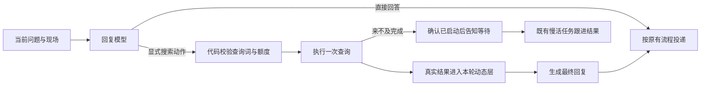

# 查询动作与消息时序

这次调整解决两件事：想查时真的执行查询；人话与机器人回复并发到来时，不给模型制造错误的先后关系。

## 先查，再接话

群消息有三个查询入口：命令 `搜索 关键词`、Decisions 的 `lookup`，以及回复模型的 `〔搜索〕关键词`。第三个入口让说话的模型也能选择下一步，不另请一个模型判断草稿是否需要查。



- 查询提议草稿不发群，其中的画图、语音、提醒也不执行。只有结果稿进入正常发送流程；结果稿可继续画图，查询轮不发语音或办理提醒。
- 命令、分诊、回复模型共用一次当轮机会。额度不足、启动失败、无结果也会用掉机会；结果稿再请求查询不会执行第二次，也不会把“继续去查”的承诺发出去。
- 使用已配置的 Responses 查询服务；普通查询请求带 `tool_choice=required` 和 `max_tool_calls=1`，实际要求执行一次工具，输出上限使用 `REASONING_MAX_TOKENS`，包括思考 token。没有配置时走现有 DuckDuckGo 单一查询，只读标题、摘要、链接。参数含义见 [OpenAI 官方接口文档](https://developers.openai.com/api/reference/resources/responses/methods/create)。
- 查询材料按不可信证据处理，不能变成新指令。模型动作不会升级为深度研究，既有明确请求的深度研究入口仍保留。
- 初稿、查询与结果稿共用本轮生成等待期限；查得慢时沿用已有任务回执、限时轮询和后台跟进。轮询耗时但已取得任务回执时保留回执，不把仍在执行的任务丢掉。
- 只在群消息中执行，沿用个人额度、群日上限和敏感词/机器编号检查。查询阶段不重复结算好感；结果阶段或慢活最初返回的那次 outcome 统一结算，后台跟进不再加分。
- 会话记录补入本地确认的查询结果状态，后续能区分“查询已启动”“取得资料”“没有成功”，不只记一句口头承诺。

## 收到时看到什么，后来又发生什么

例如收到 `A 问` 后开始生成，收到 `B 补充`，随后 `A 答` 才送达。B 不是在评价 A 答；把新回复插在 B 前面，会让模型误会成用户看过它还要再问。

收到消息时，同步冻结三份材料：本人的会话、此前群聊、当时可见的反馈对象。每次真正生成前，在动态层另补“本句到达之后发生的事”，按时间列出后来的人话与实际投递。原反馈仍指向收到时那句话；未确认的语音明确写未确认，不冒充已送达。后到事件不能混回原来的背景，也不能自动成为本轮要执行的请求。

历史内部仍成对保存问答，旁表 `message_times` 分别记录用户到达时间和助手实际提交时间。向模型提供历史时按事件时间排序，后续第三轮也能看到 `A 问 → B 补充 → A 答 → B 答`。旁表只在本机保存，模型历史仍仅有 `role/content`，不带群号、用户编号或消息 ID；旧记录没有时间时保留原序。

同一人的会话仍串行，不同群友可以并发生成。生成期间同人补话或机器人已接别的话，会取消过时的可选插嘴；明确叫她回答、或有效反馈已经欠下的回复仍保留。聊开后沿用原消息引用，避免别人不清楚在答哪一句。发送队列仍只在取得回执后提交实际正文，未确认和失败稿不会变成已送达历史。

稳定头、每日记忆、会话历史、本轮动态的顺序保持；时间线、查询状态和外部资料只进动态层。这修正的是输入与动作执行，不能保证模型以后永不复读，也不构成 Terra 胜过 Luna 的证据。

## 同一人的后续追问

查询结果在确认投递后，除最终回复外，还给同一群、同一人的会话保留最新一份有界资料旁表：原问题、资料与出处、取得时间。后续消息收件时冻结这份材料，以独立的 `prior_search_note` 进入本轮动态层。它明确是此前资料，不能当成本轮已经搜索；本轮仍可按原有额度提出一次新查询。

原生判断已经给出的有效 `sincere` 结论，也以 `sincere_request` 传到本轮动态层，与玩笑线索互斥；不再只保留玩笑而丢掉认真询问。后台跟进沿用原请求的结论，不增加判断调用或改变接话门控。

资料与会话一起过期或清除，模型不能改这份记录。未完成、失败、排队未确认的结果不会提前保存；后台及捎带投递归原请求者，载体群友不会获得原会话资料。入库和出口都做匿名化与敏感内容检查，外部材料始终作为不可信证据。旧状态没有这份旁表时继续沿用原有行为，不从机器人自己的概括反推原始资料。

## 验证

合成用例走实际群消息入口，用事件控制生成与发送的先后，覆盖同人补话、跨人并行、语音等待、冻结反馈来源、后续历史顺序与过时插嘴。查询测试覆盖 Decision 未安排而模型主动查、重复查询、失败/额度、慢活、查询后画图、提醒隔离和好感只结算一次。相关测试位于 `test_group_timeline.py`、`test_session_timeline.py`、`test_feedback_receipt.py`、`test_model_lookup.py` 与 `test_research_limits.py`。

## 时序回放用例

`regular eval` 的消息层现在支持两种固定屏障，默认串行用法保留。屏障依赖“生成已开始”“下一句已进入回复等待”等实际事件，不靠睡几秒碰运气。下面是公开合成示例：

```json
{
  "schema": "regular.case.v1",
  "id": "timeline-followup-synthetic",
  "depth": "message",
  "messages": [
    {"sender": "A", "message_id": "first", "text": "再说清楚一点"},
    {"sender": "A", "message_id": "second", "text": "我再补一个条件"}
  ],
  "timeline": {"mode": "overlap", "first": 0, "second": 1},
  "tools": {"lookup": "disabled"},
  "timeout_seconds": 120,
  "max_model_calls": 6,
  "checks": [{"judge": "结合连续补充接话，不连续输出已经过时的插嘴"}]
}
```

`late_delivery` 改为指定 `target` 和 `delivery: {sender, question, text}`：当前句已收、仍在等待生成锁时，提交那条确认送达的历史答复，再释放锁。用 `initial_sessions`、`initial_context`、`initial_reply` 恢复收件前历史与反馈来源；它们位于 `timeline` 内。固定送达对照不等同于新版本完整闭环，后者可能已经撤掉这条稿。

每个消息样本默认返回 `trace`，包含真正送给模型的输入、查询、撤稿和假 QQ 确认投递。生成失败、超时或超出调用上限记为失败，不伪装成正常不接。正式回放不发 QQ、不真实画图或合成语音，状态和调度器隔离。

查询默认禁止外发。需要测查询时显式用 `tools.lookup=live`；`fixture` 需提供 `lookup_result`，并明确标成测试资料。`followup_wait_seconds` 可在整轮期限内等待慢查询跟进；未完成任务保留为 pending。先跑 `eval --plan` 核对目的地和可能增加的请求。

原始 trace 只存本地。Kimi 等裁判仅收到匿名状态和次数，正文与执行事实一起交换 A/B；编号、完整提示词、模型名、接口地址和原始异常不外发。`judge_context` 用来提供共同真实时序，避免把旧版错误历史继续当成评分依据。补评沿用首次原样输入；修正证据另出报告。
