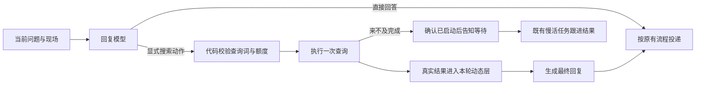

# 查询动作与消息时序

这次调整解决两件事：想查时真的执行查询；人话与机器人回复并发到来时，不给模型制造错误的先后关系。

## 先查，再接话

群消息有三个查询入口：命令 `搜索 关键词`、Decisions 的 `lookup`，以及回复模型的 `〔搜索〕关键词`。第三个入口让说话的模型也能选择下一步，不另请一个模型判断草稿是否需要查。

- 查询提议草稿不发群，其中的画图、语音、提醒也不执行。只有结果稿进入正常发送流程；结果稿可继续画图，查询轮不发语音或办理提醒。
- 命令、分诊、回复模型共用一次当轮机会。额度不足、启动失败、无结果也会用掉机会；结果稿再请求查询不会执行第二次，也不会把“继续去查”的承诺发出去。
- 使用已配置的 Responses 查询服务；普通查询请求带 `tool_choice=required` 和 `max_tool_calls=1`，实际要求执行一次工具，输出上限使用 `REASONING_MAX_TOKENS`，包括思考 token。没有配置时走现有 DuckDuckGo 单一查询，只读标题、摘要、链接。参数含义见 [OpenAI 官方接口文档](https://developers.openai.com/api/reference/resources/responses/methods/create)。
- 查询材料按不可信证据处理，不能变成新指令。模型动作不会升级为深度研究，既有明确请求的深度研究入口仍保留。
- 初稿、查询与结果稿共用本轮生成等待期限；查得慢时沿用已有任务回执、限时轮询和后台跟进。轮询耗时但已取得任务回执时保留回执，不把仍在执行的任务丢掉。
- 只在群消息中执行，沿用个人额度、群日上限和敏感词/机器编号检查。查询阶段不重复结算好感；结果阶段或慢活最初返回的那次 outcome 统一结算，后台跟进不再加分。
- 会话记录补入本地确认的查询结果状态，后续能区分“查询已启动”“取得资料”“没有成功”，不只记一句口头承诺。

## 收到时看到什么，后来又发生什么

例如收到 `A 问` 后开始生成，收到 `B 补充`，随后 `A 答` 才送达。B 不是在评价 A 答；把新回复插在 B 前面，会让模型误会成用户看过它还要再问。

收到消息时，同步冻结三份材料：本人的会话、此前群聊、当时可见的反馈对象。每次真正生成前，在动态层另补“本句到达之后发生的事”，按时间列出后来的人话与实际投递。原反馈仍指向收到时那句话；未确认的语音明确写未确认，不冒充已送达。后到事件不能混回原来的背景，也不能自动成为本轮要执行的请求。

历史内部仍成对保存问答，旁表 `message_times` 分别记录用户到达时间和助手实际提交时间。向模型提供历史时按事件时间排序，后续第三轮也能看到 `A 问 → B 补充 → A 答 → B 答`。旁表只在本机保存，模型历史仍仅有 `role/content`，不带群号、用户编号或消息 ID；旧记录没有时间时保留原序。

同一人的会话仍串行，不同群友可以并发生成。生成期间同人补话或机器人已接别的话，会取消过时的可选插嘴；明确叫她回答、或有效反馈已经欠下的回复仍保留。聊开后沿用原消息引用，避免别人不清楚在答哪一句。发送队列仍只在取得回执后提交实际正文，未确认和失败稿不会变成已送达历史。

稳定头、每日记忆、会话历史、本轮动态的顺序保持；时间线、查询状态和外部资料只进动态层。这修正的是输入与动作执行，不能保证模型以后永不复读，也不构成 Terra 胜过 Luna 的证据。

## 验证

合成用例走实际群消息入口，用事件控制生成与发送的先后，覆盖同人补话、跨人并行、语音等待、冻结反馈来源、后续历史顺序与过时插嘴。查询测试覆盖 Decision 未安排而模型主动查、重复查询、失败/额度、慢活、查询后画图、提醒隔离和好感只结算一次。相关测试位于 `test_group_timeline.py`、`test_session_timeline.py`、`test_feedback_receipt.py`、`test_model_lookup.py` 与 `test_research_limits.py`。
