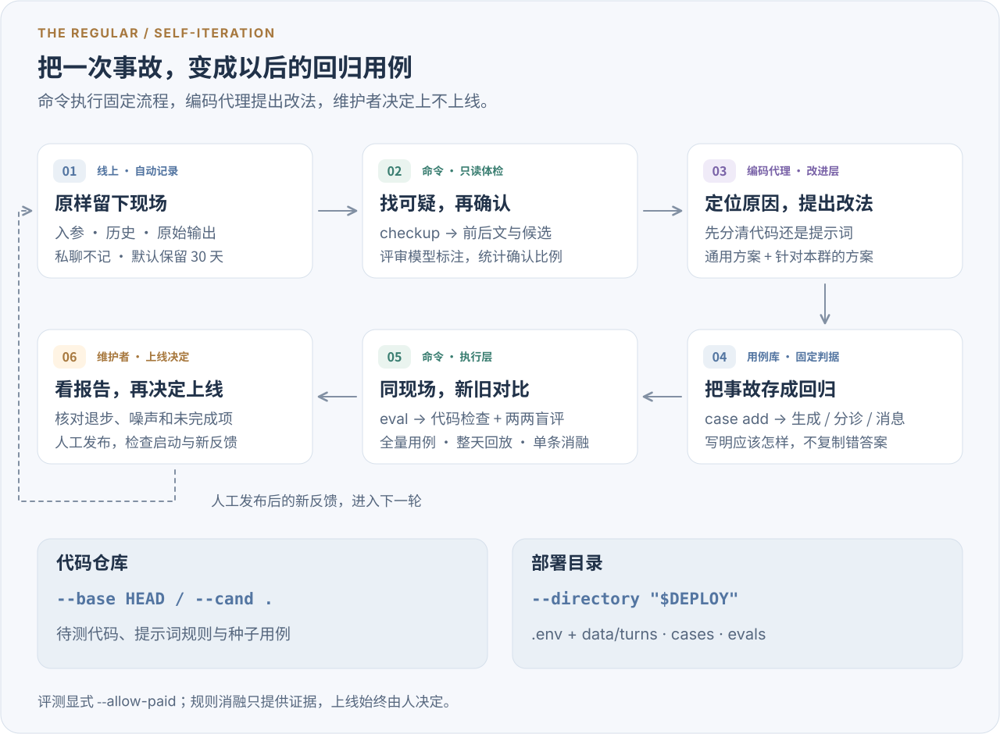
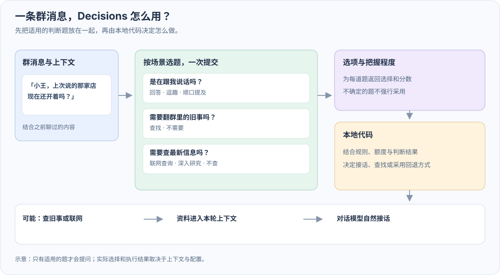

# 自己迭代：把手动回放做成工具（设计稿，2026-11-03）

> 状态：第 1–5、7 步的命令已实现；2026-11-04 已部署，机器人启动与当前连接检查正常。
> 完整历史用例集的验收与更长时间的线上观察仍待完成。

小王现在的每一次改进，本质上是手动跑了一圈「自我改进」：线上出事、从记录里还原现场、
拿真实语料回放几种改法、挑好的上线。这篇写怎么把这一圈里机械的部分做成命令，
让事故越攒越多、每次改动都拿全部旧事故重跑，人只留下两件事：改哪个、上不上线。

不追求全自动的递归自我改进（RSI）。目标是先把这一圈变便宜、变可重复；
等它便宜了，交给代理跑也就顺理成章（第 6 节）。

## 1. 现在一轮是怎么跑的

拿 11-03 这一轮当例子（[引用和 @](quotes.md)、[岔开话题](deflection.md)）：

| 步骤 | 实际做了什么 | 花在哪 |
| --- | --- | --- |
| 发现 | 群主截了一张早上 9 点的图 | 全靠人；没截图就不知道 |
| 还原 | 翻 `bot.log`、归档、交互日志，认出 D3D7 是小王自己的 @ | 每次重写一遍 grep 和小脚本 |
| 回放 | 手写 `probe.py`：从日志抠出 9 个场景、各自前 6 句背景，拼成生产提示词 | 当时的称呼说明、会话历史拿不到，只能编个近似的；脚本在会话草稿目录，用完就散 |
| 评测 | 新旧各抽 4–8 次，kimi 两两盲评，再用正则数「家务 / 假车 / 刚醒」 | 网络断了两次要重跑；盲评看不出套路，得另外数 |
| 修改 | 提示词改了三版，每版重跑 | |
| 回归 | 1326 个离线测试 | 只验代码，不验措辞 |
| 上线 | 打包、部署、看启动日志 | |

对照两篇论文：

- **[Dream-RSI](https://arxiv.org/abs/2609.14858)**：把跑过的探索历史当成「回放模拟器」，离线评估新策略、挑分高的再上线。
  前提是每个分支的结果都已经记录在案，新策略只是在记录过的树上换条路走。
  我们的「要不要开口」那一层符合这个前提（存档就是模拟器，17/20 的回放就是这么来的）；
  回复内容那一层不符合：换了提示词说的就是新话，群友会怎么反应没有记录，只能靠评审。
- **[Harness²](https://arxiv.org/abs/2610.14224)**：没有标准答案时，用「对比」代替「打分」——
  同一任务留一份原始执行当参照，提两种范围的改法（通用的 / 本领域的），在相同条件下跑，
  看行为差在哪，再决定合并哪些；改完的经验进库，下次改的时候用。

我们两样都在做，只是全靠手。

## 2. 卡在哪

1. **发现靠截图。** 分诊层其实一直在判「群友是不是在纠正小王上一句」，
   11-01 到 11-03 标出 41 次 `repair_briefly`（交互日志的 `natural_feedback`），没人看。
2. **回放现场每次手拼，拼得不全，用完就扔。** [到点提醒](reminders.md)、[岔开话题](deflection.md)
   两篇都写着「脚本在会话草稿目录，没进代码」。
3. **只回放这一次的事故。** 改岔开话题时，没人回头跑一遍提醒、读图、慢活那几批场景。
   Dream-RSI 表 2：用全部历史回放 1.90，只用当轮 1.59。
4. **单轮评审看不出套路。** 「给你画把拖把，今天主打家政写实」单拎出来显得机灵，
   群主嫌的是它天天这么干。这种问题只有把一整天放在一起才看得见。
5. **规则只增不减。** `prompts.py` 10 月以来改了 24 次，稳定头 4,916 字、13 段。
   11-03 修的两处（「拽回柴米油盐」「你刚醒没多久」）都是 GLM 时期加的刹车，换到 luna 变成了台词。
   Dream-RSI 图 6 也是这个教训：把历史提炼成方向性指导塞进提示词，比直接回放差。

## 3. 要什么、不要什么

要：

- 每一轮回复的输入原样留下来，回放不用再拼。
- 每天自动列出可疑的地方，不等截图。
- 事故一条命令存成用例；每次改动一条命令把**所有**用例重跑，出对比表。
- 提示词里每条规则知道自己是为哪次事故加的，换模型时能逐条验证还有没有用。

不要：

- 不让任何东西自动改提示词并自动上线（理由见第 6 节）。
- 不训练模型，不做通用评测平台。
- 不为私聊开新的数据流：私聊原文不进记录、不进回放（跟分诊层的约定一致）。

## 4. 整体



这张图描述维护流程：线上代码记录现场，固定命令收集候选并评测，外接编码代理提出和修订改法，
独立评审模型完成另行标注或盲评，维护者决定是否发布。`checkup` 不会自己调用评审模型；
候选改动也不会因报告分数较高而自动上线。

所有带真实群聊的数据（每轮输入、用例、体检报告、评测报告）都在部署目录的 `data/` 下，
跟归档一个待遇，不进代码库；代码库里只放命令本身和种子用例：事故那几条（岔开话题、引用）
用的是 `docs/` 里已经公开的原句，其余全是合成的。

<a id="iteration-example"></a>

### 一次迭代怎样走完

下面是合成走读，沿用 Decisions 一节的茶杯场景，不代表新发现的线上事故或实测成绩。
假设机器人刚回答「我不确定这是什么」，群友补充「阿团，我觉得像个茶杯」，
旧版却判成 `let_it_pass`，最后没有接住。

1. **从记录回到现场。** 维护代理可以从体检候选或维护者给出的线索进入，
   按 `turn_id` 对照生成 / 分诊记录、归档和交互日志中的实际送达。
   体检信号只提供线索，这个合成例子不保证会命中某条现有信号。
2. **先固定期望，再改。** 将现场存成回归用例，写 `addressed=answer`；
   含义是接住相关补充，不是认定「茶杯」一定正确。旧版的错误输出只作参照，不能变成正确答案。
   同时选入「群友互聊时只是提到阿团」等已有用例，保护原来应该安静的场景。
3. **定位到真正需要改的边界。** 如果原始 payload 已有前文，而题面没把补充句解释清楚，
   编码代理修改题面，用分诊层重跑同一 payload。若上一句根本没有进入 payload，
   就修本地输入构造，改用消息层重走归档事件；重放旧 payload 无法验出这个修复。
   改法可以分别尝试通用语义说明与适合本群的说明，再按相同判据比较。
4. **把同一现场交给两个版本。** `--base` 和 `--cand` 分别加载基线和候选代码，
   对每条选定用例重复抽样。分诊用例按期望选项检查；生成用例按可执行判据检查，
   需要语气、相关性等判断时再交独立模型两两盲评。修完这条还要跑历史用例，
   整天生成回放另看口头禅、长度和接话比例，规则消融另问某条规则是否仍有必要。
5. **让报告决定下一步工作。** 原例改善但旧例退步，返回定位与修改；出现噪声内下降，
   只对相关用例增大样本；模型调用失败或覆盖缺失，补齐后再下结论。
   没有检测到退步也只是评测证据，维护者还要结合未覆盖项决定是否发布。
6. **把这一轮留下来。** 代码改动跑相关离线测试；退步要交代原因，未覆盖项要列明。
   候选改动、新用例、事故记录与对比报告一同供维护者审阅。
   用例加入以后每次回归，事故记录与规则出处成为下一轮修改的输入；人工发布后，
   新的线上行为再次留下记录，再进入体检与回放。

当前已接通记录、体检、用例、回放与报告命令，维护者触发编码代理执行维护流程。
一次改动是否值得保留，由这套证据支持；持续效果还要靠后续未见样本与线上观察验证。
整天回放使用的是已有回复记录，不会模拟群友听到新回复后产生的新对话。

<a id="iteration-surfaces"></a>

### 可迭代对象与验证边界

迭代对象包括提示词、判断题、信息输入结构和本地处理策略。编码代理修改候选代码，
评测命令重跑同一份现场；机器人本身不会在群里修改源码、账本或自己的权限。

| 对象 | 可以改什么 / 在哪里 | 怎样验证 |
| --- | --- | --- |
| 回复提示词 | [prompts.py](../prompts.py)：人设措辞、接话说明、输出格式、提醒与媒体标记说明；带 `# rule:` 的段落可逐条消融 | 生成层回放；使用同一份背景与记忆比较候选回复 |
| Decisions 判断题 | [regular/decision_prompts.py](../regular/decision_prompts.py)：`instructions`、题面中的语义例子、`choices[].description` | 分诊层重新加载候选版本的题目；`name` 和 `value` 是代码协议，改名须同步调用方和用例 |
| Decisions 的信息输入 | [regular/decisions.py](../regular/decisions.py) 的 `FeedbackTracker.assess`：取哪些上下文、怎样截断和匿名、何时问哪道题 | 消息层重新执行输入构造；分诊层沿用当时记录的 payload |
| 判断结果怎样成为动作 | `usable_choices` 的解析与弃答；反馈短修、收敛窗口、过期处理及 [bot.py](../bot.py) 路由 | 选项解析可用分诊层；时间窗口、状态变化和最终路由需消息层及定向测试 |
| 上下文、记忆与资料 | [storage.py](../storage.py)、[digest.py](../digest.py)、[recall.py](../recall.py)、[knowledge.py](../knowledge.py)：裁剪、证据选择、注入时机与格式 | 生成层可比较已记录材料的使用；材料如何选出、摘要如何生成，还需模块测试 |
| 本地执行与异步 | [expression.py](../expression.py)、[reminders.py](../reminders.py)、[slowwork.py](../slowwork.py)、[delivery.py](../delivery.py)：解析、时间计算、任务状态与发送降级 | 消息层及模块测试；真实查询、画图、语音和平台投递另做 smoke |
| 模型与调用参数 | [providers.py](../providers.py)、[config.py](../config.py)：候选模型、推理强度、token 上限、超时与成本边界 | 同条件回放加供应商测试；两版默认共用部署配置，不等于比较了两套配置 |
| 改进与评测流程 | [regular/eval.py](../regular/eval.py)、[regular/cases.py](../regular/cases.py)、[AGENTS.md](../AGENTS.md)：判据、评审题面、统计与经验复用 | 固定验证集及独立检查；修改评审后，不能只凭它自己的分数证明它更好 |

“能改”和“已有自动搜索”分开看。现有 `--search-wording` 只支持 `remind`（提醒格式说明）
和 `banter`（**聊天生成层**的接话说明）。Decisions 题面可以由编码代理修改后跑分诊评测，
但还没有内置自动措辞搜索目标。隐私、单步工具、成本与人工上线等硬边界不能被自动搜索放宽。

现有回放还有这些边界：

- 消息用例若预置 `triage_choices`，回放会固定采用这些选项；比较题面或完整分诊路由须使用未预置答案的用例。
- 消息层替换知识库渲染、画图和语音等调用；消息处理通过，不等于真实外部能力已验收。
- 主分诊 `assess` 已记录 payload；旧话回扣 `consider_callback` 尚未同样记录原始输入，动态记忆判断题也未纳入通用题目重建池。不能把“分诊可回放”扩大成所有 Decisions 调用都完整覆盖。

<a id="decisions-input"></a>

### Decisions 实际看到什么

Decisions 收到的是**有界的事实输入，加上本轮适用的一组选择题**，不是回复模型的四层提示词。
`providers.call_decision` 发原生请求，顶层只有 `model`、`input`、`questions`；
`input` 在 HTTP 请求中是序列化后的 JSON 字符串。



下面全部是合成场景，没有使用真实群聊数据：

> 成员甲：这个东西是什么？<br>
> 机器人阿团：我不确定这是什么。<br>
> 成员甲：阿团，我觉得像个茶杯。

本地代码将发言人转换为 `member_a` 之类的代号。`input` 解码后可以是：

```json
{
  "recent_human_messages": [
    {"speaker": "member_a", "text": "这个东西是什么？"}
  ],
  "bot_reply": {
    "route": "invited_reply",
    "reply_to": "member_a",
    "text": "我不确定这是什么。"
  },
  "latest_message": {
    "speaker": "member_a",
    "text": "阿团，我觉得像个茶杯。"
  },
  "latest_is_directed": true,
  "bot_is_addressed_as": ["阿团"]
}
```

| 字段 | 来源与作用 |
| --- | --- |
| `recent_human_messages` | 有回复观察窗口时取登记上一条回复时的人类背景，否则取当前背景；最多最近四条，逐条裁剪、脱敏 |
| `bot_reply` | 窗口内最近一条确认送达的模型回复，附回复路径和对象代号；没有时不带 |
| `messages_after_bot_reply` | 机器人回复之后、当前句之前的补充，最多四条；有合适材料才带，避免把补充错放到回复之前 |
| `latest_message` | 当前说话人的代号和本轮文本 |
| `latest_is_directed` | 本地检测到的平台 @ 或机器人名字；是措辞事实，不直接等于“应该答” |
| `bot_is_addressed_as` | 可用的机器人叫法，帮助判断文本中的名字指谁；取不到时不带 |
| `nickname_candidate` | 本地起名解析提出的候选，通过本地过滤后才带 |

群号、openid 和原始消息 ID 留在本地关联，不进入这份输入。
整份群归档、每日记忆和回复人设也不会自动附到这次判断中。
可选字段只在条件成立时出现；一题都用不上就不发请求。

题目来自 [regular/decision_prompts.py](../regular/decision_prompts.py)。每题包含
`type`、`name`、`instructions` 和 `choices`。下面只展开 `addressed` 一题：英文题面为节选，
选项描述用中文解释含义，完整线上措辞见源码。

```json
{
  "type": "choice",
  "name": "addressed",
  "instructions": "The latest Chinese group-chat message mentions or addresses the bot by name. First use bot_reply and recent_human_messages if present to determine whether the latest message continues that exchange.",
  "choices": [
    {"value": "answer", "description": "正在与机器人交谈，等待它回答，包括对上句的相关补充或纠正"},
    {"value": "quip", "description": "可以短接一句的调侃或评价，但不等它回答"},
    {"value": "let_it_pass", "description": "只是提到机器人，或回复会打扰、重复、争夺注意力"}
  ]
}
```

请求封装相当于：

```python
body = {
    "model": settings["model"],
    "input": json.dumps(payload, ensure_ascii=False),
    "questions": decision_prompts.addressed_questions(),
}
```

示例只演示一道题；真实 `assess` 会按条件合并反馈目标、下一步、是否被叫到、请求性质、
起名、旧账、查询等适用题目，最多一次请求，并非每轮都把全部题目发一遍。
上面的合成场景可要求 `addressed=answer`：陈述句也是在补充刚才的对话，应该接住。
这并没有认定“茶杯”就是事实。

下面是合成的单题返回；接口没有直接写群回复：

```json
{
  "answers": [{
    "name": "addressed",
    "type": "choice",
    "choice": "answer",
    "confidence": 0.85,
    "probabilities": [
      {"value": "answer", "probability": 0.90},
      {"value": "quip", "probability": 0.06},
      {"value": "let_it_pass", "probability": 0.04}
    ]
  }]
}
```

本地 `usable_choices` 校验格式、选项与边际，再由调用方处理路由、短修或收敛。
分数用于相对比较，不当作校准后的正确率。当前没有独立 few-shot 示例库或 `examples` 字段，
只有 `instructions` 中的语义例子；增加或改写这些例子也是可测的迭代对象。

最小迭代路径：

```bash
# 在代码仓库执行，DEPLOY 指向部署数据；先明确期望
.venv/bin/python -m regular --directory "$DEPLOY" case add \
  --turn <triage_turn_id> --id triage-followup-01 --choice addressed=answer

# 修改 regular/decision_prompts.py 的题面或选项说明后，比较同一输入
.venv/bin/python -m regular --directory "$DEPLOY" eval \
  --base HEAD --cand . --cases triage-followup-01 -n 4 --allow-paid
```

若修改的是 payload 构造，已保存的分诊输入不会随之改变；应改用消息层，
检查 @、引用与历史怎样重新进入判断，不能只重放旧 payload。

<a id="harness2-components"></a>

### 与 Harness² 八类组件的对应

[Harness² 官方说明](https://github.com/google-research/harness2#harness-components)和
[论文附录 D.3、表 5](https://arxiv.org/html/2610.14224v1#A4.SS3)讨论的是八类可编辑组件，
不是八个必须逐级凑满的层级。下表按本项目职责映射，并不表示实现了通用 Agent 平台。

| Harness² 组件 | 老群友中的对应 | 当前边界 |
| --- | --- | --- |
| C1 系统提示词 | `prompts.py` 的人设、共享规则、输出规则；Decisions 的任务题面也可单独修改 | 直接对应，按生成或分诊入口分别验证 |
| C2 护栏 | 共享硬规则、敏感词过滤、身份与账本权限、额度和超时边界 | 直接对应；实现可以修正，硬约束不能交给自动搜索放宽 |
| C3 记忆 | 每日记忆、会话历史、档案与个人原话的选择及注入 | 直接对应；可迭代策略与格式，真实档案和账本由代码维护，模型不能随意改写 |
| C4 工具使用说明 | 搜索、召回、画图、语音、提醒的条件、标记与即时能力说明 | 直接对应；显式协议和本地代码执行，保持单步边界 |
| C5 子代理 | 机器人内部没有自主分派任务的子代理系统 | 多种模型按固定路径分工不等于子代理；外接编码代理的协作不算机器人自带能力 |
| C6 按需技能 | 机器人内部没有由模型加载并执行的技能库 | 能力按配置和固定接口启用，不提供通用多步技能循环 |
| C7 脚本 | 提醒解析、查询、投递等确定性工作由固定本地函数完成 | 承担部分同类职责；没有开放模型生成脚本或执行 shell，不算论文中的脚本执行组件 |
| C8 插件 | 生成和投递前后的本地门控、清洗、结果记录 | 承担部分同类职责，没有可编辑的工具循环插件系统 |

严格说是**四类直接对应，另两类的部分职责由本地代码承担，两类刻意不做**。
Decisions 不是另加的一层：题面属于可编辑判断说明，输入结构属于上下文构造。
八类组件、缓存用的四层提示词、评测用的三种回放深度，描述的是三个不同维度。

## 5. 四个组件

### ① 记下每轮的模型输入

**在哪记。** 群聊回复、插嘴、慢活跟进、主动发言都走 `bot.get_ai_reply`。它的入参就是一轮的全部变量：
群聊背景、称呼说明、状态、即时提示（`media_note`）、知识库 / 旧账 / 搜索材料、喊停、插嘴提示……
稳定头由当前代码的 `prompts` 现拼，会话历史和每日记忆从 `runtime.SESSIONS` 取。
所以在这里记一条就够：入参原样 + 当时的会话历史 + 每日记忆 + 模型原始输出 + 最终发出去的正文。

```json
{"turn_id": "…", "ts": 1793667642.1, "group": "…", "user": "…", "message_id": "…",
 "route": "reply", "release": "948ea63", "head_sha": "稳定头的哈希",
 "kwargs": {"user_text": "…", "context_hint": "…", "relation_note": "…", "state_note": "…",
            "media_note": "…", "unprompted": false, "quip": false, "…": "…"},
 "session": [{"role": "user", "content": "…"}, {"role": "assistant", "content": "…"}],
 "memory_block": "…",
 "model": "gpt-6-luna", "effort": "low", "raw": "…", "sent": "…", "outgoing_id": "…"}
```

- 直接调模型的四处（起名审核、群史记查询、到点提醒那句、催债）先不记，需要时再补。
- 主要分诊的输入（`decisions.FeedbackTracker.assess` 拼的那份 payload）也记在 `data/turns/`，
  连同题目名和选择，供分诊层回放。旧账 callback 仍只有交互日志中的结果和分数（`decision_scores`），
  没有完整原始输入，不属于这条回放链的完整覆盖范围。
- `private=True` 的不记。
- 存 `data/turns/日期.jsonl`，过了当天压缩，默认留 30 天（`TURN_LOG_KEEP_DAYS`），开关 `TURN_LOG_ENABLED`。
  量：11-03 一天 107 次送达，每轮输入的大头是背景和会话历史，估计每天 1MB 上下。

**回放的三种深度。**

- **生成层回放**：拿记下的入参再调一次 `get_ai_reply`，稳定头用待测代码现拼。
  覆盖提示词措辞、换模型、换推理强度 —— 迄今大部分修改都在这一层。便宜，一轮一次调用。
- **分诊层回放**：保持当时的 payload，按待测版本重新构造题目并检查选项。
  适合改题面、选项说明和有效选择的阈值；输入字段与上下文构造的变化要交给消息层验证。
- **消息层回放**：把一段归档消息按原顺序喂给真的 `handle_group_msg`（假发送，模型真假可选），
  覆盖分诊、背景怎么拼、@ 和引用怎么认这些代码。11-03 的引用改动就属于这一层：
  生成层回放只会重放当时那份「看不见引用」的背景。现有的 `tests/test_image_then_question.py`、
  `regular demo` 也是这种跑法。旧归档缺原始的 @ 和引用索引，新归档已经记录这些字段供消息层还原；
  缺失的历史字段不能凭空补回。

### ② 每日体检

`regular checkup [--day 11-03] [--json]`：只读，不联网，不调模型（跟 `regular calibration` 一样）。
扫一天的归档、交互日志和每轮输入，按下面的信号列出可疑的地方。每条信号都是从一次事故来的：

| 信号 | 怎么认 | 来自 |
| --- | --- | --- |
| 叫了没回 | `at=1` 的消息两分钟内没有送达；或者 @ 了一个从没说过话的人（像 11-03 之前的 D3D7） | 11-03 09:00 |
| 同一句问好几遍 | 同一个人五分钟内两条以上消息高度重合 | 09:00–09:04 老任问了四遍 |
| 被纠正 | `natural_feedback` 里 `repair_briefly`（三天 41 次） | 分诊层已有 |
| 群里的反应不对 | 小王说完一分钟内，有人回「？？」「又似了」「答非所问」「串了」「没听懂」 | 11-02 20:57「にまますら」 |
| 只说不做 | 小王说了「我去查」「找到再告诉你」「记下了」「到点叫你」，一分钟内没有查询、提醒的记录 | 11-01 02:49 提醒、11-03 09:05「我去搜搜看」 |
| 口头禅 | 小王当天自己的话里，4–6 字片段在不同对话里出现三次以上，且比前七天明显多 | 「刚醒 / 开机」三天 27 句、「车刚打火」、「这锅我背」 |
| 碰了敏感词 | 小王的输出被敏感词表拦下或改写过 | |

每条列出前五句、后三句和对应的 `turn_id`，附一行把它存成用例的命令。
报告写到 `data/checkups/日期.md`，维护面板（`regular panel`）加一页看。
候选由独立评审模型结合前后文标「是 / 不是」，回写标注后统计每种信号的确认比例，作为保留、修改或删除信号的依据。
这里的标注来自评审模型，统计反映它的判断；`checkup` 本身仍只读日志、不调用模型。
这些信号只是候选，不是结论 —— 「？？」可能是在问别人。

可以每天凌晨跑一次（launchd），也可以手动跑。

### ③ 用例库和评测

**用例**：`data/cases/<id>.json`，一个用例 = 一份现场 + 要检查什么。

```json
{"id": "2026-11-03-orange-irish",
 "incident": "docs/quotes.md",
 "depth": "generate",
 "turn": {"…记下的那一轮…": "…"},
 "reference": "当时小王实际回的那句",
 "checks": [
   {"must_not": "刚醒|开机|转圈"},
   {"must_not": "洗衣|买菜|厨房|车刚"},
   {"tag_absent": "不接"},
   {"judge": "有没有顺着他引用的那杯酒接"}]}
```

检查分两类：

- **能直接判的**用代码判：必须有 / 不许有（正则）、标记有没有（〔画〕〔提醒〕〔不接〕）、回没回、长度上限。
  提醒那批（时间算得对不对）、读图那批（有没有说「看不到」）基本都是这一类。
- **要人味判断的**交给盲评：不参赛的 kimi-k3.1-pro，打乱顺序看一对回复（新旧两版，或新版和当时的原回复），
  按这条用例的问题选更好的一条、标越线。这就是 Harness² 的对比：不问「好不好」，问「哪条更好、差在哪」。

**评测命令**：

```
regular eval --base 948ea63 --cand . [--cases all|标签] [-n 4] --allow-paid
regular eval --base 948ea63 --cand . --day 11-03 --allow-paid
```

- 要花钱的命令跟 `regular probe` 一样，不加 `--allow-paid` 不发请求。
- 两个版本各起一个子进程，`PYTHONPATH` 指向各自的代码（`--base` 用 `git worktree` 临时检出），
  用同一份记录回放，避免像 11-03 那样在一个进程里拿 `exec` 换提示词。
- 每条用例每个版本抽 n 次：能直接判的算通过率；盲评算胜率；网络错误自动重试，重试不成的那对剔掉、单独计数。
  下降要过一道单侧检验才算退步（每条抽 4 次时，至少掉 3 次；盲评旧版 4:0）——
  同一版本对同一版本跑，盲评 2:0 实测就出现过。够不上的单列成「噪声内下降」，加大 `-n` 只跑那几条再定。
  越线不看次数，一次就算退步。
- 盲评走本机网关上的 `cn:kimi-k3.1-pro`（`EVAL_JUDGE_PROVIDER=zhipu`，网关就是 `ZHIPU_BASE_URL`）；
  跑之前先答一道送分题，配错了当场报错，不等几百次生成跑完才发现盲评整批被剔掉。
- **整天回放**（`--day`）：把某天记下的每一轮都按两个版本重新生成一遍，比整体指标 ——
  口头禅片段的次数、〔不接〕比例、平均长度、碰敏感词次数、家务 / 假车这类自定义正则。
  单轮盲评看不出的套路，在这里才看得见。
- 报告写到 `data/evals/时间.md`：退步的用例排最前（旧版过、新版不过），然后是胜率和整天指标。
- **上线前跑一遍全量**：有退步的用例必须在提交说明里交代为什么能接受。

成本估一下：11-03 那次 9 个场景、新旧各 4 次、加盲评，一共 108 次调用，几分钟跑完。
用例攒到 60 条、每条 4 次，大约 480 次回复调用加 240 次盲评，十几分钟；整天回放 150 轮 × 2 版本 = 300 次。
OpenAI 额度够用，瓶颈是时间，所以要并发、要能只跑某个标签。

**种子用例**：11-03 这 9 个场景、到点提醒的 10 种说法、读图那 3 种情形、什么时候开口那 20 条，
先把已经在文档里的回放都搬进来。

### ④ 规则账本

`prompts.py` 里每段规则挂一个标识和出处：

```python
# rule: deflect-in-place | 2026-11-03 | docs/deflection.md | cases: deflect-*
```

- `regular eval --ablate deflect-in-place`：把这段拿掉，跑它挂的用例和全量用例。
  拿掉以后什么都没变差的规则，就是删除候选。结论分四种：可删除、仍需保留（有退步）、
  说不准（只有噪声内下降）、判断不了（没挂用例，或有用例没跑完）。所以每条规则至少挂一条用例，
  种子里给账本上的每条规则都配了合成用例。日期写这段措辞第一次进仓库的那天（`git log -S` 可查）。
- 换模型、换推理强度时，所有规则逐条拿掉跑一遍。GLM → luna 那次如果有这个，
  「拽回柴米油盐」「你刚醒没多久」会在换模型当天就暴露，而不是等群主嫌生硬。
- 稳定头长度记进每次评测报告，看它是不是还在只增不减。

## 6. 谁来跑：两层分工

**执行层：我们自己的命令，直接调对话 API。** 回放、检查、盲评、整天回放的步骤都是固定的，
就是上面的 `regular checkup`、`regular eval`：直接调 luna 和 kimi 的接口，不需要代理。
这样结果可重复、能进测试、花多少钱算得清；回放走的是线上同一套生成代码；
不管是人、Claude Code 还是 CodeX 来迭代，打分的尺子是同一把。两篇论文也是这么分的：
评估是固定的代码，只有「改」的那个角色是模型。

**改进层：外接现成的编码代理（Claude Code / CodeX），只通过上面那些命令干活。**
读体检报告、翻日志定位原因、判断是代码问题还是提示词问题、写改法、补用例和事故记录、开分支 ——
这些交给它们。不自己拿对话 API 写一个「读报告 → 改提示词」的循环：

- **一半的问题不在提示词里。** 11-03 三个原因里两个是代码（@ 的 ID、没读引用）。只会改提示词的循环修不了，
  还会往提示词里再补一条刹车 —— 正是第 2 节说的「规则只增不减」。
- **定位问题本来就是编码代理的活。** 翻日志、改代码、跑测试，自己再造一个会用工具的代理，就是重写一遍 Claude Code。
- **论文里也是现成的。** Dream-RSI 做 harness 优化时改策略的是 Claude Code，Harness² 的编辑器是跑在 OpenCode 里的模型。

代理每一轮照着做：

1. 读体检报告，挑最严重的几条；
2. 用日志和每轮输入定位原因，先分清是代码问题还是提示词问题；
3. 提两种改法：一种通用的，一种只针对这个群和人设的（Harness² 的分范围）；
4. 存用例、跑全量评测和整天回放；
5. 写报告、开分支，附上新用例和事故记录。

落地要四样东西：

- **一份流程说明进代码库**：写进 `AGENTS.md` 的一节（或做成项目技能），就是上面五步加每步用哪条命令。
  Claude Code 和 CodeX 读同一份，换谁跑都一样。
- **在 Pro 上跑**：数据在那儿，CodeX 本来也在那儿。代理读群聊数据，跟现在人工迭代一样，内容作为模型输入发给
  Anthropic 或 OpenAI。
- **权限卡死**：只能读 `data/`、跑这几条命令、开分支；不给 `.env`，不能 `launchctl`，不能重启机器人。
  上线永远是人的一条命令。
- **先手动，再定时**：先由群主一句「看看今天的体检」开一个会话，跑顺两三周、确认它挑的问题和提的改法靠谱，
  再改成每天凌晨跑一次。

**不自动上线。** Dream-RSI 能全自动挑，是因为它的分数是真实执行结果（内核跑多快、题解对不对）；
我们的分数来自一个评审模型和几十条用例，全自动选优会挑出迎合评审的版本。群里出的错也收不回来：
一句越线的话可能就是封号。

**例外：窄口子可以直接用 API 自动搜措辞。** 只改一小段提示词、而且有代码能判对错的检查时，
值得写一个搜索循环：让模型把这一段改写出十几个版本，逐个跑评测，留最好的，交给人批准。
当前已接入提醒的时间格式和生成层的接话说明（「什么时候开口」那批带标签回放）；
原生 Decisions 题面可修改后做分诊评测，其自动措辞搜索尚未接入。
人设、语气这类只能靠盲评的不这么做。

经验库不用另起：`docs/` 下的事故记录加上用例库，就是 Harness² 说的「改进库」——
代理改之前先读相关的几篇，改完补一篇。

## 7. 落地顺序

| 步骤 | 内容 | 依赖 | 工作量 |
| --- | --- | --- | --- |
| 1 | ① 记每轮输入（生成层）+ 分诊输入，部署上线开始攒 | 无 | 小 |
| 2 | ② 体检命令 + 面板页，由独立评审模型标注候选并统计确认比例 | 1（只读部分可先做） | 中 |
| 3 | ③ 用例格式、`regular eval`、整天回放；搬种子用例 | 1 | 中 |
| 4 | ④ 规则标识和拿掉重跑 | 3 | 小 |
| 5 | 消息层回放：归档补原始 @ 和引用索引 | 3 | 中 |
| 6 | 流程说明写进 `AGENTS.md`；代理先手动触发、跑顺后每天凌晨跑，出报告和分支 | 2、3 跑顺两三周以后 | 小 |
| 7 | 窄口子的措辞自动搜索（提醒时间格式、生成层接话说明；原生分诊题面搜索未接入） | 3 | 小 |

第 1 步越早上线越好：每晚一天，就少一天能原样回放的现场。

## 8. 怎么算有用

- **发现**：群主截图之前，体检已经列出来的比例。
- **回归**：修过的问题上线后再犯的次数（有了全量用例应该趋近于零）。
- **成本**：一轮「发现 → 上线」里花在拼现场、重跑上的时间。
- **提示词**：稳定头的长度不再只涨不跌。

## 9. 待定

- 插嘴那几轮（小王自己定接不接）量比正经回复还大，要不要全记：建议全记，〔不接〕的也记，
  「该不接的时候接了」本身就是要回放的问题。
- 盲评固定用 kimi-k3.1-pro，还是两家交叉评、只信两家一致的。
- 体检报告除了面板，要不要每天私聊发给群主一份摘要。
- 用例里的真实群聊会随着 `data/` 一起备份；要不要单独设保留期。
